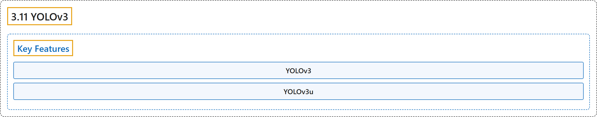

# 3.11 YOLOv3

## Classification

## Glossary

| Term | Definition | 中文翻译 | Source |
|---|---|---|---|
| **3.11 YOLOv3** YOLOv3 | (context) "This document presents an overview of **three closely related object detection models, namely YOLOv3, YOLOv3-Ultralytics, and YOLOv3u**." | （语境）本文档概述**三个密切相关的目标检测模型，即 YOLOv3、YOLOv3-Ultralytics 和 YOLOv3u**。 | [Ultralytics, n.d., "YOLOv3 and YOLOv3u", para. 1](https://docs.ultralytics.com/models/yolov3/#yolov3-and-yolov3u) |
| **Key Features** 主要特性 | (No definition) | （无定义） | [Ultralytics, n.d., "Key Features"](https://docs.ultralytics.com/models/yolov3/#key-features) |
| **YOLOv3** YOLOv3 | "YOLOv3: **Introduced the use of three different scales for detection, leveraging three different sizes of detection kernels: 13x13, 26x26, and 52x52.**" | YOLOv3 **引入三种不同尺度来做检测，利用三种不同大小的检测核：13x13、26x26 和 52x52。** | [Ultralytics, n.d., "Key Features", item 1](https://docs.ultralytics.com/models/yolov3/#key-features) |
| **YOLOv3u** YOLOv3u | "YOLOv3u: **This updated model incorporates the anchor-free, objectness-free split head from YOLOv8.**" | YOLOv3u：这个更新的模型**采用了来自 YOLOv8 的无锚框、无目标性分数的分离式检测头。** | [Ultralytics, n.d., "Key Features", item 2](https://docs.ultralytics.com/models/yolov3/#key-features) |

## References

Ultralytics. (n.d.). *YOLOv3 and YOLOv3u*. Ultralytics YOLO Docs (ultralytics 8.4.194). Retrieved October 31, 2026, from <https://docs.ultralytics.com/models/yolov3/>
