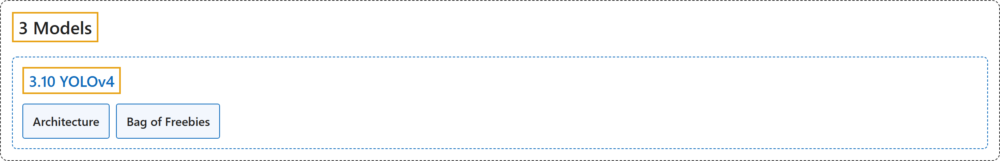

# 3.10 YOLOv4

## Classification

## Glossary

| Term | Definition | 中文翻译 | Source |
|---|---|---|---|
| **3.10 YOLOv4** YOLOv4 | "YOLOv4 is **designed to provide the optimal balance between speed and accuracy**, making it an excellent choice for many applications." | YOLOv4 **旨在提供速度与精度之间的最佳平衡**，因此是许多应用的绝佳选择。 | [Ultralytics, n.d., "YOLOv4: High-Speed and Precise Object Detection", para. 1](https://docs.ultralytics.com/models/yolov4/#yolov4-high-speed-and-precise-object-detection) |
| **Architecture** 架构 | (context) "YOLOv4 makes use of **several innovative features that work together to optimize its performance**." | （语境）YOLOv4 使用了**若干相互配合、共同优化其性能的创新特性**。 | [Ultralytics, n.d., "Architecture", para. 1](https://docs.ultralytics.com/models/yolov4/#architecture) |
| **Bag of Freebies** 免费技巧包（Bag of Freebies） | "YOLOv4 also makes use of methods known as "bag of freebies," which are **techniques that improve the accuracy of the model during training without increasing the cost of inference**." | YOLOv4 还使用了被称为“免费技巧包”的方法，它们是**在训练中提高模型精度而不增加推理成本的技术**。 | [Ultralytics, n.d., "Bag of Freebies", para. 1](https://docs.ultralytics.com/models/yolov4/#bag-of-freebies) |

## References

Ultralytics. (n.d.). *YOLOv4: High-Speed and Precise Object Detection*. Ultralytics YOLO Docs (ultralytics 8.4.194). Retrieved October 31, 2026, from <https://docs.ultralytics.com/models/yolov4/>
