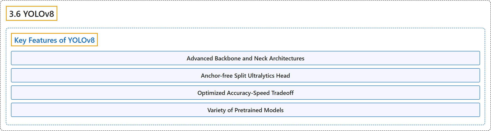

# 3.6 YOLOv8

## Classification

## Glossary

| Term | Definition | 中文翻译 | Source |
|---|---|---|---|
| **3.6 YOLOv8** YOLOv8 | (context) "Released January 2023. **Proven and widely adopted with extensive community support.**" | （语境）2023 年 1 月发布。**久经验证、广泛采用，社区支持丰富。** | [Ultralytics, n.d., "Explore Ultralytics YOLOv8", para. 1](https://docs.ultralytics.com/models/yolov8/#explore-ultralytics-yolov8) |
| **Key Features of YOLOv8** YOLOv8 的主要特性 | (No definition) | （无定义） | [Ultralytics, n.d., "Key Features of YOLOv8"](https://docs.ultralytics.com/models/yolov8/#key-features-of-yolov8) |
| **Advanced Backbone and Neck Architectures** 先进的骨干与颈部架构 | "Advanced Backbone and Neck Architectures: YOLOv8 **employs state-of-the-art backbone and neck architectures**, resulting in improved feature extraction and object detection performance." | 先进的骨干与颈部架构：YOLOv8 **采用最先进的骨干网络和颈部架构**，提升了特征提取和目标检测性能。 | [Ultralytics, n.d., "Key Features of YOLOv8", item 1](https://docs.ultralytics.com/models/yolov8/#key-features-of-yolov8) |
| **Anchor-free Split Ultralytics Head** 无锚框分离式 Ultralytics 检测头 | "Anchor-free Split Ultralytics Head: YOLOv8 adopts an anchor-free split Ultralytics head, **which contributes to better accuracy and a more efficient detection process compared to anchor-based approaches**." | 无锚框分离式 Ultralytics 检测头：YOLOv8 采用无锚框的分离式 Ultralytics 检测头，它**与基于锚框的方法相比，带来更好的精度和更高效的检测过程**。 | [Ultralytics, n.d., "Key Features of YOLOv8", item 2](https://docs.ultralytics.com/models/yolov8/#key-features-of-yolov8) |
| **Optimized Accuracy-Speed Tradeoff** 优化的精度与速度权衡 | "Optimized Accuracy-Speed Tradeoff: With a focus on **maintaining an optimal balance between accuracy and speed**, YOLOv8 is suitable for real-time object detection tasks in diverse application areas." | 优化的精度与速度权衡：YOLOv8 专注于**在精度与速度之间保持最佳平衡**，适用于各种应用领域的实时目标检测任务。 | [Ultralytics, n.d., "Key Features of YOLOv8", item 3](https://docs.ultralytics.com/models/yolov8/#key-features-of-yolov8) |
| **Variety of Pretrained Models** 多样的预训练模型 | "Variety of Pretrained Models: YOLOv8 offers **a range of pretrained models to cater to various tasks and performance requirements**" | 多样的预训练模型：YOLOv8 提供**一系列预训练模型，以满足各种任务和性能需求** | [Ultralytics, n.d., "Key Features of YOLOv8", item 4](https://docs.ultralytics.com/models/yolov8/#key-features-of-yolov8) |

## References

Ultralytics. (n.d.). *Explore Ultralytics YOLOv8*. Ultralytics YOLO Docs (ultralytics 8.4.194). Retrieved October 31, 2026, from <https://docs.ultralytics.com/models/yolov8/>
