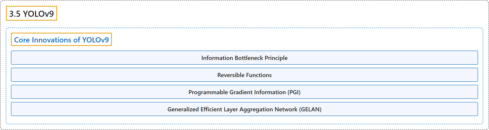

# 3.5 YOLOv9

## Classification

## Glossary

| Term | Definition | 中文翻译 | Source |
|---|---|---|---|
| **3.5 YOLOv9** YOLOv9 | "YOLOv9 marks a significant advancement in real-time object detection, **introducing groundbreaking techniques such as Programmable Gradient Information (PGI) and the Generalized Efficient Layer Aggregation Network (GELAN)**." | YOLOv9 标志着实时目标检测的重大进步，**引入了可编程梯度信息（PGI）和广义高效层聚合网络（GELAN）等开创性技术**。 | [Ultralytics, n.d., "YOLOv9: A Leap Forward in Object Detection Technology", para. 1](https://docs.ultralytics.com/models/yolov9/#yolov9-a-leap-forward-in-object-detection-technology) |
| **Core Innovations of YOLOv9** YOLOv9 的核心创新 | (context) "YOLOv9's advancements are **deeply rooted in addressing the challenges posed by information loss in deep neural networks**." | （语境）YOLOv9 的进步**深深植根于解决深度神经网络中信息丢失带来的挑战**。 | [Ultralytics, n.d., "Core Innovations of YOLOv9", para. 1](https://docs.ultralytics.com/models/yolov9/#core-innovations-of-yolov9) |
| **Information Bottleneck Principle** 信息瓶颈原理 | "The Information Bottleneck Principle reveals a fundamental challenge in deep learning: **as data passes through successive layers of a network, the potential for information loss increases**." | 信息瓶颈原理揭示了深度学习中的一个根本挑战，即**数据在网络中逐层传递时，信息丢失的可能性随之增加**。 | [Ultralytics, n.d., "Information Bottleneck Principle", para. 1](https://docs.ultralytics.com/models/yolov9/#information-bottleneck-principle) |
| **Reversible Functions** 可逆函数 | "A function is deemed reversible **if it can be inverted without any loss of information**, as expressed by:" | 如果一个函数**能够在不损失任何信息的情况下被求逆**，它就被视为可逆的，表示为： | [Ultralytics, n.d., "Reversible Functions", para. 1](https://docs.ultralytics.com/models/yolov9/#reversible-functions) |
| **Programmable Gradient Information (PGI)** 可编程梯度信息（PGI） | "PGI is **a novel concept introduced in YOLOv9 to combat the information bottleneck problem**, ensuring the preservation of essential data across deep network layers." | PGI 是 **YOLOv9 引入的一个新概念，用来对抗信息瓶颈问题**，确保关键数据在深层网络中得以保留。 | [Ultralytics, n.d., "Programmable Gradient Information (PGI)", para. 1](https://docs.ultralytics.com/models/yolov9/#programmable-gradient-information-pgi) |
| **Generalized Efficient Layer Aggregation Network (GELAN)** 广义高效层聚合网络（GELAN） | "GELAN represents **a strategic architectural advancement, enabling YOLOv9 to achieve superior parameter utilization and computational efficiency**." | GELAN 代表了**一项战略性的架构进步，使 YOLOv9 获得更优的参数利用率和计算效率**。 | [Ultralytics, n.d., "Generalized Efficient Layer Aggregation Network (GELAN)", para. 1](https://docs.ultralytics.com/models/yolov9/#generalized-efficient-layer-aggregation-network-gelan) |

## References

Ultralytics. (n.d.). *YOLOv9: A Leap Forward in Object Detection Technology*. Ultralytics YOLO Docs (ultralytics 8.4.194). Retrieved October 31, 2026, from <https://docs.ultralytics.com/models/yolov9/>
