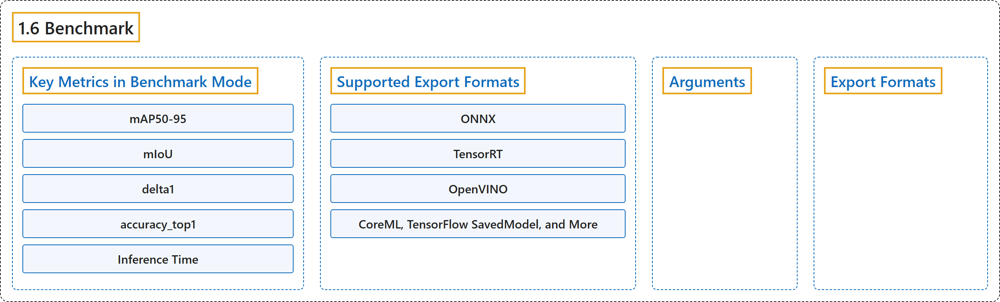

# 1.6 Benchmark

## Classification

## Glossary

| Term | Definition | 中文翻译 | Source |
|---|---|---|---|
| **1.6 Benchmark** 基准测试 | "Benchmark mode in Ultralytics YOLO26 serves this purpose by **providing a robust framework for assessing the speed and accuracy of your model across a range of export formats**." | Ultralytics YOLO26 的基准测试模式**提供一个稳健的框架，用于评估模型在一系列导出格式下的速度和精度**。 | [Ultralytics, n.d., "Model Benchmarking with Ultralytics YOLO", para. 1](https://docs.ultralytics.com/modes/benchmark/#model-benchmarking-with-ultralytics-yolo) |
| **Key Metrics in Benchmark Mode** 基准测试模式的关键指标 | (No definition) | （无定义） | [Ultralytics, n.d., "Key Metrics in Benchmark Mode"](https://docs.ultralytics.com/modes/benchmark/#key-metrics-in-benchmark-mode) |
| **mAP50-95** mAP50-95 | "mAP50-95: **For object detection, instance segmentation, pose estimation, and OBB.**" | mAP50-95：**用于目标检测、实例分割、姿态估计和 OBB。** | [Ultralytics, n.d., "Key Metrics in Benchmark Mode", item 1](https://docs.ultralytics.com/modes/benchmark/#key-metrics-in-benchmark-mode) |
| **mIoU** mIoU | "mIoU: **For semantic segmentation.**" | mIoU：**用于语义分割。** | [Ultralytics, n.d., "Key Metrics in Benchmark Mode", item 2](https://docs.ultralytics.com/modes/benchmark/#key-metrics-in-benchmark-mode) |
| **delta1** delta1 | "delta1: **For depth estimation.**" | delta1：**用于深度估计。** | [Ultralytics, n.d., "Key Metrics in Benchmark Mode", item 3](https://docs.ultralytics.com/modes/benchmark/#key-metrics-in-benchmark-mode) |
| **accuracy_top1** accuracy_top1 | "accuracy_top1: **For image classification.**" | accuracy_top1：**用于图像分类。** | [Ultralytics, n.d., "Key Metrics in Benchmark Mode", item 4](https://docs.ultralytics.com/modes/benchmark/#key-metrics-in-benchmark-mode) |
| **Inference Time** 推理时间 | "Inference Time: **Time taken for each image in milliseconds.**" | 推理时间：**处理每张图像所用的时间，以毫秒计。** | [Ultralytics, n.d., "Key Metrics in Benchmark Mode", item 5](https://docs.ultralytics.com/modes/benchmark/#key-metrics-in-benchmark-mode) |
| **Supported Export Formats** 支持的导出格式 | (No definition) | （无定义） | [Ultralytics, n.d., "Supported Export Formats"](https://docs.ultralytics.com/modes/benchmark/#supported-export-formats) |
| **ONNX** ONNX | "ONNX: **For optimal CPU performance**" | ONNX：**用于获得最佳 CPU 性能** | [Ultralytics, n.d., "Supported Export Formats", item 1](https://docs.ultralytics.com/modes/benchmark/#supported-export-formats) |
| **TensorRT** TensorRT | "TensorRT: **For maximal GPU efficiency**" | TensorRT：**用于获得最高 GPU 效率** | [Ultralytics, n.d., "Supported Export Formats", item 2](https://docs.ultralytics.com/modes/benchmark/#supported-export-formats) |
| **OpenVINO** OpenVINO | "OpenVINO: **For Intel hardware optimization**" | OpenVINO：**用于 Intel 硬件优化** | [Ultralytics, n.d., "Supported Export Formats", item 3](https://docs.ultralytics.com/modes/benchmark/#supported-export-formats) |
| **CoreML, TensorFlow SavedModel, and More** CoreML、TensorFlow SavedModel 等 | "CoreML, TensorFlow SavedModel, and More: **For diverse deployment needs.**" | CoreML、TensorFlow SavedModel 等：**用于多样的部署需求。** | [Ultralytics, n.d., "Supported Export Formats", item 4](https://docs.ultralytics.com/modes/benchmark/#supported-export-formats) |
| **Arguments** 参数 | "Arguments such as `model`, `data`, `imgsz`, `quantize`, `device`, `verbose` and `format` provide users with **the flexibility to fine-tune the benchmarks to their specific needs** and compare the performance of different export formats with ease." | `model`、`data`、`imgsz`、`quantize`、`device`、`verbose` 和 `format` 等参数让用户**能灵活地按自己的需要微调基准测试**，并轻松比较不同导出格式的性能。 | [Ultralytics, n.d., "Arguments", para. 1](https://docs.ultralytics.com/modes/benchmark/#arguments) |
| **Export Formats** 导出格式 | (context) "Benchmarks will **attempt to run automatically on all possible export formats listed below**." | （语境）基准测试会**尝试在下面列出的所有可用导出格式上自动运行**。 | [Ultralytics, n.d., "Export Formats", para. 1](https://docs.ultralytics.com/modes/benchmark/#export-formats) |

## References

Ultralytics. (n.d.). *Model Benchmarking with Ultralytics YOLO*. Ultralytics YOLO Docs (ultralytics 8.4.194). Retrieved October 31, 2026, from <https://docs.ultralytics.com/modes/benchmark/>
