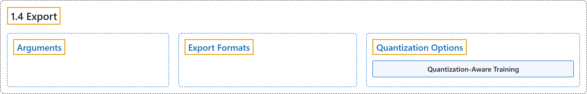

# 1.4 Export

## Classification

## Glossary

| Term | Definition | 中文翻译 | Source |
|---|---|---|---|
| **1.4 Export** 导出 | "Export mode in Ultralytics YOLO26 offers **a versatile range of options for exporting your trained model to different formats**, making it deployable across various platforms and devices." | Ultralytics YOLO26 的导出模式提供**多种选项，把训练好的模型导出为不同格式**，使其能部署到各种平台和设备上。 | [Ultralytics, n.d., "Model Export with Ultralytics YOLO", para. 1](https://docs.ultralytics.com/modes/export/#model-export-with-ultralytics-yolo) |
| **Arguments** 参数 | (context) "This table details **the configurations and options available for exporting YOLO models to different formats**." | （语境）此表详细列出了**把 YOLO 模型导出为不同格式时可用的配置和选项**。 | [Ultralytics, n.d., "Arguments", para. 1](https://docs.ultralytics.com/modes/export/#arguments) |
| **Export Formats** 导出格式 | (context) "Available YOLO26 export formats are in the table below." | （语境）可用的 YOLO26 导出格式见下表。 | [Ultralytics, n.d., "Export Formats", para. 1](https://docs.ultralytics.com/modes/export/#export-formats) |
| **Quantization Options** 量化选项 | (context) "Use the `quantize` argument to **request the export precision**." | （语境）使用 `quantize` 参数来**指定导出精度**。 | [Ultralytics, n.d., "Quantization Options", para. 1](https://docs.ultralytics.com/modes/export/#quantization-options) |
| **Quantization-Aware Training** 量化感知训练 | "Quantization-aware training (QAT) instead **learns weights that tolerate INT8 by fine-tuning with fake-quantization in the loop**, which recovers accuracy that calibration alone loses." | 量化感知训练（QAT）则**通过在循环中加入伪量化来微调，学到能承受 INT8 的权重**，从而找回仅靠校准会损失的精度。 | [Ultralytics, n.d., "Quantization-Aware Training", para. 1](https://docs.ultralytics.com/modes/export/#quantization-aware-training) |

## References

Ultralytics. (n.d.). *Model Export with Ultralytics YOLO*. Ultralytics YOLO Docs (ultralytics 8.4.194). Retrieved October 31, 2026, from <https://docs.ultralytics.com/modes/export/>
