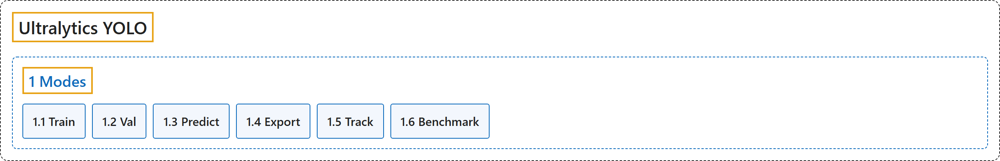

# 1. Modes

## Classification

## Glossary

| Term | Definition | 中文翻译 | Source |
|---|---|---|---|
| **1 Modes** 模式 | (context) "Ultralytics YOLO26 is not just another object detection model; it's **a versatile framework designed to cover the entire lifecycle of machine learning models—from data ingestion and model training to validation, deployment, and real-world tracking**." | （语境）Ultralytics YOLO26 不只是又一个目标检测模型；它是**一个多用途框架，旨在覆盖机器学习模型的整个生命周期：从数据摄取、模型训练，到验证、部署和真实场景中的跟踪**。 | [Ultralytics, n.d.-a, "Introduction", para. 1](https://docs.ultralytics.com/modes/#introduction) |
| **[1.1 Train](train.md)** 训练 | "Training a deep learning model involves **feeding it data and adjusting its parameters so that it can make accurate predictions**." | 训练深度学习模型就是**给它输入数据并调整其参数，使它能做出准确的预测**。 | [Ultralytics, n.d.-e, "Model Training with Ultralytics YOLO", para. 1](https://docs.ultralytics.com/modes/train/#model-training-with-ultralytics-yolo) |
| **[1.2 Val](val.md)** 验证 | "Validation is **a critical step in the machine learning pipeline, allowing you to assess the quality of your trained models**." | 验证是**机器学习流水线中的关键一步，让你评估训练好的模型的质量**。 | [Ultralytics, n.d.-f, "Model Validation with Ultralytics YOLO", para. 1](https://docs.ultralytics.com/modes/val/#model-validation-with-ultralytics-yolo) |
| **[1.3 Predict](predict.md)** 预测 | (context) "In the world of machine learning and computer vision, **the process of making sense of visual data** is often called inference or prediction." | （语境）在机器学习和计算机视觉领域，**理解视觉数据的过程**通常称为推理或预测。 | [Ultralytics, n.d.-d, "Model Prediction with Ultralytics YOLO", para. 1](https://docs.ultralytics.com/modes/predict/#model-prediction-with-ultralytics-yolo) |
| **[1.4 Export](export.md)** 导出 | "Export mode in Ultralytics YOLO26 offers **a versatile range of options for exporting your trained model to different formats**, making it deployable across various platforms and devices." | Ultralytics YOLO26 的导出模式提供**多种选项，把训练好的模型导出为不同格式**，使其能部署到各种平台和设备上。 | [Ultralytics, n.d.-c, "Model Export with Ultralytics YOLO", para. 1](https://docs.ultralytics.com/modes/export/#model-export-with-ultralytics-yolo) |
| **[1.5 Track](track.md)** 跟踪 | "Object tracking in the realm of video analytics is **a critical task that not only identifies the location and class of objects within the frame but also maintains a unique ID for each detected object as the video progresses**." | 视频分析中的目标跟踪是**一项关键任务，它不仅识别画面中物体的位置和类别，还随着视频推进为每个检测到的物体保持唯一的 ID**。 | [Ultralytics, n.d.-g, "Multi-Object Tracking with Ultralytics YOLO", para. 1](https://docs.ultralytics.com/modes/track/#multi-object-tracking-with-ultralytics-yolo) |
| **[1.6 Benchmark](benchmark.md)** 基准测试 | "Benchmark mode in Ultralytics YOLO26 serves this purpose by **providing a robust framework for assessing the speed and accuracy of your model across a range of export formats**." | Ultralytics YOLO26 的基准测试模式**提供一个稳健的框架，用于评估模型在一系列导出格式下的速度和精度**。 | [Ultralytics, n.d.-b, "Model Benchmarking with Ultralytics YOLO", para. 1](https://docs.ultralytics.com/modes/benchmark/#model-benchmarking-with-ultralytics-yolo) |

## References

Ultralytics. (n.d.-a). *Introduction*. Ultralytics YOLO Docs (ultralytics 8.4.194). Retrieved October 31, 2026, from <https://docs.ultralytics.com/modes/>

Ultralytics. (n.d.-b). *Model Benchmarking with Ultralytics YOLO*. Ultralytics YOLO Docs (ultralytics 8.4.194). Retrieved October 31, 2026, from <https://docs.ultralytics.com/modes/benchmark/>

Ultralytics. (n.d.-c). *Model Export with Ultralytics YOLO*. Ultralytics YOLO Docs (ultralytics 8.4.194). Retrieved October 31, 2026, from <https://docs.ultralytics.com/modes/export/>

Ultralytics. (n.d.-d). *Model Prediction with Ultralytics YOLO*. Ultralytics YOLO Docs (ultralytics 8.4.194). Retrieved October 31, 2026, from <https://docs.ultralytics.com/modes/predict/>

Ultralytics. (n.d.-e). *Model Training with Ultralytics YOLO*. Ultralytics YOLO Docs (ultralytics 8.4.194). Retrieved October 31, 2026, from <https://docs.ultralytics.com/modes/train/>

Ultralytics. (n.d.-f). *Model Validation with Ultralytics YOLO*. Ultralytics YOLO Docs (ultralytics 8.4.194). Retrieved October 31, 2026, from <https://docs.ultralytics.com/modes/val/>

Ultralytics. (n.d.-g). *Multi-Object Tracking with Ultralytics YOLO*. Ultralytics YOLO Docs (ultralytics 8.4.194). Retrieved October 31, 2026, from <https://docs.ultralytics.com/modes/track/>
