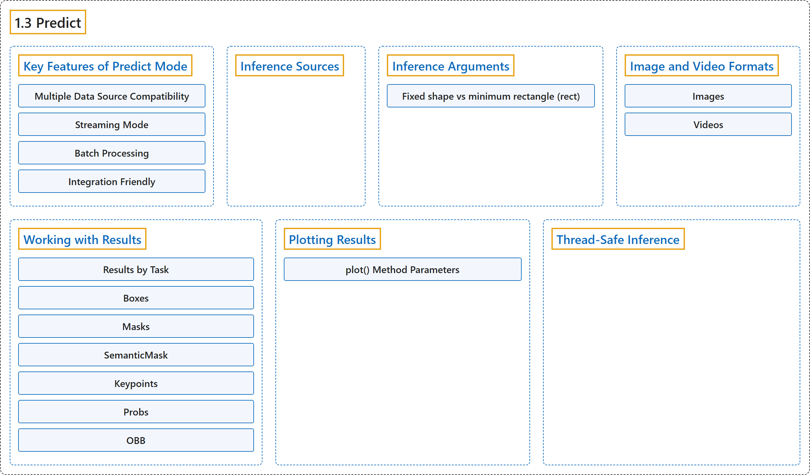

# 1.3 Predict

## Classification

## Glossary

| Term | Definition | 中文翻译 | Source |
|---|---|---|---|
| **1.3 Predict** 预测 | (context) "In the world of machine learning and computer vision, **the process of making sense of visual data** is often called inference or prediction." | （语境）在机器学习和计算机视觉领域，**理解视觉数据的过程**通常称为推理或预测。 | [Ultralytics, n.d., "Model Prediction with Ultralytics YOLO", para. 1](https://docs.ultralytics.com/modes/predict/#model-prediction-with-ultralytics-yolo) |
| **Key Features of Predict Mode** 预测模式的主要功能 | (context) "YOLO26's predict mode is designed to be **robust and versatile**, featuring:" | （语境）YOLO26 的预测模式设计得**稳健而多用途**，具有以下功能： | [Ultralytics, n.d., "Key Features of Predict Mode", para. 1](https://docs.ultralytics.com/modes/predict/#key-features-of-predict-mode) |
| **Multiple Data Source Compatibility** 多数据源兼容 | "Multiple Data Source Compatibility: Whether your data is in the form of **individual images, a collection of images, video files, or real-time video streams**, predict mode has you covered." | 多数据源兼容：无论你的数据是**单张图像、一组图像、视频文件还是实时视频流**，预测模式都能处理。 | [Ultralytics, n.d., "Key Features of Predict Mode", item 1](https://docs.ultralytics.com/modes/predict/#key-features-of-predict-mode) |
| **Streaming Mode** 流式模式 | "Streaming Mode: Use the streaming feature to **generate a memory-efficient generator of `Results` objects**." | 流式模式：使用流式功能**生成一个节省内存的 `Results` 对象生成器**。 | [Ultralytics, n.d., "Key Features of Predict Mode", item 2](https://docs.ultralytics.com/modes/predict/#key-features-of-predict-mode) |
| **Batch Processing** 批处理 | "Batch Processing: **Process multiple images or video frames in a single batch**, further reducing total inference time." | 批处理：**在一个批次中处理多张图像或多帧视频**，进一步缩短总推理时间。 | [Ultralytics, n.d., "Key Features of Predict Mode", item 3](https://docs.ultralytics.com/modes/predict/#key-features-of-predict-mode) |
| **Integration Friendly** 易于集成 | "Integration Friendly: **Easily integrate with existing data pipelines and other software components**, thanks to its flexible API." | 易于集成：凭借灵活的 API，**能轻松集成到现有数据流水线和其他软件组件中**。 | [Ultralytics, n.d., "Key Features of Predict Mode", item 4](https://docs.ultralytics.com/modes/predict/#key-features-of-predict-mode) |
| **Inference Sources** 推理来源 | (context) "YOLO26 can **process different types of input sources for inference**, as shown in the table below." | （语境）YOLO26 能**处理不同类型的输入来源来做推理**，如下表所示。 | [Ultralytics, n.d., "Inference Sources", para. 1](https://docs.ultralytics.com/modes/predict/#inference-sources) |
| **Inference Arguments** 推理参数 | "`model.predict()` accepts **multiple arguments that can be passed at inference time to override defaults**:" | `model.predict()` 接受**多个可在推理时传入、用来覆盖默认值的参数**： | [Ultralytics, n.d., "Inference Arguments", para. 1](https://docs.ultralytics.com/modes/predict/#inference-arguments) |
| **Fixed shape vs minimum rectangle (rect)** 固定形状与最小矩形（rect） | (context) "By default, predict uses **`rect=True`**, which enables **minimum-rectangle** padding when possible." | （语境）默认情况下，预测使用 **`rect=True`**，在可能时启用**最小矩形**填充。 | [Ultralytics, n.d., "Fixed shape vs minimum rectangle ( rect )", para. 1](https://docs.ultralytics.com/modes/predict/#fixed-shape-vs-minimum-rectangle-rect) |
| **Image and Video Formats** 图像与视频格式 | (context) "YOLO26 supports **various image and video formats**" | （语境）YOLO26 支持**多种图像和视频格式** | [Ultralytics, n.d., "Image and Video Formats", para. 1](https://docs.ultralytics.com/modes/predict/#image-and-video-formats) |
| **Images** 图像 | (context) "The below table contains **valid Ultralytics image formats**." | （语境）下表列出了 **Ultralytics 有效的图像格式**。 | [Ultralytics, n.d., "Images", para. 1](https://docs.ultralytics.com/modes/predict/#images) |
| **Videos** 视频 | (context) "The below table contains **valid Ultralytics video formats**." | （语境）下表列出了 **Ultralytics 有效的视频格式**。 | [Ultralytics, n.d., "Videos", para. 1](https://docs.ultralytics.com/modes/predict/#videos) |
| **Working with Results** 使用结果 | (context) "All Ultralytics `predict()` calls will **return a list of `Results` objects**:" | （语境）所有 Ultralytics `predict()` 调用都会**返回一个 `Results` 对象列表**： | [Ultralytics, n.d., "Working with Results", para. 1](https://docs.ultralytics.com/modes/predict/#working-with-results) |
| **Results by Task** 按任务的结果 | (context) "Each prediction **returns one `Results` object per image or frame**." | （语境）每次预测**为每张图像或每一帧返回一个 `Results` 对象**。 | [Ultralytics, n.d., "Results by Task", para. 1](https://docs.ultralytics.com/modes/predict/#results-by-task) |
| **Boxes** Boxes（边界框） | "`Boxes` object can be used to **index, manipulate, and convert bounding boxes to different formats**." | `Boxes` 对象可用于**索引、操作边界框，并把它转换为不同格式**。 | [Ultralytics, n.d., "Boxes", para. 1](https://docs.ultralytics.com/modes/predict/#boxes) |
| **Masks** Masks（掩码） | "`Masks` object can be used to **index, manipulate and convert masks to segments**." | `Masks` 对象可用于**索引、操作掩码，并把掩码转换为分段**。 | [Ultralytics, n.d., "Masks", para. 1](https://docs.ultralytics.com/modes/predict/#masks) |
| **SemanticMask** SemanticMask（语义掩码） | "`SemanticMask` **stores one dense class map for semantic segmentation results**." | `SemanticMask` **为语义分割结果存储一张稠密的类别图**。 | [Ultralytics, n.d., "SemanticMask", para. 1](https://docs.ultralytics.com/modes/predict/#semanticmask) |
| **Keypoints** Keypoints（关键点） | "`Keypoints` object can be used to **index, manipulate and normalize coordinates**." | `Keypoints` 对象可用于**索引、操作并归一化坐标**。 | [Ultralytics, n.d., "Keypoints", para. 1](https://docs.ultralytics.com/modes/predict/#keypoints) |
| **Probs** Probs（概率） | "`Probs` object can be used to **obtain `top1` and `top5` classification indices and scores**." | `Probs` 对象可用于**获取 `top1` 和 `top5` 分类索引及分数**。 | [Ultralytics, n.d., "Probs", para. 1](https://docs.ultralytics.com/modes/predict/#probs) |
| **OBB** OBB（旋转边界框） | "`OBB` object can be used to **index, manipulate, and convert oriented bounding boxes to different formats**." | `OBB` 对象可用于**索引、操作旋转边界框，并把它转换为不同格式**。 | [Ultralytics, n.d., "OBB", para. 1](https://docs.ultralytics.com/modes/predict/#obb) |
| **Plotting Results** 绘制结果 | "The `plot()` method in `Results` objects facilitates **visualization of predictions by overlaying detected objects (such as bounding boxes, masks, keypoints, and probabilities) onto the original image**." | `Results` 对象的 `plot()` 方法便于**把检测到的物体（如边界框、掩码、关键点和概率）叠加到原图上，从而可视化预测**。 | [Ultralytics, n.d., "Plotting Results", para. 1](https://docs.ultralytics.com/modes/predict/#plotting-results) |
| **plot() Method Parameters** plot() 方法参数 | (context) "The `plot()` method supports **various arguments to customize the output**:" | （语境）`plot()` 方法支持**各种用来定制输出的参数**： | [Ultralytics, n.d., "plot() Method Parameters", para. 1](https://docs.ultralytics.com/modes/predict/#plot-method-parameters) |
| **Thread-Safe Inference** 线程安全推理 | "Thread-safe inference guarantees that **each thread's predictions are isolated and do not interfere with one another**, avoiding race conditions and ensuring consistent and reliable outputs." | 线程安全推理保证**每个线程的预测彼此隔离、互不干扰**，避免竞态条件，确保输出一致可靠。 | [Ultralytics, n.d., "Thread-Safe Inference", para. 1](https://docs.ultralytics.com/modes/predict/#thread-safe-inference) |

## References

Ultralytics. (n.d.). *Model Prediction with Ultralytics YOLO*. Ultralytics YOLO Docs (ultralytics 8.4.194). Retrieved October 31, 2026, from <https://docs.ultralytics.com/modes/predict/>
