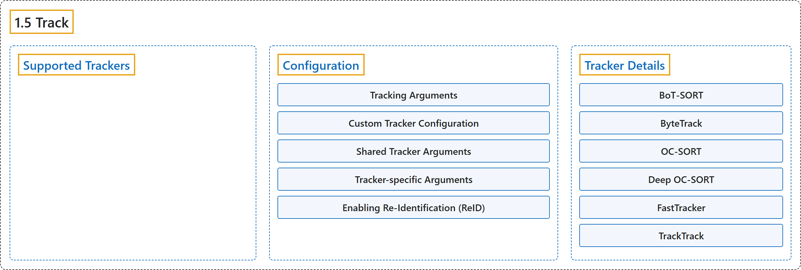

# 1.5 Track

## Classification

## Glossary

| Term | Definition | 中文翻译 | Source |
|---|---|---|---|
| **1.5 Track** 跟踪 | "Object tracking in the realm of video analytics is **a critical task that not only identifies the location and class of objects within the frame but also maintains a unique ID for each detected object as the video progresses**." | 视频分析中的目标跟踪是**一项关键任务，它不仅识别画面中物体的位置和类别，还随着视频推进为每个检测到的物体保持唯一的 ID**。 | [Ultralytics, n.d., "Multi-Object Tracking with Ultralytics YOLO", para. 1](https://docs.ultralytics.com/modes/track/#multi-object-tracking-with-ultralytics-yolo) |
| **Supported Trackers** 支持的跟踪器 | (context) "Ultralytics YOLO **ships with six built-in trackers**." | （语境）Ultralytics YOLO **内置六个跟踪器**。 | [Ultralytics, n.d., "Supported Trackers", para. 1](https://docs.ultralytics.com/modes/track/#supported-trackers) |
| **Configuration** 配置 | (No definition) | （无定义） | [Ultralytics, n.d., "Configuration"](https://docs.ultralytics.com/modes/track/#configuration) |
| **Tracking Arguments** 跟踪参数 | (context) "Tracking configuration **shares properties with Predict mode, such as `conf`, `iou`, and `show`**." | （语境）跟踪配置**与预测模式共用一些属性，例如 `conf`、`iou` 和 `show`**。 | [Ultralytics, n.d., "Tracking Arguments", para. 1](https://docs.ultralytics.com/modes/track/#tracking-arguments) |
| **Custom Tracker Configuration** 自定义跟踪器配置 | (context) "Ultralytics also allows you to **use a modified tracker configuration file**." | （语境）Ultralytics 还允许你**使用修改过的跟踪器配置文件**。 | [Ultralytics, n.d., "Custom Tracker Configuration", para. 1](https://docs.ultralytics.com/modes/track/#custom-tracker-configuration) |
| **Shared Tracker Arguments** 共享跟踪器参数 | (context) "The following parameters are **common to most tracker YAML files**" | （语境）以下参数**为大多数跟踪器 YAML 文件所共有** | [Ultralytics, n.d., "Shared Tracker Arguments", para. 1](https://docs.ultralytics.com/modes/track/#shared-tracker-arguments) |
| **Tracker-specific Arguments** 跟踪器专属参数 | (context) "Each algorithm **exposes additional knobs on top of the shared parameters**." | （语境）每个算法都**在共享参数之外提供额外的调节项**。 | [Ultralytics, n.d., "Tracker-specific Arguments", para. 1](https://docs.ultralytics.com/modes/track/#tracker-specific-arguments) |
| **Enabling Re-Identification (ReID)** 启用重识别（ReID） | (context) "ReID is **disabled by default to minimize overhead**." | （语境）ReID **默认关闭，以尽量减少开销**。 | [Ultralytics, n.d., "Enabling Re-Identification (ReID)", para. 1](https://docs.ultralytics.com/modes/track/#enabling-re-identification-reid) |
| **model: auto** model: auto | "`model: auto` — **Uses native YOLO detector features, adding minimal overhead.**" | `model: auto`：**使用 YOLO 检测器自身的特征，开销极小。** | [Ultralytics, n.d., "Enabling Re-Identification (ReID)", item 1](https://docs.ultralytics.com/modes/track/#enabling-re-identification-reid) |
| **Custom ReID model** 自定义 ReID 模型 | "Custom ReID model — **Point `model:` at a `.pt` checkpoint or a compatible exported embedding model**" | 自定义 ReID 模型：**把 `model:` 指向一个 `.pt` 检查点或兼容的已导出嵌入模型** | [Ultralytics, n.d., "Enabling Re-Identification (ReID)", item 2](https://docs.ultralytics.com/modes/track/#enabling-re-identification-reid) |
| **Tracker Details** 跟踪器详解 | (context) "The sections below describe **each tracker's design, specific parameters, and tuning tips**." | （语境）下面各节介绍**每个跟踪器的设计、专属参数和调参建议**。 | [Ultralytics, n.d., "Tracker Details", para. 1](https://docs.ultralytics.com/modes/track/#tracker-details) |
| **BoT-SORT** BoT-SORT | "BoT-SORT (Aharon et al., 2022) **extends ByteTrack with camera-motion compensation and optional ReID**:" | BoT-SORT（Aharon 等，2022）**在 ByteTrack 的基础上加入相机运动补偿和可选的 ReID**： | [Ultralytics, n.d., "BoT-SORT", para. 1](https://docs.ultralytics.com/modes/track/#bot-sort) |
| **Camera Motion Compensation (CMC)** 相机运动补偿（CMC） | "Camera Motion Compensation (CMC): **an affine warp estimated each frame** (sparse optical flow by default; ORB / ECC also available) **is applied to Kalman states before IoU matching**." | 相机运动补偿（CMC）：**每帧估计一个仿射变换**（默认用稀疏光流；也可用 ORB / ECC），**在 IoU 匹配前作用到卡尔曼状态上**。 | [Ultralytics, n.d., "BoT-SORT", item 1](https://docs.ultralytics.com/modes/track/#bot-sort) |
| **Optional ReID** 可选 ReID | "Optional ReID: **appearance embeddings can be fused into the cost matrix**." | 可选 ReID：**外观嵌入可以融合进代价矩阵**。 | [Ultralytics, n.d., "BoT-SORT", item 2](https://docs.ultralytics.com/modes/track/#bot-sort) |
| **ByteTrack** ByteTrack | "ByteTrack (Zhang et al., ECCV 2022) is **the lightweight baseline**." | ByteTrack（Zhang 等，ECCV 2022）是**轻量级基线**。 | [Ultralytics, n.d., "ByteTrack", para. 1](https://docs.ultralytics.com/modes/track/#bytetrack) |
| **Stage 1** 第一阶段 | "Stage 1: **match high-score detections against active tracks.**" | 第一阶段：**把高分检测结果与活动轨迹匹配。** | [Ultralytics, n.d., "ByteTrack", item 1](https://docs.ultralytics.com/modes/track/#bytetrack) |
| **Stage 2** 第二阶段 | "Stage 2: **retry unmatched tracks against low-score detections** to recover through brief partial occlusion." | 第二阶段：**把未匹配的轨迹再与低分检测结果匹配**，以便在短暂的部分遮挡后恢复。 | [Ultralytics, n.d., "ByteTrack", item 2](https://docs.ultralytics.com/modes/track/#bytetrack) |
| **OC-SORT** OC-SORT | "OC-SORT (Cao et al., CVPR 2023) is **an observation-centric extension of SORT**." | OC-SORT（Cao 等，CVPR 2023）是**以观测为中心的 SORT 扩展**。 | [Ultralytics, n.d., "OC-SORT", para. 1](https://docs.ultralytics.com/modes/track/#oc-sort) |
| **Observation-Centric Re-update (ORU)** 以观测为中心的重新更新（ORU） | "Observation-Centric Re-update (ORU): **replays a virtual trajectory between the last observation and the current detection, re-running the Kalman update to repair drifted velocity.**" | 以观测为中心的重新更新（ORU）：**在上一次观测和当前检测之间回放一条虚拟轨迹，重新执行卡尔曼更新以修正漂移的速度。** | [Ultralytics, n.d., "OC-SORT", item 1](https://docs.ultralytics.com/modes/track/#oc-sort) |
| **Observation-Centric Momentum (OCM)** 以观测为中心的动量（OCM） | "Observation-Centric Momentum (OCM): **penalizes detections moving in the wrong direction via a velocity-consistency term.**" | 以观测为中心的动量（OCM）：**通过速度一致性项惩罚朝错误方向移动的检测结果。** | [Ultralytics, n.d., "OC-SORT", item 2](https://docs.ultralytics.com/modes/track/#oc-sort) |
| **Observation-Centric Recovery (OCR)** 以观测为中心的恢复（OCR） | "Observation-Centric Recovery (OCR): **re-checks unmatched detections against recently lost tracks using their last observation rather than the predicted state.**" | 以观测为中心的恢复（OCR）：**用最近丢失轨迹的最后一次观测（而非预测状态）重新核对未匹配的检测结果。** | [Ultralytics, n.d., "OC-SORT", item 3](https://docs.ultralytics.com/modes/track/#oc-sort) |
| **Deep OC-SORT** Deep OC-SORT | "Deep OC-SORT **augments OC-SORT with appearance information and camera-motion compensation**:" | Deep OC-SORT **在 OC-SORT 的基础上加入外观信息和相机运动补偿**： | [Ultralytics, n.d., "Deep OC-SORT", para. 1](https://docs.ultralytics.com/modes/track/#deep-oc-sort) |
| **Appearance matching** 外观匹配 | "Appearance matching: **cosine embedding distance is gated by overlap and fused with motion cost.**" | 外观匹配：**余弦嵌入距离先经重叠度门控，再与运动代价融合。** | [Ultralytics, n.d., "Deep OC-SORT", item 1](https://docs.ultralytics.com/modes/track/#deep-oc-sort) |
| **Dynamic appearance EMA** 动态外观 EMA | "Dynamic appearance EMA: **track embeddings update with an EMA whose smoothing factor adapts to detection confidence.**" | 动态外观 EMA：**轨迹嵌入用 EMA 更新，其平滑系数随检测置信度自适应。** | [Ultralytics, n.d., "Deep OC-SORT", item 2](https://docs.ultralytics.com/modes/track/#deep-oc-sort) |
| **Camera Motion Compensation** 相机运动补偿 | "Camera Motion Compensation: **Kalman states are warped frame-to-frame via sparse optical flow, ORB, or ECC.**" | 相机运动补偿：**卡尔曼状态通过稀疏光流、ORB 或 ECC 逐帧变换。** | [Ultralytics, n.d., "Deep OC-SORT", item 3](https://docs.ultralytics.com/modes/track/#deep-oc-sort) |
| **FastTracker** FastTracker | "FastTracker is **an occlusion-aware ByteTrack variant with no appearance model**:" | FastTracker 是**一种能感知遮挡、不带外观模型的 ByteTrack 变体**： | [Ultralytics, n.d., "FastTracker", para. 1](https://docs.ultralytics.com/modes/track/#fasttracker) |
| **Occlusion detection** 遮挡检测 | "Occlusion detection: **flags tracks occluded when coverage by other active tracks exceeds `occ_cover_thresh`.**" | 遮挡检测：**当轨迹被其他活动轨迹覆盖的比例超过 `occ_cover_thresh` 时，把它标记为被遮挡。** | [Ultralytics, n.d., "FastTracker", item 1](https://docs.ultralytics.com/modes/track/#fasttracker) |
| **Kalman rollback on occlusion** 遮挡时卡尔曼回滚 | "Kalman rollback on occlusion: **rolls the Kalman state back to a pre-occlusion frame using ring-buffered history.**" | 遮挡时卡尔曼回滚：**利用环形缓冲的历史，把卡尔曼状态回滚到遮挡前的一帧。** | [Ultralytics, n.d., "FastTracker", item 2](https://docs.ultralytics.com/modes/track/#fasttracker) |
| **Motion dampening and search expansion** 运动阻尼与搜索扩展 | "Motion dampening and search expansion: **velocity is dampened and the predicted bbox is enlarged while occluded.**" | 运动阻尼与搜索扩展：**遮挡期间速度被阻尼，预测框被放大。** | [Ultralytics, n.d., "FastTracker", item 3](https://docs.ultralytics.com/modes/track/#fasttracker) |
| **Init-IoU suppression** 初始化 IoU 抑制 | "Init-IoU suppression: **prevents new tracks from spawning on top of active tracks.**" | 初始化 IoU 抑制：**防止新轨迹在活动轨迹之上生成。** | [Ultralytics, n.d., "FastTracker", item 4](https://docs.ultralytics.com/modes/track/#fasttracker) |
| **TrackTrack** TrackTrack | "TrackTrack (Shim et al., CVPR 2025) is the default tracker. It **reasons from each track's perspective with multi-cue iterative association**:" | TrackTrack（Shim 等，CVPR 2025）是默认跟踪器。它**从每条轨迹的视角出发，用多线索迭代关联进行推理**： | [Ultralytics, n.d., "TrackTrack", para. 1](https://docs.ultralytics.com/modes/track/#tracktrack) |
| **Track-Perspective-Based Association (TPA)** 基于轨迹视角的关联（TPA） | "Track-Perspective-Based Association (TPA): **combines HMIoU, optional cosine ReID distance, confidence-projection distance, and corner-angle distance.**" | 基于轨迹视角的关联（TPA）：**结合 HMIoU、可选的余弦 ReID 距离、置信度投影距离和角点角度距离。** | [Ultralytics, n.d., "TrackTrack", item 1](https://docs.ultralytics.com/modes/track/#tracktrack) |
| **Track-Aware Initialization (TAI)** 感知轨迹的初始化（TAI） | "Track-Aware Initialization (TAI): **suppresses duplicate spawns before a new ID is created.**" | 感知轨迹的初始化（TAI）：**在创建新 ID 之前抑制重复生成。** | [Ultralytics, n.d., "TrackTrack", item 2](https://docs.ultralytics.com/modes/track/#tracktrack) |

## References

Ultralytics. (n.d.). *Multi-Object Tracking with Ultralytics YOLO*. Ultralytics YOLO Docs (ultralytics 8.4.194). Retrieved October 31, 2026, from <https://docs.ultralytics.com/modes/track/>
