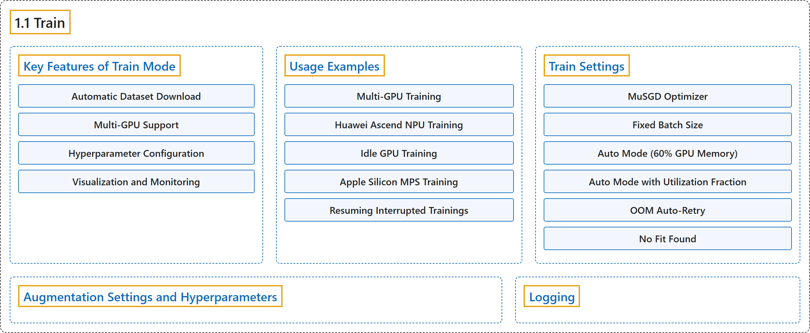

# 1.1 Train

## Classification

## Glossary

| Term | Definition | 中文翻译 | Source |
|---|---|---|---|
| **1.1 Train** 训练 | "Training a deep learning model involves **feeding it data and adjusting its parameters so that it can make accurate predictions**." | 训练深度学习模型就是**给它输入数据并调整其参数，使它能做出准确的预测**。 | [Ultralytics, n.d., "Model Training with Ultralytics YOLO", para. 1](https://docs.ultralytics.com/modes/train/#model-training-with-ultralytics-yolo) |
| **Key Features of Train Mode** 训练模式的主要功能 | (context) "The following are some notable features of YOLO26's Train mode:" | （语境）以下是 YOLO26 训练模式的一些主要功能： | [Ultralytics, n.d., "Key Features of Train Mode", para. 1](https://docs.ultralytics.com/modes/train/#key-features-of-train-mode) |
| **Automatic Dataset Download** 自动下载数据集 | "Automatic Dataset Download: Dataset configurations with a download source are **downloaded automatically on first use**" | 自动下载数据集：带有下载来源的数据集配置会**在首次使用时自动下载** | [Ultralytics, n.d., "Key Features of Train Mode", item 1](https://docs.ultralytics.com/modes/train/#key-features-of-train-mode) |
| **Multi-GPU Support** 多 GPU 支持 | "Multi-GPU Support: **Scale your training efforts seamlessly across multiple GPUs** to expedite the process." | 多 GPU 支持：**把训练无缝扩展到多块 GPU 上**，以加快过程。 | [Ultralytics, n.d., "Key Features of Train Mode", item 2](https://docs.ultralytics.com/modes/train/#key-features-of-train-mode) |
| **Hyperparameter Configuration** 超参数配置 | "Hyperparameter Configuration: **The option to modify hyperparameters through YAML configuration files or CLI arguments.**" | 超参数配置：**可以通过 YAML 配置文件或命令行参数修改超参数。** | [Ultralytics, n.d., "Key Features of Train Mode", item 3](https://docs.ultralytics.com/modes/train/#key-features-of-train-mode) |
| **Visualization and Monitoring** 可视化与监控 | "Visualization and Monitoring: **Real-time tracking of training metrics and visualization of the learning process** for better insights." | 可视化与监控：**实时跟踪训练指标并可视化学习过程**，以便更好地洞察。 | [Ultralytics, n.d., "Key Features of Train Mode", item 4](https://docs.ultralytics.com/modes/train/#key-features-of-train-mode) |
| **Usage Examples** 使用示例 | (No definition) | （无定义） | [Ultralytics, n.d., "Usage Examples"](https://docs.ultralytics.com/modes/train/#usage-examples) |
| **Multi-GPU Training** 多 GPU 训练 | "Multi-GPU training allows for **more efficient utilization of available hardware resources by distributing the training load across multiple GPUs**." | 多 GPU 训练**把训练负载分布到多块 GPU 上，从而更高效地利用可用的硬件资源**。 | [Ultralytics, n.d., "Multi-GPU Training", para. 1](https://docs.ultralytics.com/modes/train/#multi-gpu-training) |
| **Huawei Ascend NPU Training** 华为昇腾 NPU 训练 | (context) "Ultralytics supports **training and validation on Huawei Ascend NPUs through torch_npu**." | （语境）Ultralytics 支持**通过 torch_npu 在华为昇腾 NPU 上训练和验证**。 | [Ultralytics, n.d., "Huawei Ascend NPU Training", para. 1](https://docs.ultralytics.com/modes/train/#huawei-ascend-npu-training) |
| **Idle GPU Training** 空闲 GPU 训练 | "Idle GPU Training enables **automatic selection of the least utilized GPUs in multi-GPU systems**, optimizing resource usage without manual GPU selection." | 空闲 GPU 训练能**在多 GPU 系统中自动选择利用率最低的 GPU**，无需手动选择 GPU 即可优化资源使用。 | [Ultralytics, n.d., "Idle GPU Training", para. 1](https://docs.ultralytics.com/modes/train/#idle-gpu-training) |
| **Apple Silicon MPS Training** Apple 芯片 MPS 训练 | (context) "The MPS offers **a high-performance way of executing computation and image processing tasks on Apple's custom silicon**." | （语境）MPS 提供了**在 Apple 自研芯片上执行计算和图像处理任务的高性能方式**。 | [Ultralytics, n.d., "Apple Silicon MPS Training", para. 1](https://docs.ultralytics.com/modes/train/#apple-silicon-mps-training) |
| **Resuming Interrupted Trainings** 恢复中断的训练 | "**Resuming training from a previously saved state** is a crucial feature when working with deep learning models." | **从先前保存的状态恢复训练**是使用深度学习模型时的一项关键功能。 | [Ultralytics, n.d., "Resuming Interrupted Trainings", para. 1](https://docs.ultralytics.com/modes/train/#resuming-interrupted-trainings) |
| **Train Settings** 训练设置 | "The training settings for YOLO models encompass **various hyperparameters and configurations used during the training process**." | YOLO 模型的训练设置包括**训练过程中使用的各种超参数和配置**。 | [Ultralytics, n.d., "Train Settings", para. 1](https://docs.ultralytics.com/modes/train/#train-settings) |
| **MuSGD Optimizer** MuSGD 优化器 | "In YOLO26, **MuSGD** is **a hybrid optimizer that combines standard SGD updates with Muon-style orthogonalized updates**." | 在 YOLO26 中，**MuSGD** 是**一种混合优化器，把标准 SGD 更新与 Muon 风格的正交化更新结合起来**。 | [Ultralytics, n.d., "MuSGD Optimizer", para. 1](https://docs.ultralytics.com/modes/train/#musgd-optimizer) |
| **Fixed Batch Size** 固定批大小 | "Fixed Batch Size: Set an integer value (e.g., `batch=16`), **specifying the number of images per batch directly**." | 固定批大小：设置一个整数值（例如 `batch=16`），**直接指定每批的图像数量**。 | [Ultralytics, n.d., "Train Settings", Note on Batch-size Settings, item 1](https://docs.ultralytics.com/modes/train/#train-settings) |
| **Auto Mode (60% GPU Memory)** 自动模式（60% GPU 显存） | "Auto Mode (60% GPU Memory): Use `batch=-1` to **automatically adjust batch size for approximately 60% of the CUDA memory available to training**." | 自动模式（60% GPU 显存）：使用 `batch=-1`，**自动调整批大小，使其占用训练可用 CUDA 显存的约 60%**。 | [Ultralytics, n.d., "Train Settings", Note on Batch-size Settings, item 2](https://docs.ultralytics.com/modes/train/#train-settings) |
| **Auto Mode with Utilization Fraction** 按利用率比例的自动模式 | "Auto Mode with Utilization Fraction: Set a fraction value (e.g., `batch=0.70`) to **adjust batch size based on the specified fraction of available GPU memory**." | 按利用率比例的自动模式：设置一个比例值（例如 `batch=0.70`），**按可用 GPU 显存的指定比例调整批大小**。 | [Ultralytics, n.d., "Train Settings", Note on Batch-size Settings, item 3](https://docs.ultralytics.com/modes/train/#train-settings) |
| **OOM Auto-Retry** 显存溢出自动重试 | "OOM Auto-Retry: If a CUDA out-of-memory error occurs during the first epoch, **the trainer automatically halves the batch size and retries** (up to 3 times)." | 显存溢出自动重试：如果第一个轮次中发生 CUDA 显存溢出错误，**训练器会自动把批大小减半并重试**（最多 3 次）。 | [Ultralytics, n.d., "Train Settings", Note on Batch-size Settings, item 4](https://docs.ultralytics.com/modes/train/#train-settings) |
| **No Fit Found** 找不到合适值 | "No Fit Found: If no candidate batch size produces a usable profile, **AutoBatch raises a clear `RuntimeError`** instead of silently falling back to an unrelated default." | 找不到合适值：如果没有任何候选批大小能得到可用的分析结果，**AutoBatch 会抛出明确的 `RuntimeError`**，而不是悄悄退回到一个无关的默认值。 | [Ultralytics, n.d., "Train Settings", Note on Batch-size Settings, item 5](https://docs.ultralytics.com/modes/train/#train-settings) |
| **Augmentation Settings and Hyperparameters** 增强设置与超参数 | "Augmentation techniques are essential for **improving the robustness and performance of YOLO models by introducing variability into the training data**, helping the model generalize better to unseen data." | 增强技术对于**通过给训练数据引入变化来提升 YOLO 模型的鲁棒性和性能**至关重要，能帮助模型更好地泛化到未见过的数据。 | [Ultralytics, n.d., "Augmentation Settings and Hyperparameters", para. 1](https://docs.ultralytics.com/modes/train/#augmentation-settings-and-hyperparameters) |
| **Logging** 日志记录 | (context) "Training metrics, plots, and checkpoints are **always written to the run directory**, and Ultralytics also **streams them to any experiment tracker you have installed and enabled**" | （语境）训练指标、图表和检查点**总会写入运行目录**，Ultralytics 还会**把它们推送到你已安装并启用的任何实验跟踪工具** | [Ultralytics, n.d., "Logging", para. 1](https://docs.ultralytics.com/modes/train/#logging) |

## References

Ultralytics. (n.d.). *Model Training with Ultralytics YOLO*. Ultralytics YOLO Docs (ultralytics 8.4.194). Retrieved October 31, 2026, from <https://docs.ultralytics.com/modes/train/>
