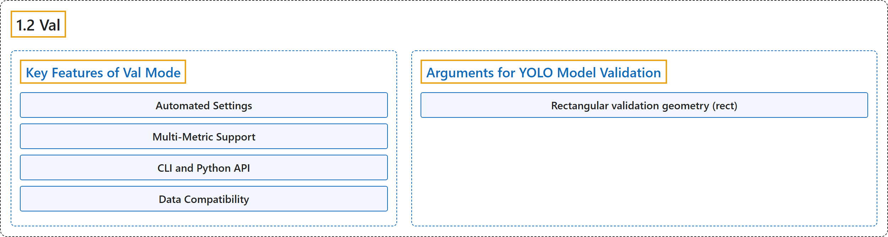

# 1.2 Val

## Classification

## Glossary

| Term | Definition | 中文翻译 | Source |
|---|---|---|---|
| **1.2 Val** 验证 | "Validation is **a critical step in the machine learning pipeline, allowing you to assess the quality of your trained models**." | 验证是**机器学习流水线中的关键一步，让你评估训练好的模型的质量**。 | [Ultralytics, n.d., "Model Validation with Ultralytics YOLO", para. 1](https://docs.ultralytics.com/modes/val/#model-validation-with-ultralytics-yolo) |
| **Key Features of Val Mode** 验证模式的主要功能 | (context) "These are the notable functionalities offered by YOLO26's Val mode:" | （语境）以下是 YOLO26 验证模式提供的主要功能： | [Ultralytics, n.d., "Key Features of Val Mode", para. 1](https://docs.ultralytics.com/modes/val/#key-features-of-val-mode) |
| **Automated Settings** 自动设置 | "Automated Settings: **Models remember their training configurations** for straightforward validation." | 自动设置：**模型会记住自己的训练配置**，使验证简单直接。 | [Ultralytics, n.d., "Key Features of Val Mode", item 1](https://docs.ultralytics.com/modes/val/#key-features-of-val-mode) |
| **Multi-Metric Support** 多指标支持 | "Multi-Metric Support: **Evaluate your model based on a range of accuracy metrics.**" | 多指标支持：**基于一系列精度指标评估你的模型。** | [Ultralytics, n.d., "Key Features of Val Mode", item 2](https://docs.ultralytics.com/modes/val/#key-features-of-val-mode) |
| **CLI and Python API** 命令行与 Python API | "CLI and Python API: **Choose from command-line interface or Python API** based on your preference for validation." | 命令行与 Python API：根据你的偏好，**在命令行界面和 Python API 之间选择**来做验证。 | [Ultralytics, n.d., "Key Features of Val Mode", item 3](https://docs.ultralytics.com/modes/val/#key-features-of-val-mode) |
| **Data Compatibility** 数据兼容性 | "Data Compatibility: **Works seamlessly with datasets used during the training phase as well as custom datasets.**" | 数据兼容性：**可无缝使用训练阶段用过的数据集以及自定义数据集。** | [Ultralytics, n.d., "Key Features of Val Mode", item 4](https://docs.ultralytics.com/modes/val/#key-features-of-val-mode) |
| **Arguments for YOLO Model Validation** YOLO 模型验证的参数 | "These arguments **control aspects such as input image size, batch processing, and performance thresholds**." | 这些参数**控制输入图像尺寸、批处理和性能阈值等方面**。 | [Ultralytics, n.d., "Arguments for YOLO Model Validation", para. 1](https://docs.ultralytics.com/modes/val/#arguments-for-yolo-model-validation) |
| **Rectangular validation geometry (rect)** 矩形验证几何（rect） | (context) "**Static exports use their recorded `(height, width)` input shape**, including non-square exports, for validation." | （语境）**静态导出的模型在验证时使用其记录的 `(height, width)` 输入形状**，包括非正方形的导出。 | [Ultralytics, n.d., "Rectangular validation geometry ( rect )", para. 1](https://docs.ultralytics.com/modes/val/#rectangular-validation-geometry-rect) |

## References

Ultralytics. (n.d.). *Model Validation with Ultralytics YOLO*. Ultralytics YOLO Docs (ultralytics 8.4.194). Retrieved October 31, 2026, from <https://docs.ultralytics.com/modes/val/>
