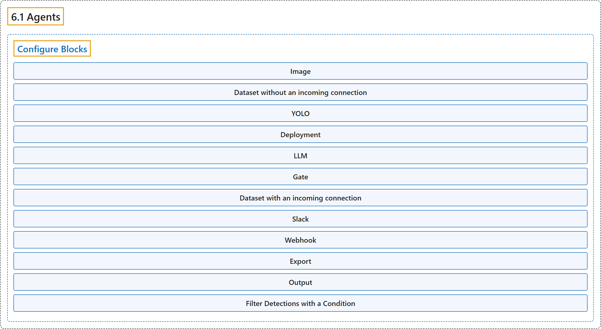

# 6.1 Agents

## Classification

## Glossary

| Term | Definition | 中文翻译 | Source |
|---|---|---|---|
| **6.1 Agents** 智能体 | "Agents **connects images, models, conditions, and actions in a visual workflow**." | Agents **在一个可视化工作流中把图像、模型、条件和动作连接起来**。 | [Ultralytics, n.d., "Agents", para. 1](https://docs.ultralytics.com/platform/agents/#agents) |
| **Configure Blocks** 配置模块 | (context) "Select a block **to edit its settings**. Connect an output to another block to pass its result downstream." | （语境）选中一个模块**即可编辑其设置**。把一个输出连接到另一个模块，就能把它的结果传给下游。 | [Ultralytics, n.d., "Configure Blocks", para. 1](https://docs.ultralytics.com/platform/agents/#configure-blocks) |
| **Image** 图像模块 | "**Upload an image or a video sampled into up to 10 frames by default, or select one image from an uploaded dataset**" | **上传一张图像或一段视频（默认最多采样 10 帧），或从已上传的数据集中选一张图像** | [Ultralytics, n.d., "Configure Blocks", table, row 1](https://docs.ultralytics.com/platform/agents/#configure-blocks) |
| **Dataset without an incoming connection** 无传入连接的数据集模块 | "**Read images from a selected dataset and split**, with a configurable input limit" | **从选定的数据集和划分中读取图像**，输入数量上限可配置 | [Ultralytics, n.d., "Configure Blocks", table, row 2](https://docs.ultralytics.com/platform/agents/#configure-blocks) |
| **YOLO** YOLO 模块 | "**Run an official model or a trained model from the workspace**" | **运行官方模型或工作区中训练好的模型** | [Ultralytics, n.d., "Configure Blocks", table, row 3](https://docs.ultralytics.com/platform/agents/#configure-blocks) |
| **Deployment** 部署模块 | "**Predict through an existing ready Platform deployment**" | **通过一个已就绪的现有平台部署进行预测** | [Ultralytics, n.d., "Configure Blocks", table, row 4](https://docs.ultralytics.com/platform/agents/#configure-blocks) |
| **LLM** LLM 模块 | "**Send the image and upstream context to the selected language or vision-language model**" | **把图像和上游上下文发送给选定的语言模型或视觉语言模型** | [Ultralytics, n.d., "Configure Blocks", table, row 5](https://docs.ultralytics.com/platform/agents/#configure-blocks) |
| **Gate** 门控模块 | "**Control downstream execution with a condition or cadence**" | **用条件或节奏控制下游的执行** | [Ultralytics, n.d., "Configure Blocks", table, row 6](https://docs.ultralytics.com/platform/agents/#configure-blocks) |
| **Dataset with an incoming connection** 有传入连接的数据集模块 | "**Add the incoming image to a destination dataset**" | **把传入的图像添加到目标数据集** | [Ultralytics, n.d., "Configure Blocks", table, row 7](https://docs.ultralytics.com/platform/agents/#configure-blocks) |
| **Slack** Slack 模块 | "**Send a message to the workspace's connected Slack channel**" | **向工作区已连接的 Slack 频道发送消息** | [Ultralytics, n.d., "Configure Blocks", table, row 8](https://docs.ultralytics.com/platform/agents/#configure-blocks) |
| **Webhook** Webhook 模块 | "**POST a JSON body to an HTTPS endpoint**" | **向一个 HTTPS 端点 POST 一个 JSON 正文** | [Ultralytics, n.d., "Configure Blocks", table, row 9](https://docs.ultralytics.com/platform/agents/#configure-blocks) |
| **Export** 导出模块 | "**Export a model using Platform's existing export workflow**" | **使用平台现有的导出工作流导出模型** | [Ultralytics, n.d., "Configure Blocks", table, row 10](https://docs.ultralytics.com/platform/agents/#configure-blocks) |
| **Output** 输出模块 | "**Display the upstream result**" | **显示上游的结果** | [Ultralytics, n.d., "Configure Blocks", table, row 11](https://docs.ultralytics.com/platform/agents/#configure-blocks) |
| **Filter Detections with a Condition** 用条件筛选检测结果 | (context) "Use the same **Gate** block **for detection counts and confidence filters**." | （语境）用同一个**门控**模块来**处理检测数量和置信度筛选**。 | [Ultralytics, n.d., "Filter Detections with a Condition", para. 1](https://docs.ultralytics.com/platform/agents/#filter-detections-with-a-condition) |

## References

Ultralytics. (n.d.). *Agents*. Ultralytics YOLO Docs (ultralytics 8.4.194). Retrieved October 31, 2026, from <https://docs.ultralytics.com/platform/agents/>
