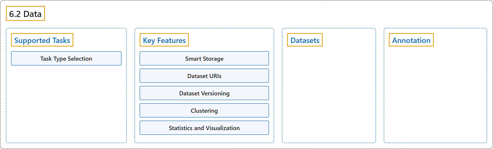

# 6.2 Data

## Classification

## Glossary

| Term | Definition | 中文翻译 | Source |
|---|---|---|---|
| **6.2 Data** 数据 | (context) "Data preparation is **the foundation of successful computer vision models**." | （语境）数据准备是**成功的计算机视觉模型的基础**。 | [Ultralytics, n.d.-b, "Data Preparation", para. 1](https://docs.ultralytics.com/platform/data/#data-preparation) |
| **Supported Tasks** 支持的任务 | (context) "Ultralytics Platform datasets support **all 7 YOLO task types**:" | （语境）Ultralytics 平台的数据集支持**全部 7 种 YOLO 任务类型**： | [Ultralytics, n.d.-b, "Supported Tasks", para. 1](https://docs.ultralytics.com/platform/data/#supported-tasks) |
| **Task Type Selection** 任务类型选择 | "The task type is **set when creating a dataset and determines which annotation tools are available**." | 任务类型**在创建数据集时设定，并决定可用的标注工具**。 | [Ultralytics, n.d.-b, "Supported Tasks", Task Type Selection, para. 1](https://docs.ultralytics.com/platform/data/#supported-tasks) |
| **Key Features** 主要功能 | (No definition) | （无定义） | [Ultralytics, n.d.-b, "Key Features"](https://docs.ultralytics.com/platform/data/#key-features) |
| **Smart Storage** 智能存储 | (context) "Ultralytics Platform **manages storage efficiently**:" | （语境）Ultralytics 平台**高效地管理存储**： | [Ultralytics, n.d.-b, "Smart Storage", para. 1](https://docs.ultralytics.com/platform/data/#smart-storage) |
| **Deduplication** 去重 | "Deduplication: Identical images in the same data region **are stored once**" | 去重：同一数据区域中**相同的图像只存储一次** | [Ultralytics, n.d.-b, "Smart Storage", item 1](https://docs.ultralytics.com/platform/data/#smart-storage) |
| **Integrity** 完整性 | "Integrity: Uploads **are verified for data integrity**" | 完整性：上传内容**会经过数据完整性校验** | [Ultralytics, n.d.-b, "Smart Storage", item 2](https://docs.ultralytics.com/platform/data/#smart-storage) |
| **Efficiency** 效率 | "Efficiency: Optimized storage and **fast processing**" | 效率：优化的存储和**快速的处理** | [Ultralytics, n.d.-b, "Smart Storage", item 3](https://docs.ultralytics.com/platform/data/#smart-storage) |
| **Dataset URIs** 数据集 URI | "Reference datasets using the **`ul://` URI format**" | 使用 **`ul://` URI 格式**引用数据集 | [Ultralytics, n.d.-b, "Dataset URIs", para. 1](https://docs.ultralytics.com/platform/data/#dataset-uris) |
| **Dataset Versioning** 数据集版本管理 | "**Create immutable NDJSON snapshots of your dataset** for reproducible training." | **为数据集创建不可变的 NDJSON 快照**，以便可复现地训练。 | [Ultralytics, n.d.-b, "Dataset Versioning", para. 1](https://docs.ultralytics.com/platform/data/#dataset-versioning) |
| **Clustering** 聚类 | "Explore your dataset as **an interactive 2D scatter plot where visually similar images sit close together**" | 把数据集当作**一张交互式二维散点图来探索，视觉上相似的图像彼此靠近** | [Ultralytics, n.d.-b, "Clustering", para. 1](https://docs.ultralytics.com/platform/data/#clustering) |
| **Statistics and Visualization** 统计与可视化 | (context) "The `Charts` tab provides **automatic analysis** including:" | （语境）`Charts` 标签页提供**自动分析**，包括： | [Ultralytics, n.d.-b, "Statistics and Visualization", para. 1](https://docs.ultralytics.com/platform/data/#statistics-and-visualization) |
| **Datasets** 数据集 | "Ultralytics Platform datasets **provide a streamlined solution for managing your training data**." | Ultralytics Platform 的数据集**提供一种管理训练数据的简化方案**。 | [Ultralytics, n.d.-c, "Datasets", para. 1](https://docs.ultralytics.com/platform/data/datasets/#datasets) |
| **Annotation** 标注 | "Ultralytics Platform includes **an annotation editor for labeling images with bounding boxes, polygons, keypoints, oriented boxes, and classifications**." | Ultralytics Platform 包含**一个标注编辑器，可用边界框、多边形、关键点、旋转框和分类标签标注图像**。 | [Ultralytics, n.d.-a, "Annotation Editor", para. 1](https://docs.ultralytics.com/platform/data/annotation/#annotation-editor) |

## References

Ultralytics. (n.d.-a). *Annotation Editor*. Ultralytics YOLO Docs (ultralytics 8.4.194). Retrieved October 31, 2026, from <https://docs.ultralytics.com/platform/data/annotation/>

Ultralytics. (n.d.-b). *Data Preparation*. Ultralytics YOLO Docs (ultralytics 8.4.194). Retrieved October 31, 2026, from <https://docs.ultralytics.com/platform/data/>

Ultralytics. (n.d.-c). *Datasets*. Ultralytics YOLO Docs (ultralytics 8.4.194). Retrieved October 31, 2026, from <https://docs.ultralytics.com/platform/data/datasets/>
