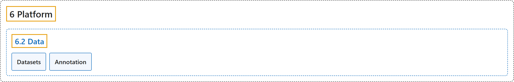

# 6.2 Data

## Classification

## Glossary

| Term | Definition | 中文翻译 | Source |
|---|---|---|---|
| **6.2 Data** 数据 | (context) "Data preparation is **the foundation of successful computer vision models**." | （语境）数据准备是**成功的计算机视觉模型的基础**。 | [Ultralytics, n.d.-b, "Data Preparation", para. 1](https://docs.ultralytics.com/platform/data/#data-preparation) |
| **Datasets** 数据集 | "Ultralytics Platform datasets **provide a streamlined solution for managing your training data**." | Ultralytics Platform 的数据集**提供一种管理训练数据的简化方案**。 | [Ultralytics, n.d.-c, "Datasets", para. 1](https://docs.ultralytics.com/platform/data/datasets/#datasets) |
| **Annotation** 标注 | "Ultralytics Platform includes **an annotation editor for labeling images with bounding boxes, polygons, keypoints, oriented boxes, and classifications**." | Ultralytics Platform 包含**一个标注编辑器，可用边界框、多边形、关键点、旋转框和分类标签标注图像**。 | [Ultralytics, n.d.-a, "Annotation Editor", para. 1](https://docs.ultralytics.com/platform/data/annotation/#annotation-editor) |

## References

Ultralytics. (n.d.-a). *Annotation Editor*. Ultralytics YOLO Docs (ultralytics 8.4.194). Retrieved October 31, 2026, from <https://docs.ultralytics.com/platform/data/annotation/>

Ultralytics. (n.d.-b). *Data Preparation*. Ultralytics YOLO Docs (ultralytics 8.4.194). Retrieved October 31, 2026, from <https://docs.ultralytics.com/platform/data/>

Ultralytics. (n.d.-c). *Datasets*. Ultralytics YOLO Docs (ultralytics 8.4.194). Retrieved October 31, 2026, from <https://docs.ultralytics.com/platform/data/datasets/>
