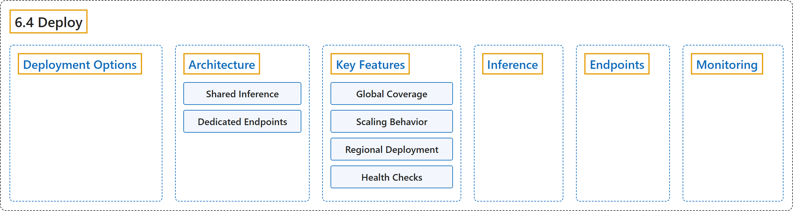

# 6.4 Deploy

## Classification

## Glossary

| Term | Definition | 中文翻译 | Source |
|---|---|---|---|
| **6.4 Deploy** 部署 | "Ultralytics Platform provides **comprehensive model deployment options for putting your YOLO models into production**." | Ultralytics Platform 提供**全面的模型部署选项，把 YOLO 模型投入生产**。 | [Ultralytics, n.d.-b, "Deployment", para. 1](https://docs.ultralytics.com/platform/deploy/#deployment) |
| **Deployment Options** 部署方式 | (context) "Ultralytics Platform offers **multiple deployment paths**:" | （语境）Ultralytics 平台提供**多种部署途径**： | [Ultralytics, n.d.-b, "Deployment Options", para. 1](https://docs.ultralytics.com/platform/deploy/#deployment-options) |
| **Architecture** 架构 | (No definition) | （无定义） | [Ultralytics, n.d.-b, "Architecture"](https://docs.ultralytics.com/platform/deploy/#architecture) |
| **Shared Inference** 共享推理 | "Requests to a model are **routed to the service in that model's data region**, so results stay inside the region where the model is stored" | 对某个模型的请求会**被路由到该模型所在数据区域的服务**，因此结果始终留在存储模型的区域内 | [Ultralytics, n.d.-b, "Shared Inference", para. 1](https://docs.ultralytics.com/platform/deploy/#shared-inference) |
| **Dedicated Endpoints** 专用端点 | "Each endpoint is **a single-tenant service** with:" | 每个端点都是**一个单租户服务**，具有： | [Ultralytics, n.d.-b, "Dedicated Endpoints", para. 2](https://docs.ultralytics.com/platform/deploy/#dedicated-endpoints) |
| **Key Features** 主要功能 | (No definition) | （无定义） | [Ultralytics, n.d.-b, "Key Features"](https://docs.ultralytics.com/platform/deploy/#key-features) |
| **Global Coverage** 全球覆盖 | (context) "Deploy close to your users **with 42 regions** covering:" | （语境）借助 **42 个区域**就近部署到用户附近，覆盖： | [Ultralytics, n.d.-b, "Global Coverage", para. 1](https://docs.ultralytics.com/platform/deploy/#global-coverage) |
| **Scaling Behavior** 伸缩行为 | (context) "Endpoints **currently behave as follows**:" | （语境）端点**目前的行为如下**： | [Ultralytics, n.d.-b, "Scaling Behavior", para. 1](https://docs.ultralytics.com/platform/deploy/#scaling-behavior) |
| **Default resources** 默认资源 | "Default resources: idle endpoints **scale down to zero and cold-start on the next request**" | 默认资源：空闲端点**缩容到零，并在下一个请求到来时冷启动** | [Ultralytics, n.d.-b, "Scaling Behavior", item 1](https://docs.ultralytics.com/platform/deploy/#scaling-behavior) |
| **Custom resources** 自定义资源 | "Custom resources: one instance **stays warm and accrues uptime charges until stopped**" | 自定义资源：一个实例**保持预热，并在停止前持续产生运行时长费用** | [Ultralytics, n.d.-b, "Scaling Behavior", item 2](https://docs.ultralytics.com/platform/deploy/#scaling-behavior) |
| **Single active instance** 单活动实例 | "Single active instance: each endpoint currently **serves from one instance on all plans**" | 单活动实例：每个端点目前**在所有套餐中都只由一个实例提供服务** | [Ultralytics, n.d.-b, "Scaling Behavior", item 3](https://docs.ultralytics.com/platform/deploy/#scaling-behavior) |
| **Load shedding** 负载削减 | "Load shedding: requests **receive `429` responses when the endpoint is temporarily at capacity**" | 负载削减：请求**在端点暂时满载时会收到 `429` 响应** | [Ultralytics, n.d.-b, "Scaling Behavior", item 4](https://docs.ultralytics.com/platform/deploy/#scaling-behavior) |
| **Request timeout** 请求超时 | "Request timeout: direct endpoint requests **have a maximum duration of 1 hour**" | 请求超时：直接发往端点的请求**最长持续 1 小时** | [Ultralytics, n.d.-b, "Scaling Behavior", item 5](https://docs.ultralytics.com/platform/deploy/#scaling-behavior) |
| **Regional Deployment** 区域部署 | "**Use the measured region latency to place an endpoint near its callers.**" | **利用测得的区域延迟，把端点放在靠近调用方的位置。** | [Ultralytics, n.d.-b, "Regional Deployment", para. 1](https://docs.ultralytics.com/platform/deploy/#regional-deployment) |
| **Health Checks** 健康检查 | "Each running deployment includes **an automatic health check** with:" | 每个运行中的部署都包含**一项自动健康检查**，具有： | [Ultralytics, n.d.-b, "Health Checks", para. 1](https://docs.ultralytics.com/platform/deploy/#health-checks) |
| **Inference** 推理 | "Ultralytics Platform provides **browser-based inference for testing trained models and dedicated endpoints for programmatic access**." | Ultralytics Platform 提供**基于浏览器的推理，用于测试训练好的模型，并提供供程序访问的专用端点**。 | [Ultralytics, n.d.-c, "Inference", para. 1](https://docs.ultralytics.com/platform/deploy/inference/#inference) |
| **Endpoints** 端点 | "Each endpoint is **a single-tenant service with a unique endpoint URL and independent monitoring**." | 每个端点都是**一个单租户服务，有唯一的端点 URL 和独立的监控**。 | [Ultralytics, n.d.-a, "Dedicated Endpoints", para. 1](https://docs.ultralytics.com/platform/deploy/endpoints/#dedicated-endpoints) |
| **Monitoring** 监控 | "Ultralytics Platform provides **monitoring for deployed endpoints**." | Ultralytics Platform 提供**对已部署端点的监控**。 | [Ultralytics, n.d.-d, "Monitoring", para. 1](https://docs.ultralytics.com/platform/deploy/monitoring/#monitoring) |

## References

Ultralytics. (n.d.-a). *Dedicated Endpoints*. Ultralytics YOLO Docs (ultralytics 8.4.194). Retrieved October 31, 2026, from <https://docs.ultralytics.com/platform/deploy/endpoints/>

Ultralytics. (n.d.-b). *Deployment*. Ultralytics YOLO Docs (ultralytics 8.4.194). Retrieved October 31, 2026, from <https://docs.ultralytics.com/platform/deploy/>

Ultralytics. (n.d.-c). *Inference*. Ultralytics YOLO Docs (ultralytics 8.4.194). Retrieved October 31, 2026, from <https://docs.ultralytics.com/platform/deploy/inference/>

Ultralytics. (n.d.-d). *Monitoring*. Ultralytics YOLO Docs (ultralytics 8.4.194). Retrieved October 31, 2026, from <https://docs.ultralytics.com/platform/deploy/monitoring/>
