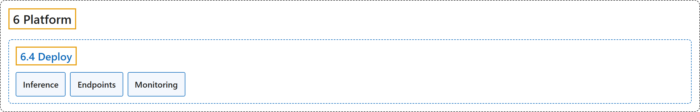

# 6.4 Deploy

## Classification

## Glossary

| Term | Definition | 中文翻译 | Source |
|---|---|---|---|
| **6.4 Deploy** 部署 | "Ultralytics Platform provides **comprehensive model deployment options for putting your YOLO models into production**." | Ultralytics Platform 提供**全面的模型部署选项，把 YOLO 模型投入生产**。 | [Ultralytics, n.d.-b, "Deployment", para. 1](https://docs.ultralytics.com/platform/deploy/#deployment) |
| **Inference** 推理 | "Ultralytics Platform provides **browser-based inference for testing trained models and dedicated endpoints for programmatic access**." | Ultralytics Platform 提供**基于浏览器的推理，用于测试训练好的模型，并提供供程序访问的专用端点**。 | [Ultralytics, n.d.-c, "Inference", para. 1](https://docs.ultralytics.com/platform/deploy/inference/#inference) |
| **Endpoints** 端点 | "Each endpoint is **a single-tenant service with a unique endpoint URL and independent monitoring**." | 每个端点都是**一个单租户服务，有唯一的端点 URL 和独立的监控**。 | [Ultralytics, n.d.-a, "Dedicated Endpoints", para. 1](https://docs.ultralytics.com/platform/deploy/endpoints/#dedicated-endpoints) |
| **Monitoring** 监控 | "Ultralytics Platform provides **monitoring for deployed endpoints**." | Ultralytics Platform 提供**对已部署端点的监控**。 | [Ultralytics, n.d.-d, "Monitoring", para. 1](https://docs.ultralytics.com/platform/deploy/monitoring/#monitoring) |

## References

Ultralytics. (n.d.-a). *Dedicated Endpoints*. Ultralytics YOLO Docs (ultralytics 8.4.194). Retrieved October 31, 2026, from <https://docs.ultralytics.com/platform/deploy/endpoints/>

Ultralytics. (n.d.-b). *Deployment*. Ultralytics YOLO Docs (ultralytics 8.4.194). Retrieved October 31, 2026, from <https://docs.ultralytics.com/platform/deploy/>

Ultralytics. (n.d.-c). *Inference*. Ultralytics YOLO Docs (ultralytics 8.4.194). Retrieved October 31, 2026, from <https://docs.ultralytics.com/platform/deploy/inference/>

Ultralytics. (n.d.-d). *Monitoring*. Ultralytics YOLO Docs (ultralytics 8.4.194). Retrieved October 31, 2026, from <https://docs.ultralytics.com/platform/deploy/monitoring/>
