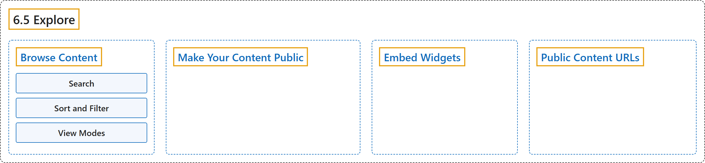

# 6.5 Explore

## Classification

## Glossary

| Term | Definition | 中文翻译 | Source |
|---|---|---|---|
| **6.5 Explore** 探索 | "Ultralytics Platform Explore page **showcases public content from the community**." | Ultralytics Platform 的 Explore 页面**展示来自社区的公开内容**。 | [Ultralytics, n.d., "Explore", para. 1](https://docs.ultralytics.com/platform/explore/#explore) |
| **Browse Content** 浏览内容 | (No definition) | （无定义） | [Ultralytics, n.d., "Browse Content"](https://docs.ultralytics.com/platform/explore/#browse-content) |
| **Search** 搜索 | (context) "Each tab has **its own search bar**." | （语境）每个标签页都有**自己的搜索栏**。 | [Ultralytics, n.d., "Search", para. 1](https://docs.ultralytics.com/platform/explore/#search) |
| **Sort and Filter** 排序与筛选 | (context) "The dropdown in the toolbar holds **sort options on the Datasets and Projects tabs and filters on all three tabs**:" | （语境）工具栏中的下拉菜单包含**数据集和项目标签页上的排序选项，以及全部三个标签页上的筛选器**： | [Ultralytics, n.d., "Sort and Filter", para. 1](https://docs.ultralytics.com/platform/explore/#sort-and-filter) |
| **View Modes** 视图模式 | (context) "On the Datasets and Projects tabs, toggle between **three view modes** for browsing:" | （语境）在数据集和项目标签页上，可在**三种视图模式**之间切换来浏览： | [Ultralytics, n.d., "View Modes", para. 1](https://docs.ultralytics.com/platform/explore/#view-modes) |
| **Make Your Content Public** 公开你的内容 | "**Public content is visible to everyone, including users who aren't signed in.**" | **公开内容对所有人可见，包括未登录的用户。** | [Ultralytics, n.d., "Make Your Content Public", para. 1](https://docs.ultralytics.com/platform/explore/#make-your-content-public) |
| **Embed Widgets** 嵌入小组件 | "Public content can be **embedded in external websites using embed URLs**:" | 公开内容可以**通过嵌入 URL 嵌入到外部网站中**： | [Ultralytics, n.d., "Embed Widgets", para. 1](https://docs.ultralytics.com/platform/explore/#embed-widgets) |
| **Public Content URLs** 公开内容 URL | (context) "Public content on the platform uses **clean, shareable URLs**:" | （语境）平台上的公开内容使用**简洁、可分享的 URL**： | [Ultralytics, n.d., "Public Content URLs", para. 1](https://docs.ultralytics.com/platform/explore/#public-content-urls) |

## References

Ultralytics. (n.d.). *Explore*. Ultralytics YOLO Docs (ultralytics 8.4.194). Retrieved October 31, 2026, from <https://docs.ultralytics.com/platform/explore/>
