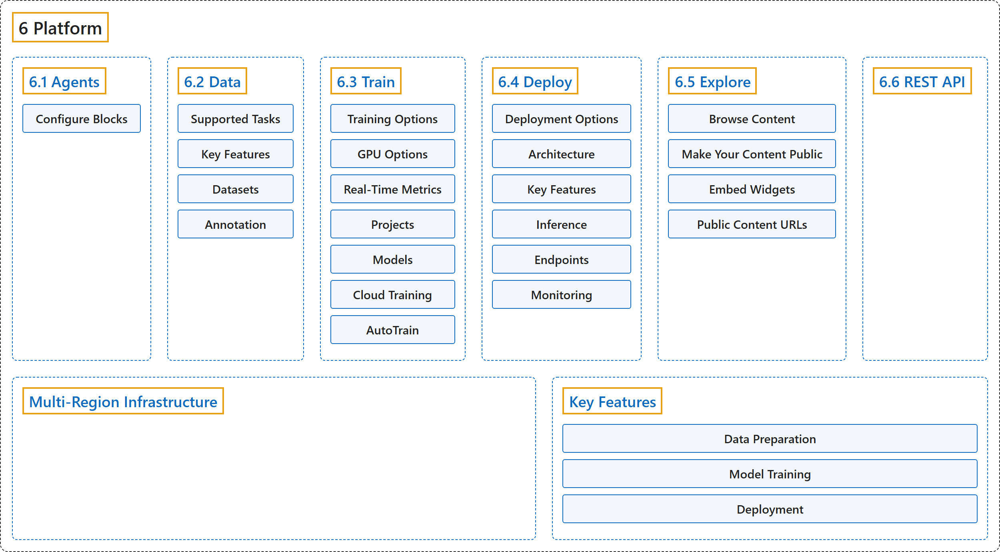

# 6. Platform

## Classification

## Glossary

| Term | Definition | 中文翻译 | Source |
|---|---|---|---|
| **6 Platform** 平台 | "Ultralytics Platform is **a comprehensive end-to-end computer vision platform that streamlines the entire ML workflow from data preparation to model deployment**." | Ultralytics Platform 是**一个全面的端到端计算机视觉平台，简化从数据准备到模型部署的整个机器学习工作流**。 | [Ultralytics, n.d.-g, "Ultralytics Platform", para. 1](https://docs.ultralytics.com/platform/#ultralytics-platform) |
| **[6.1 Agents](agents.md)** 智能体 | "Agents **connects images, models, conditions, and actions in a visual workflow**." | Agents **在一个可视化工作流中把图像、模型、条件和动作连接起来**。 | [Ultralytics, n.d.-a, "Agents", para. 1](https://docs.ultralytics.com/platform/agents/#agents) |
| **[6.2 Data](data.md)** 数据 | (context) "Data preparation is **the foundation of successful computer vision models**." | （语境）数据准备是**成功的计算机视觉模型的基础**。 | [Ultralytics, n.d.-b, "Data Preparation", para. 1](https://docs.ultralytics.com/platform/data/#data-preparation) |
| **[6.3 Train](train.md)** 训练 | "Ultralytics Platform provides **comprehensive tools for training YOLO models, from organizing experiments to running cloud training jobs with real-time metrics streaming**." | Ultralytics Platform 提供**训练 YOLO 模型的全套工具，从组织实验到运行带实时指标流的云端训练任务**。 | [Ultralytics, n.d.-e, "Model Training", para. 1](https://docs.ultralytics.com/platform/train/#model-training) |
| **[6.4 Deploy](deploy.md)** 部署 | "Ultralytics Platform provides **comprehensive model deployment options for putting your YOLO models into production**." | Ultralytics Platform 提供**全面的模型部署选项，把 YOLO 模型投入生产**。 | [Ultralytics, n.d.-c, "Deployment", para. 1](https://docs.ultralytics.com/platform/deploy/#deployment) |
| **[6.5 Explore](explore.md)** 探索 | "Ultralytics Platform Explore page **showcases public content from the community**." | Ultralytics Platform 的 Explore 页面**展示来自社区的公开内容**。 | [Ultralytics, n.d.-d, "Explore", para. 1](https://docs.ultralytics.com/platform/explore/#explore) |
| **[6.6 REST API](rest-api.md)** REST API | "Ultralytics Platform provides **a REST API for programmatic access to datasets, images, projects, models, training, exports, and deployments**." | Ultralytics Platform 提供**一个 REST API，供程序访问数据集、图像、项目、模型、训练、导出和部署**。 | [Ultralytics, n.d.-f, "REST API Reference", para. 1](https://docs.ultralytics.com/platform/api/#rest-api-reference) |
| **Multi-Region Infrastructure** 多区域基础设施 | (context) "**Your data stays in your region.** Ultralytics Platform operates infrastructure in three global regions:" | （语境）**你的数据留在你所在的区域。** Ultralytics Platform 在全球三个区域运营基础设施： | [Ultralytics, n.d.-g, "Multi-Region Infrastructure", para. 1](https://docs.ultralytics.com/platform/#multi-region-infrastructure) |
| **Key Features** 主要功能 | (No definition) | （无定义） | [Ultralytics, n.d.-g, "Key Features"](https://docs.ultralytics.com/platform/#key-features) |
| **Data Preparation** 数据准备 | (No definition) | （无定义） | [Ultralytics, n.d.-g, "Data Preparation"](https://docs.ultralytics.com/platform/#data-preparation) |
| **Dataset Management** 数据集管理 | "Dataset Management: **Create datasets from local files, a URL, connected cloud storage, or an on-premise host, with automatic processing**" | 数据集管理：**从本地文件、URL、已连接的云存储或本地部署的主机创建数据集，并自动处理** | [Ultralytics, n.d.-g, "Data Preparation", item 1](https://docs.ultralytics.com/platform/#data-preparation) |
| **Annotation Editor** 标注编辑器 | "Annotation Editor: **Manual annotation tools for 6 YOLO task types**" | 标注编辑器：**面向 6 种 YOLO 任务类型的手动标注工具** | [Ultralytics, n.d.-g, "Data Preparation", item 2](https://docs.ultralytics.com/platform/#data-preparation) |
| **Skeleton Templates** 骨架模板 | "Skeleton Templates: **Built-in (Person, Hand, Dog, Face, Box) and custom skeleton templates for one-click pose annotation**" | 骨架模板：**内置（人、手、狗、脸、框）和自定义的骨架模板，用于一键姿态标注** | [Ultralytics, n.d.-g, "Data Preparation", item 3](https://docs.ultralytics.com/platform/#data-preparation) |
| **Smart Annotation** 智能标注 | "Smart Annotation: **Use SAM 2.1 (Tiny, Small, Base, Large), SAM 3, or SAM 3.1 (default) from the annotation toolbar** for detect, segment, semantic, and OBB tasks" | 智能标注：对检测、分割、语义分割和 OBB 任务，**在标注工具栏中使用 SAM 2.1（Tiny、Small、Base、Large）、SAM 3 或 SAM 3.1（默认）** | [Ultralytics, n.d.-g, "Data Preparation", item 4](https://docs.ultralytics.com/platform/#data-preparation) |
| **Dataset Versioning** 数据集版本管理 | "Dataset Versioning: **Create numbered NDJSON snapshots with descriptions, then download or restore any version for reproducible training**" | 数据集版本管理：**创建带说明的编号 NDJSON 快照，之后可下载或恢复任一版本，以便可复现地训练** | [Ultralytics, n.d.-g, "Data Preparation", item 5](https://docs.ultralytics.com/platform/#data-preparation) |
| **Statistics** 统计 | "Statistics: **Class distribution, split distribution, location heatmaps, and bounding box dimension analysis**" | 统计：**类别分布、划分分布、位置热力图和边界框尺寸分析** | [Ultralytics, n.d.-g, "Data Preparation", item 6](https://docs.ultralytics.com/platform/#data-preparation) |
| **Model Training** 模型训练 | (No definition) | （无定义） | [Ultralytics, n.d.-g, "Model Training"](https://docs.ultralytics.com/platform/#model-training) |
| **Cloud Training** 云端训练 | "Cloud Training: **Train on cloud GPUs** (24 on all plans, 26 with Pro or Enterprise for B200 and B300) **with real-time metrics and a live cost estimate**" | 云端训练：**在云 GPU 上训练**（所有套餐 24 种，Pro 或 Enterprise 另有 B200 和 B300 共 26 种），**带实时指标和实时成本估算** | [Ultralytics, n.d.-g, "Model Training", item 1](https://docs.ultralytics.com/platform/#model-training) |
| **Remote Training** 远程训练 | "Remote Training: **Train anywhere and stream metrics to Ultralytics Platform**" | 远程训练：**在任何地方训练，并把指标实时推送到 Ultralytics Platform** | [Ultralytics, n.d.-g, "Model Training", item 2](https://docs.ultralytics.com/platform/#model-training) |
| **Advanced Settings** 高级设置 | "Advanced Settings: **Override any Ultralytics training argument from a built-in YAML editor in the training dialog**" | 高级设置：**在训练对话框内置的 YAML 编辑器中覆盖任何 Ultralytics 训练参数** | [Ultralytics, n.d.-g, "Model Training", item 3](https://docs.ultralytics.com/platform/#model-training) |
| **Project Organization** 项目组织 | "Project Organization: **Group related models, compare experiments, track activity**" | 项目组织：**把相关模型归组、比较实验、跟踪活动** | [Ultralytics, n.d.-g, "Model Training", item 4](https://docs.ultralytics.com/platform/#model-training) |
| **22 Export Formats** 22 种导出格式 | "22 Export Formats: **ONNX, TensorRT, CoreML, LiteRT, Hailo, Ascend, and more**" | 22 种导出格式：**ONNX、TensorRT、CoreML、LiteRT、Hailo、Ascend 等** | [Ultralytics, n.d.-g, "Model Training", item 5](https://docs.ultralytics.com/platform/#model-training) |
| **Deployment** 部署 | (No definition) | （无定义） | [Ultralytics, n.d.-g, "Deployment"](https://docs.ultralytics.com/platform/#deployment) |
| **Inference Testing** 推理测试 | "Inference Testing: **Test models directly in the browser with your own images, a webcam capture, or the built-in examples**" | 推理测试：**直接在浏览器中用你自己的图像、摄像头抓拍或内置示例测试模型** | [Ultralytics, n.d.-g, "Deployment", item 1](https://docs.ultralytics.com/platform/#deployment) |
| **Dedicated Endpoints** 专用端点 | "Dedicated Endpoints: **Deploy to 42 global regions with scale-to-zero by default** (single active instance)" | 专用端点：**部署到全球 42 个区域，默认可缩容到零**（单个活动实例） | [Ultralytics, n.d.-g, "Deployment", item 2](https://docs.ultralytics.com/platform/#deployment) |
| **Monitoring** 监控 | "Monitoring: **Real-time metrics, request logs, and performance dashboards**" | 监控：**实时指标、请求日志和性能仪表板** | [Ultralytics, n.d.-g, "Deployment", item 3](https://docs.ultralytics.com/platform/#deployment) |

## References

Ultralytics. (n.d.-a). *Agents*. Ultralytics YOLO Docs (ultralytics 8.4.194). Retrieved October 31, 2026, from <https://docs.ultralytics.com/platform/agents/>

Ultralytics. (n.d.-b). *Data Preparation*. Ultralytics YOLO Docs (ultralytics 8.4.194). Retrieved October 31, 2026, from <https://docs.ultralytics.com/platform/data/>

Ultralytics. (n.d.-c). *Deployment*. Ultralytics YOLO Docs (ultralytics 8.4.194). Retrieved October 31, 2026, from <https://docs.ultralytics.com/platform/deploy/>

Ultralytics. (n.d.-d). *Explore*. Ultralytics YOLO Docs (ultralytics 8.4.194). Retrieved October 31, 2026, from <https://docs.ultralytics.com/platform/explore/>

Ultralytics. (n.d.-e). *Model Training*. Ultralytics YOLO Docs (ultralytics 8.4.194). Retrieved October 31, 2026, from <https://docs.ultralytics.com/platform/train/>

Ultralytics. (n.d.-f). *REST API Reference*. Ultralytics YOLO Docs (ultralytics 8.4.194). Retrieved October 31, 2026, from <https://docs.ultralytics.com/platform/api/>

Ultralytics. (n.d.-g). *Ultralytics Platform*. Ultralytics YOLO Docs (ultralytics 8.4.194). Retrieved October 31, 2026, from <https://docs.ultralytics.com/platform/>
