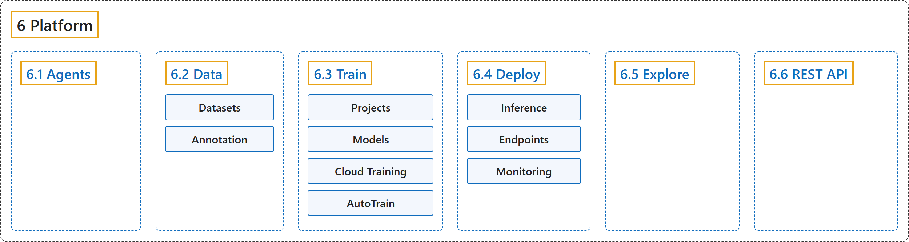

# 6. Platform

## Classification

## Glossary

| Term | Definition | 中文翻译 | Source |
|---|---|---|---|
| **6 Platform** 平台 | "Ultralytics Platform is **a comprehensive end-to-end computer vision platform that streamlines the entire ML workflow from data preparation to model deployment**." | Ultralytics Platform 是**一个全面的端到端计算机视觉平台，简化从数据准备到模型部署的整个机器学习工作流**。 | [Ultralytics, n.d.-g, "Ultralytics Platform", para. 1](https://docs.ultralytics.com/platform/#ultralytics-platform) |
| **[6.1 Agents](agents.md)** 智能体 | "Agents **connects images, models, conditions, and actions in a visual workflow**." | Agents **在一个可视化工作流中把图像、模型、条件和动作连接起来**。 | [Ultralytics, n.d.-a, "Agents", para. 1](https://docs.ultralytics.com/platform/agents/#agents) |
| **[6.2 Data](data.md)** 数据 | (context) "Data preparation is **the foundation of successful computer vision models**." | （语境）数据准备是**成功的计算机视觉模型的基础**。 | [Ultralytics, n.d.-b, "Data Preparation", para. 1](https://docs.ultralytics.com/platform/data/#data-preparation) |
| **[6.3 Train](train.md)** 训练 | "Ultralytics Platform provides **comprehensive tools for training YOLO models, from organizing experiments to running cloud training jobs with real-time metrics streaming**." | Ultralytics Platform 提供**训练 YOLO 模型的全套工具，从组织实验到运行带实时指标流的云端训练任务**。 | [Ultralytics, n.d.-e, "Model Training", para. 1](https://docs.ultralytics.com/platform/train/#model-training) |
| **[6.4 Deploy](deploy.md)** 部署 | "Ultralytics Platform provides **comprehensive model deployment options for putting your YOLO models into production**." | Ultralytics Platform 提供**全面的模型部署选项，把 YOLO 模型投入生产**。 | [Ultralytics, n.d.-c, "Deployment", para. 1](https://docs.ultralytics.com/platform/deploy/#deployment) |
| **[6.5 Explore](explore.md)** 探索 | "Ultralytics Platform Explore page **showcases public content from the community**." | Ultralytics Platform 的 Explore 页面**展示来自社区的公开内容**。 | [Ultralytics, n.d.-d, "Explore", para. 1](https://docs.ultralytics.com/platform/explore/#explore) |
| **[6.6 REST API](rest-api.md)** REST API | "Ultralytics Platform provides **a REST API for programmatic access to datasets, images, projects, models, training, exports, and deployments**." | Ultralytics Platform 提供**一个 REST API，供程序访问数据集、图像、项目、模型、训练、导出和部署**。 | [Ultralytics, n.d.-f, "REST API Reference", para. 1](https://docs.ultralytics.com/platform/api/#rest-api-reference) |

## References

Ultralytics. (n.d.-a). *Agents*. Ultralytics YOLO Docs (ultralytics 8.4.194). Retrieved October 31, 2026, from <https://docs.ultralytics.com/platform/agents/>

Ultralytics. (n.d.-b). *Data Preparation*. Ultralytics YOLO Docs (ultralytics 8.4.194). Retrieved October 31, 2026, from <https://docs.ultralytics.com/platform/data/>

Ultralytics. (n.d.-c). *Deployment*. Ultralytics YOLO Docs (ultralytics 8.4.194). Retrieved October 31, 2026, from <https://docs.ultralytics.com/platform/deploy/>

Ultralytics. (n.d.-d). *Explore*. Ultralytics YOLO Docs (ultralytics 8.4.194). Retrieved October 31, 2026, from <https://docs.ultralytics.com/platform/explore/>

Ultralytics. (n.d.-e). *Model Training*. Ultralytics YOLO Docs (ultralytics 8.4.194). Retrieved October 31, 2026, from <https://docs.ultralytics.com/platform/train/>

Ultralytics. (n.d.-f). *REST API Reference*. Ultralytics YOLO Docs (ultralytics 8.4.194). Retrieved October 31, 2026, from <https://docs.ultralytics.com/platform/api/>

Ultralytics. (n.d.-g). *Ultralytics Platform*. Ultralytics YOLO Docs (ultralytics 8.4.194). Retrieved October 31, 2026, from <https://docs.ultralytics.com/platform/>
