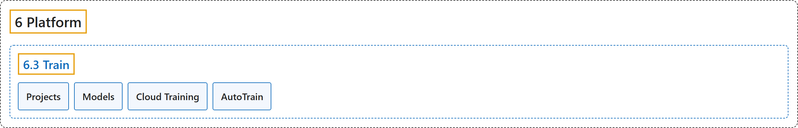

# 6.3 Train

## Classification

## Glossary

| Term | Definition | 中文翻译 | Source |
|---|---|---|---|
| **6.3 Train** 训练 | "Ultralytics Platform provides **comprehensive tools for training YOLO models, from organizing experiments to running cloud training jobs with real-time metrics streaming**." | Ultralytics Platform 提供**训练 YOLO 模型的全套工具，从组织实验到运行带实时指标流的云端训练任务**。 | [Ultralytics, n.d.-c, "Model Training", para. 1](https://docs.ultralytics.com/platform/train/#model-training) |
| **Projects** 项目 | "Ultralytics Platform projects **provide an effective solution for organizing and managing your models**." | Ultralytics Platform 的项目**提供一种组织和管理模型的有效方案**。 | [Ultralytics, n.d.-e, "Projects", para. 1](https://docs.ultralytics.com/platform/train/projects/#projects) |
| **Models** 模型 | "Ultralytics Platform provides **comprehensive model management for training, analyzing, and deploying YOLO models**." | Ultralytics Platform 提供**全面的模型管理，用于训练、分析和部署 YOLO 模型**。 | [Ultralytics, n.d.-d, "Models", para. 1](https://docs.ultralytics.com/platform/train/models/#models) |
| **Cloud Training** 云端训练 | "Ultralytics Platform Cloud Training **offers single-click training on cloud GPUs**, making model training accessible without complex setup." | Ultralytics Platform 的云端训练**提供一键式云 GPU 训练**，无需复杂配置就能训练模型。 | [Ultralytics, n.d.-b, "Cloud Training", para. 1](https://docs.ultralytics.com/platform/train/cloud-training/#cloud-training) |
| **AutoTrain** 自动训练 | "AutoTrain **uses Ask AI to help you train, compare, and improve models through a conversation**." | AutoTrain **借助 Ask AI，通过对话帮你训练、比较和改进模型**。 | [Ultralytics, n.d.-a, "AutoTrain with Ask AI", para. 1](https://docs.ultralytics.com/platform/train/autotrain/#autotrain-with-ask-ai) |

## References

Ultralytics. (n.d.-a). *AutoTrain with Ask AI*. Ultralytics YOLO Docs (ultralytics 8.4.194). Retrieved October 31, 2026, from <https://docs.ultralytics.com/platform/train/autotrain/>

Ultralytics. (n.d.-b). *Cloud Training*. Ultralytics YOLO Docs (ultralytics 8.4.194). Retrieved October 31, 2026, from <https://docs.ultralytics.com/platform/train/cloud-training/>

Ultralytics. (n.d.-c). *Model Training*. Ultralytics YOLO Docs (ultralytics 8.4.194). Retrieved October 31, 2026, from <https://docs.ultralytics.com/platform/train/>

Ultralytics. (n.d.-d). *Models*. Ultralytics YOLO Docs (ultralytics 8.4.194). Retrieved October 31, 2026, from <https://docs.ultralytics.com/platform/train/models/>

Ultralytics. (n.d.-e). *Projects*. Ultralytics YOLO Docs (ultralytics 8.4.194). Retrieved October 31, 2026, from <https://docs.ultralytics.com/platform/train/projects/>
