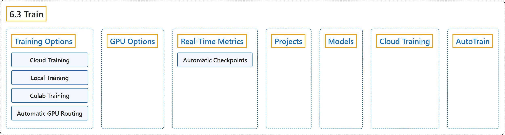

# 6.3 Train

## Classification

## Glossary

| Term | Definition | 中文翻译 | Source |
|---|---|---|---|
| **6.3 Train** 训练 | "Ultralytics Platform provides **comprehensive tools for training YOLO models, from organizing experiments to running cloud training jobs with real-time metrics streaming**." | Ultralytics Platform 提供**训练 YOLO 模型的全套工具，从组织实验到运行带实时指标流的云端训练任务**。 | [Ultralytics, n.d.-c, "Model Training", para. 1](https://docs.ultralytics.com/platform/train/#model-training) |
| **Training Options** 训练方式 | (context) "Ultralytics Platform supports **multiple training approaches**:" | （语境）Ultralytics 平台支持**多种训练方式**： | [Ultralytics, n.d.-c, "Training Options", para. 1](https://docs.ultralytics.com/platform/train/#training-options) |
| **Cloud Training** 云端训练 | "**Train on Ultralytics Cloud GPUs**" | **在 Ultralytics 云端 GPU 上训练** | [Ultralytics, n.d.-c, "Training Options", table, row 1](https://docs.ultralytics.com/platform/train/#training-options) |
| **Local Training** 本地训练 | "**Train locally, stream metrics to the platform**" | **在本地训练，把指标推送到平台** | [Ultralytics, n.d.-c, "Training Options", table, row 2](https://docs.ultralytics.com/platform/train/#training-options) |
| **Colab Training** Colab 训练 | "**Use Google Colab with platform integration**" | **借助平台集成使用 Google Colab** | [Ultralytics, n.d.-c, "Training Options", table, row 3](https://docs.ultralytics.com/platform/train/#training-options) |
| **Automatic GPU Routing** GPU 自动路由 | "When you select a GPU cheaper than the RTX PRO 6000 and Ultralytics-managed capacity is free, the Platform **runs your job on an RTX PRO 6000 while still billing your selected GPU's hourly rate**." | 当你选择比 RTX PRO 6000 便宜的 GPU 且 Ultralytics 管理的算力空闲时，平台会**在 RTX PRO 6000 上运行你的任务，但仍按你所选 GPU 的小时费率计费**。 | [Ultralytics, n.d.-c, "Training Options", Automatic GPU Routing, para. 1](https://docs.ultralytics.com/platform/train/#training-options) |
| **GPU Options** GPU 选项 | (context) "**Available GPUs for cloud training on Ultralytics Cloud**:" | （语境）**Ultralytics 云上可用于云端训练的 GPU**： | [Ultralytics, n.d.-c, "GPU Options", para. 1](https://docs.ultralytics.com/platform/train/#gpu-options) |
| **Real-Time Metrics** 实时指标 | (context) "On the model's Train tab, view **live metrics and available validation results**:" | （语境）在模型的 Train 标签页上查看**实时指标和可用的验证结果**： | [Ultralytics, n.d.-c, "Real-Time Metrics", para. 1](https://docs.ultralytics.com/platform/train/#real-time-metrics) |
| **Automatic Checkpoints** 自动检查点 | "The best checkpoint (`best.pt`, the highest-fitness epoch) is **uploaded to the Platform periodically while training runs and again when the run ends**" | 最佳检查点（`best.pt`，即适应度最高的轮次）会**在训练运行期间定期上传到平台，并在运行结束时再上传一次** | [Ultralytics, n.d.-c, "Real-Time Metrics", Automatic Checkpoints, para. 1](https://docs.ultralytics.com/platform/train/#real-time-metrics) |
| **Projects** 项目 | "Ultralytics Platform projects **provide an effective solution for organizing and managing your models**." | Ultralytics Platform 的项目**提供一种组织和管理模型的有效方案**。 | [Ultralytics, n.d.-e, "Projects", para. 1](https://docs.ultralytics.com/platform/train/projects/#projects) |
| **Models** 模型 | "Ultralytics Platform provides **comprehensive model management for training, analyzing, and deploying YOLO models**." | Ultralytics Platform 提供**全面的模型管理，用于训练、分析和部署 YOLO 模型**。 | [Ultralytics, n.d.-d, "Models", para. 1](https://docs.ultralytics.com/platform/train/models/#models) |
| **Cloud Training** 云端训练 | "Ultralytics Platform Cloud Training **offers single-click training on cloud GPUs**, making model training accessible without complex setup." | Ultralytics Platform 的云端训练**提供一键式云 GPU 训练**，无需复杂配置就能训练模型。 | [Ultralytics, n.d.-b, "Cloud Training", para. 1](https://docs.ultralytics.com/platform/train/cloud-training/#cloud-training) |
| **AutoTrain** 自动训练 | "AutoTrain **uses Ask AI to help you train, compare, and improve models through a conversation**." | AutoTrain **借助 Ask AI，通过对话帮你训练、比较和改进模型**。 | [Ultralytics, n.d.-a, "AutoTrain with Ask AI", para. 1](https://docs.ultralytics.com/platform/train/autotrain/#autotrain-with-ask-ai) |

## References

Ultralytics. (n.d.-a). *AutoTrain with Ask AI*. Ultralytics YOLO Docs (ultralytics 8.4.194). Retrieved October 31, 2026, from <https://docs.ultralytics.com/platform/train/autotrain/>

Ultralytics. (n.d.-b). *Cloud Training*. Ultralytics YOLO Docs (ultralytics 8.4.194). Retrieved October 31, 2026, from <https://docs.ultralytics.com/platform/train/cloud-training/>

Ultralytics. (n.d.-c). *Model Training*. Ultralytics YOLO Docs (ultralytics 8.4.194). Retrieved October 31, 2026, from <https://docs.ultralytics.com/platform/train/>

Ultralytics. (n.d.-d). *Models*. Ultralytics YOLO Docs (ultralytics 8.4.194). Retrieved October 31, 2026, from <https://docs.ultralytics.com/platform/train/models/>

Ultralytics. (n.d.-e). *Projects*. Ultralytics YOLO Docs (ultralytics 8.4.194). Retrieved October 31, 2026, from <https://docs.ultralytics.com/platform/train/projects/>
