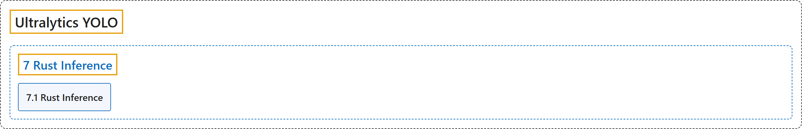

# 7. Rust Inference

## Classification

## Glossary

| Term | Definition | 中文翻译 | Source |
|---|---|---|---|
| **7 Rust Inference** Rust 推理 | "Ultralytics Inference is **a high-performance YOLO inference library and command-line tool written in Rust**." | Ultralytics Inference 是**一个用 Rust 编写的高性能 YOLO 推理库和命令行工具**。 | [Ultralytics, n.d., "Ultralytics Inference for Rust", para. 1](https://docs.ultralytics.com/inference/#ultralytics-inference-for-rust) |
| **[7.1 Rust Inference](rust-inference.md)** Rust 推理 | "Ultralytics Inference is **a high-performance YOLO inference library and command-line tool written in Rust**." | Ultralytics Inference 是**一个用 Rust 编写的高性能 YOLO 推理库和命令行工具**。 | [Ultralytics, n.d., "Ultralytics Inference for Rust", para. 1](https://docs.ultralytics.com/inference/#ultralytics-inference-for-rust) |

## References

Ultralytics. (n.d.). *Ultralytics Inference for Rust*. Ultralytics YOLO Docs (ultralytics 8.4.194). Retrieved October 31, 2026, from <https://docs.ultralytics.com/inference/>
