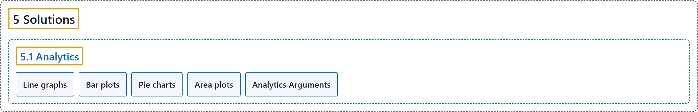

# 5.1 Analytics

## Classification

## Glossary

| Term | Definition | 中文翻译 | Source |
|---|---|---|---|
| **5.1 Analytics** 分析 | "Analytics with Ultralytics YOLO26 **turns object detection and tracking results into real-time charts**, so you can watch how object counts change across a video frame by frame." | Ultralytics YOLO26 的分析功能**把目标检测和跟踪结果转换成实时图表**，让你逐帧观察视频中物体数量的变化。 | [Ultralytics, n.d., "Analytics using Ultralytics YOLO26", para. 1](https://docs.ultralytics.com/guides/analytics/#analytics-using-ultralytics-yolo26) |
| **Line graphs** 折线图 | "Line graphs **are ideal for tracking changes over short and long periods and for comparing changes for multiple groups over the same period.**" | 折线图**适合跟踪短期和长期的变化，并比较多个组在同一时期内的变化。** | [Ultralytics, n.d., "Why Visualize Detection Data?", item 1](https://docs.ultralytics.com/guides/analytics/#why-visualize-detection-data) |
| **Bar plots** 条形图 | "Bar plots **are suitable for comparing quantities across different categories and showing relationships between a category and its numerical value.**" | 条形图**适合比较不同类别之间的数量，并展示某个类别与其数值之间的关系。** | [Ultralytics, n.d., "Why Visualize Detection Data?", item 2](https://docs.ultralytics.com/guides/analytics/#why-visualize-detection-data) |
| **Pie charts** 饼图 | "Pie charts **are effective for illustrating proportions among categories and showing parts of a whole.**" | 饼图**能有效地说明各类别之间的比例，并展示整体中的各个部分。** | [Ultralytics, n.d., "Why Visualize Detection Data?", item 3](https://docs.ultralytics.com/guides/analytics/#why-visualize-detection-data) |
| **Area plots** 面积图 | "Area plots **fill the line graph so per-class object counts over time are easier to read at a glance.**" | 面积图**填充折线图，使各类别对象计数随时间的变化一眼就能看清。** | [Ultralytics, n.d., "Why Visualize Detection Data?", item 4](https://docs.ultralytics.com/guides/analytics/#why-visualize-detection-data) |
| **Analytics Arguments** Analytics 参数 | (context) "Here's a table outlining the **Analytics arguments**:" | （语境）下表列出了 **Analytics 的参数**： | [Ultralytics, n.d., "Analytics Arguments", para. 1](https://docs.ultralytics.com/guides/analytics/#analytics-arguments) |

## References

Ultralytics. (n.d.). *Analytics using Ultralytics YOLO26*. Ultralytics YOLO Docs (ultralytics 8.4.194). Retrieved October 31, 2026, from <https://docs.ultralytics.com/guides/analytics/>
