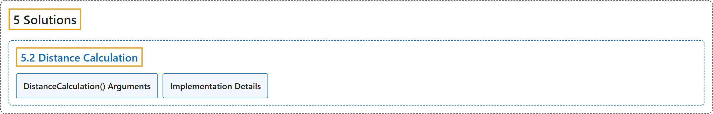

# 5.2 Distance Calculation

## Classification

## Glossary

| Term | Definition | 中文翻译 | Source |
|---|---|---|---|
| **5.2 Distance Calculation** 距离计算 | "Distance calculation is **the process of measuring the space between two detected objects within an image or video frame**." | 距离计算是**测量图像或视频帧中两个被检测物体之间距离的过程**。 | [Ultralytics, n.d., "Distance Calculation using Ultralytics YOLO26", para. 1](https://docs.ultralytics.com/guides/distance-calculation/#distance-calculation-using-ultralytics-yolo26) |
| **DistanceCalculation() Arguments** DistanceCalculation() 参数 | (context) "Here's a table with the **`DistanceCalculation` arguments**:" | （语境）下表列出了 **`DistanceCalculation` 的参数**： | [Ultralytics, n.d., "DistanceCalculation() Arguments", para. 1](https://docs.ultralytics.com/guides/distance-calculation/#distancecalculation-arguments) |
| **Implementation Details** 实现细节 | "The `DistanceCalculation` class works by **tracking objects across video frames and calculating the Euclidean distance between the centroids of selected bounding boxes**." | `DistanceCalculation` 类的工作方式是**在视频帧之间跟踪对象，并计算所选边界框质心之间的欧几里得距离**。 | [Ultralytics, n.d., "Implementation Details", para. 1](https://docs.ultralytics.com/guides/distance-calculation/#implementation-details) |

## References

Ultralytics. (n.d.). *Distance Calculation using Ultralytics YOLO26*. Ultralytics YOLO Docs (ultralytics 8.4.194). Retrieved October 31, 2026, from <https://docs.ultralytics.com/guides/distance-calculation/>
