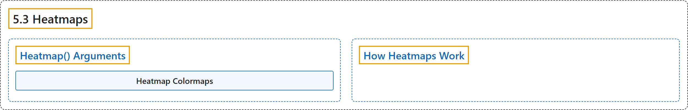

# 5.3 Heatmaps

## Classification

## Glossary

| Term | Definition | 中文翻译 | Source |
|---|---|---|---|
| **5.3 Heatmaps** 热力图 | "The Heatmap solution in Ultralytics YOLO26 **tracks objects across video frames and overlays their accumulated movement intensity onto each frame**, so busy areas glow in warm colors while quiet areas stay cool." | Ultralytics YOLO26 的热力图方案**在各视频帧中跟踪物体，并把它们累积的运动强度叠加到每一帧上**，繁忙区域显示暖色，安静区域保持冷色。 | [Ultralytics, n.d., "Object Tracking Heatmaps with Ultralytics YOLO26", para. 1](https://docs.ultralytics.com/guides/heatmaps/#object-tracking-heatmaps-with-ultralytics-yolo26) |
| **Heatmap() Arguments** Heatmap() 参数 | (context) "Here's a table with the **`Heatmap` arguments**:" | （语境）下表列出了 **`Heatmap` 的参数**： | [Ultralytics, n.d., "Heatmap() Arguments", para. 1](https://docs.ultralytics.com/guides/heatmaps/#heatmap-arguments) |
| **Heatmap Colormaps** 热力图颜色映射 | "The `colormap` argument **accepts any OpenCV colormap**." | `colormap` 参数**接受任何 OpenCV 颜色映射**。 | [Ultralytics, n.d., "Heatmap Colormaps", para. 1](https://docs.ultralytics.com/guides/heatmaps/#heatmap-colormaps) |
| **How Heatmaps Work** 热力图的工作原理 | "Once per frame, **the accumulated intensity layer is normalized, colorized with the selected colormap, and blended with the original frame**." | 每一帧都会**将累积的强度层归一化，用所选颜色映射着色，再与原始帧混合**。 | [Ultralytics, n.d., "How Heatmaps Work", para. 2](https://docs.ultralytics.com/guides/heatmaps/#how-heatmaps-work) |

## References

Ultralytics. (n.d.). *Object Tracking Heatmaps with Ultralytics YOLO26*. Ultralytics YOLO Docs (ultralytics 8.4.194). Retrieved October 31, 2026, from <https://docs.ultralytics.com/guides/heatmaps/>
