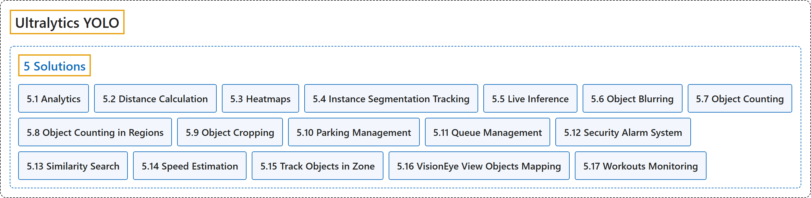

# 5. Solutions

## Classification

## Glossary

| Term | Definition | 中文翻译 | Source |
|---|---|---|---|
| **5 Solutions** 解决方案 | "Ultralytics Solutions provide **cutting-edge applications of YOLO models, offering real-world solutions like object counting, blurring, and security systems**, enhancing efficiency and accuracy in diverse industries." | Ultralytics Solutions 提供 **YOLO 模型的前沿应用，给出目标计数、模糊处理、安防系统等真实场景的解决方案**，在各行各业提升效率和准确率。 | [Ultralytics, n.d.-p, "Ultralytics Solutions: Harness YOLO26 to Solve Real-World Problems", para. 1](https://docs.ultralytics.com/solutions/#ultralytics-solutions-harness-yolo26-to-solve-real-world-problems) |
| **[5.1 Analytics](analytics.md)** 分析 | "Analytics with Ultralytics YOLO26 **turns object detection and tracking results into real-time charts**, so you can watch how object counts change across a video frame by frame." | Ultralytics YOLO26 的分析功能**把目标检测和跟踪结果转换成实时图表**，让你逐帧观察视频中物体数量的变化。 | [Ultralytics, n.d.-a, "Analytics using Ultralytics YOLO26", para. 1](https://docs.ultralytics.com/guides/analytics/#analytics-using-ultralytics-yolo26) |
| **[5.2 Distance Calculation](distance-calculation.md)** 距离计算 | "Distance calculation is **the process of measuring the space between two detected objects within an image or video frame**." | 距离计算是**测量图像或视频帧中两个被检测物体之间距离的过程**。 | [Ultralytics, n.d.-c, "Distance Calculation using Ultralytics YOLO26", para. 1](https://docs.ultralytics.com/guides/distance-calculation/#distance-calculation-using-ultralytics-yolo26) |
| **[5.3 Heatmaps](heatmaps.md)** 热力图 | "The Heatmap solution in Ultralytics YOLO26 **tracks objects across video frames and overlays their accumulated movement intensity onto each frame**, so busy areas glow in warm colors while quiet areas stay cool." | Ultralytics YOLO26 的热力图方案**在各视频帧中跟踪物体，并把它们累积的运动强度叠加到每一帧上**，繁忙区域显示暖色，安静区域保持冷色。 | [Ultralytics, n.d.-k, "Object Tracking Heatmaps with Ultralytics YOLO26", para. 1](https://docs.ultralytics.com/guides/heatmaps/#object-tracking-heatmaps-with-ultralytics-yolo26) |
| **[5.4 Instance Segmentation Tracking](instance-segmentation-tracking.md)** 实例分割跟踪 | (context) "Instance segmentation is **a computer vision task that involves identifying and outlining individual objects in an image at the pixel level**." | （语境）实例分割是**一项在像素级别识别并勾勒图像中各个物体的计算机视觉任务**。 | [Ultralytics, n.d.-e, "Instance Segmentation and Tracking using Ultralytics YOLO26", para. 1](https://docs.ultralytics.com/guides/instance-segmentation-and-tracking/#instance-segmentation-and-tracking-using-ultralytics-yolo26) |
| **[5.5 Live Inference](live-inference.md)** 实时推理 | (context) "Combining this with Ultralytics YOLO26 allows for **real-time object detection and analysis directly in your browser**." | （语境）把它与 Ultralytics YOLO26 结合，就能**直接在浏览器中进行实时目标检测和分析**。 | [Ultralytics, n.d.-f, "Live Inference with Streamlit Application using Ultralytics YOLO26", para. 1](https://docs.ultralytics.com/guides/streamlit-live-inference/#live-inference-with-streamlit-application-using-ultralytics-yolo26) |
| **[5.6 Object Blurring](object-blurring.md)** 物体模糊 | "Object blurring with Ultralytics YOLO26 involves **applying a blurring effect to specific detected objects in an image or video**." | Ultralytics YOLO26 的物体模糊是**对图像或视频中特定的被检测物体施加模糊效果**。 | [Ultralytics, n.d.-g, "Object Blurring using Ultralytics YOLO26", para. 1](https://docs.ultralytics.com/guides/object-blurring/#object-blurring-using-ultralytics-yolo26) |
| **[5.7 Object Counting](object-counting.md)** 物体计数 | "Object counting with Ultralytics YOLO26 involves **accurate identification and counting of specific objects in videos and camera streams**." | Ultralytics YOLO26 的物体计数是**在视频和摄像头流中准确识别并计数特定物体**。 | [Ultralytics, n.d.-i, "Object Counting using Ultralytics YOLO26", para. 1](https://docs.ultralytics.com/guides/object-counting/#object-counting-using-ultralytics-yolo26) |
| **[5.8 Object Counting in Regions](object-counting-in-regions.md)** 区域内物体计数 | "The RegionCounter solution in Ultralytics YOLO26 **tracks objects across video frames and, on every frame, counts the objects whose bounding-box center falls inside each region you define**." | Ultralytics YOLO26 的 RegionCounter 方案**在各视频帧中跟踪物体，并在每一帧统计边界框中心落在你定义的各个区域内的物体数量**。 | [Ultralytics, n.d.-h, "Object Counting in Regions with Ultralytics YOLO26", para. 1](https://docs.ultralytics.com/guides/region-counting/#object-counting-in-regions-with-ultralytics-yolo26) |
| **[5.9 Object Cropping](object-cropping.md)** 物体裁剪 | "Object cropping with Ultralytics YOLO26 involves **isolating and extracting specific detected objects from an image or video**." | Ultralytics YOLO26 的物体裁剪是**从图像或视频中分离并提取特定的被检测物体**。 | [Ultralytics, n.d.-j, "Object Cropping using Ultralytics YOLO26", para. 1](https://docs.ultralytics.com/guides/object-cropping/#object-cropping-using-ultralytics-yolo26) |
| **[5.10 Parking Management](parking-management.md)** 停车管理 | "A parking management system built with Ultralytics YOLO26 **detects vehicles in real time to track which parking spaces are occupied or available, then reports live lot occupancy**." | 用 Ultralytics YOLO26 构建的停车管理系统**实时检测车辆，跟踪哪些车位被占用、哪些空闲，并报告停车场的实时占用情况**。 | [Ultralytics, n.d.-b, "Build a Parking Management System with Ultralytics YOLO26", para. 1](https://docs.ultralytics.com/guides/parking-management/#build-a-parking-management-system-with-ultralytics-yolo26) |
| **[5.11 Queue Management](queue-management.md)** 排队管理 | "Queue management using Ultralytics YOLO26 involves **organizing and controlling lines of people or vehicles to reduce wait times and enhance efficiency**." | 用 Ultralytics YOLO26 进行排队管理，是**组织和控制人或车辆的队列，以减少等待时间、提高效率**。 | [Ultralytics, n.d.-l, "Queue Management using Ultralytics YOLO26", para. 1](https://docs.ultralytics.com/guides/queue-management/#queue-management-using-ultralytics-yolo26) |
| **[5.12 Security Alarm System](security-alarm-system.md)** 安防报警系统 | "The Security Alarm System Project utilizing Ultralytics YOLO26 **integrates advanced computer vision capabilities to enhance security measures**." | 基于 Ultralytics YOLO26 的安防报警系统项目**集成了先进的计算机视觉能力，以加强安防措施**。 | [Ultralytics, n.d.-m, "Security Alarm System Project Using Ultralytics YOLO26", para. 1](https://docs.ultralytics.com/guides/security-alarm-system/#security-alarm-system-project-using-ultralytics-yolo26) |
| **[5.13 Similarity Search](similarity-search.md)** 相似度搜索 | (context) "This guide walks you through **building a semantic image search engine using OpenAI CLIP and Flask**." | （语境）本指南带你**用 OpenAI CLIP 和 Flask 构建一个语义图像搜索引擎**。 | [Ultralytics, n.d.-d, "How to Build Semantic Image Search with OpenAI CLIP", para. 1](https://docs.ultralytics.com/guides/similarity-search/#how-to-build-semantic-image-search-with-openai-clip) |
| **[5.14 Speed Estimation](speed-estimation.md)** 速度估计 | "Speed estimation is **the process of calculating the rate of movement of an object within a given context**, often employed in computer vision applications." | 速度估计是**计算物体在给定情境中运动速率的过程**，常用于计算机视觉应用。 | [Ultralytics, n.d.-n, "Speed Estimation using Ultralytics YOLO26", para. 1](https://docs.ultralytics.com/guides/speed-estimation/#speed-estimation-using-ultralytics-yolo26) |
| **[5.15 Track Objects in Zone](track-objects-in-zone.md)** 区域内物体跟踪 | "TrackZone **specializes in monitoring objects within designated areas of a frame instead of the whole frame**." | TrackZone **专门监控画面中指定区域内的物体，而不是整个画面**。 | [Ultralytics, n.d.-o, "TrackZone using Ultralytics YOLO26", para. 1](https://docs.ultralytics.com/guides/trackzone/#trackzone-using-ultralytics-yolo26) |
| **[5.16 VisionEye View Objects Mapping](visioneye-view-objects-mapping.md)** VisionEye 视角物体映射 | "Ultralytics YOLO26 VisionEye offers **the capability for computers to identify and pinpoint objects, simulating the observational precision of the human eye**." | Ultralytics YOLO26 VisionEye 让**计算机能够识别并精确定位物体，模拟人眼观察的精确度**。 | [Ultralytics, n.d.-q, "VisionEye View Object Mapping using Ultralytics YOLO26", para. 1](https://docs.ultralytics.com/guides/vision-eye/#visioneye-view-object-mapping-using-ultralytics-yolo26) |
| **[5.17 Workouts Monitoring](workouts-monitoring.md)** 健身监测 | "Monitoring workouts through pose estimation with Ultralytics YOLO26 **enhances exercise assessment by accurately tracking key body landmarks and joints in real-time**." | 用 Ultralytics YOLO26 的姿态估计监测健身，**通过实时准确跟踪身体关键部位和关节来改进运动评估**。 | [Ultralytics, n.d.-r, "Workouts Monitoring using Ultralytics YOLO26", para. 1](https://docs.ultralytics.com/guides/workouts-monitoring/#workouts-monitoring-using-ultralytics-yolo26) |

## References

Ultralytics. (n.d.-a). *Analytics using Ultralytics YOLO26*. Ultralytics YOLO Docs (ultralytics 8.4.194). Retrieved October 31, 2026, from <https://docs.ultralytics.com/guides/analytics/>

Ultralytics. (n.d.-b). *Build a Parking Management System with Ultralytics YOLO26*. Ultralytics YOLO Docs (ultralytics 8.4.194). Retrieved October 31, 2026, from <https://docs.ultralytics.com/guides/parking-management/>

Ultralytics. (n.d.-c). *Distance Calculation using Ultralytics YOLO26*. Ultralytics YOLO Docs (ultralytics 8.4.194). Retrieved October 31, 2026, from <https://docs.ultralytics.com/guides/distance-calculation/>

Ultralytics. (n.d.-d). *How to Build Semantic Image Search with OpenAI CLIP*. Ultralytics YOLO Docs (ultralytics 8.4.194). Retrieved October 31, 2026, from <https://docs.ultralytics.com/guides/similarity-search/>

Ultralytics. (n.d.-e). *Instance Segmentation and Tracking using Ultralytics YOLO26*. Ultralytics YOLO Docs (ultralytics 8.4.194). Retrieved October 31, 2026, from <https://docs.ultralytics.com/guides/instance-segmentation-and-tracking/>

Ultralytics. (n.d.-f). *Live Inference with Streamlit Application using Ultralytics YOLO26*. Ultralytics YOLO Docs (ultralytics 8.4.194). Retrieved October 31, 2026, from <https://docs.ultralytics.com/guides/streamlit-live-inference/>

Ultralytics. (n.d.-g). *Object Blurring using Ultralytics YOLO26*. Ultralytics YOLO Docs (ultralytics 8.4.194). Retrieved October 31, 2026, from <https://docs.ultralytics.com/guides/object-blurring/>

Ultralytics. (n.d.-h). *Object Counting in Regions with Ultralytics YOLO26*. Ultralytics YOLO Docs (ultralytics 8.4.194). Retrieved October 31, 2026, from <https://docs.ultralytics.com/guides/region-counting/>

Ultralytics. (n.d.-i). *Object Counting using Ultralytics YOLO26*. Ultralytics YOLO Docs (ultralytics 8.4.194). Retrieved October 31, 2026, from <https://docs.ultralytics.com/guides/object-counting/>

Ultralytics. (n.d.-j). *Object Cropping using Ultralytics YOLO26*. Ultralytics YOLO Docs (ultralytics 8.4.194). Retrieved October 31, 2026, from <https://docs.ultralytics.com/guides/object-cropping/>

Ultralytics. (n.d.-k). *Object Tracking Heatmaps with Ultralytics YOLO26*. Ultralytics YOLO Docs (ultralytics 8.4.194). Retrieved October 31, 2026, from <https://docs.ultralytics.com/guides/heatmaps/>

Ultralytics. (n.d.-l). *Queue Management using Ultralytics YOLO26*. Ultralytics YOLO Docs (ultralytics 8.4.194). Retrieved October 31, 2026, from <https://docs.ultralytics.com/guides/queue-management/>

Ultralytics. (n.d.-m). *Security Alarm System Project Using Ultralytics YOLO26*. Ultralytics YOLO Docs (ultralytics 8.4.194). Retrieved October 31, 2026, from <https://docs.ultralytics.com/guides/security-alarm-system/>

Ultralytics. (n.d.-n). *Speed Estimation using Ultralytics YOLO26*. Ultralytics YOLO Docs (ultralytics 8.4.194). Retrieved October 31, 2026, from <https://docs.ultralytics.com/guides/speed-estimation/>

Ultralytics. (n.d.-o). *TrackZone using Ultralytics YOLO26*. Ultralytics YOLO Docs (ultralytics 8.4.194). Retrieved October 31, 2026, from <https://docs.ultralytics.com/guides/trackzone/>

Ultralytics. (n.d.-p). *Ultralytics Solutions: Harness YOLO26 to Solve Real-World Problems*. Ultralytics YOLO Docs (ultralytics 8.4.194). Retrieved October 31, 2026, from <https://docs.ultralytics.com/solutions/>

Ultralytics. (n.d.-q). *VisionEye View Object Mapping using Ultralytics YOLO26*. Ultralytics YOLO Docs (ultralytics 8.4.194). Retrieved October 31, 2026, from <https://docs.ultralytics.com/guides/vision-eye/>

Ultralytics. (n.d.-r). *Workouts Monitoring using Ultralytics YOLO26*. Ultralytics YOLO Docs (ultralytics 8.4.194). Retrieved October 31, 2026, from <https://docs.ultralytics.com/guides/workouts-monitoring/>
