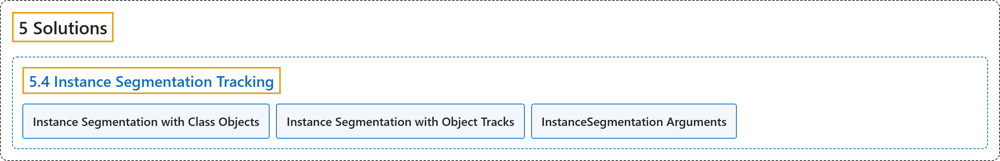

# 5.4 Instance Segmentation Tracking

## Classification

## Glossary

| Term | Definition | 中文翻译 | Source |
|---|---|---|---|
| **5.4 Instance Segmentation Tracking** 实例分割跟踪 | (context) "Instance segmentation is **a computer vision task that involves identifying and outlining individual objects in an image at the pixel level**." | （语境）实例分割是**一项在像素级别识别并勾勒图像中各个物体的计算机视觉任务**。 | [Ultralytics, n.d., "Instance Segmentation and Tracking using Ultralytics YOLO26", para. 1](https://docs.ultralytics.com/guides/instance-segmentation-and-tracking/#instance-segmentation-and-tracking-using-ultralytics-yolo26) |
| **Instance Segmentation with Class Objects** 按类别对象的实例分割 | "Instance Segmentation with Class Objects: **Each class object is assigned a unique color for clear visual separation.**" | 按类别对象的实例分割：为**每个类别对象分配一种独特的颜色，以便在视觉上清晰区分。** | [Ultralytics, n.d., "What is Instance Segmentation?", item 1](https://docs.ultralytics.com/guides/instance-segmentation-and-tracking/#what-is-instance-segmentation) |
| **Instance Segmentation with Object Tracks** 按对象轨迹的实例分割 | "Instance Segmentation with Object Tracks: **Every track is represented by a distinct color**, facilitating easy identification and tracking across video frames." | 按对象轨迹的实例分割：用**一种不同的颜色表示每条轨迹**，便于在视频帧之间轻松识别和跟踪。 | [Ultralytics, n.d., "What is Instance Segmentation?", item 2](https://docs.ultralytics.com/guides/instance-segmentation-and-tracking/#what-is-instance-segmentation) |
| **InstanceSegmentation Arguments** InstanceSegmentation 参数 | (context) "Here's a table with the **`InstanceSegmentation` arguments**:" | （语境）下表列出了 **`InstanceSegmentation` 的参数**： | [Ultralytics, n.d., "InstanceSegmentation Arguments", para. 1](https://docs.ultralytics.com/guides/instance-segmentation-and-tracking/#instancesegmentation-arguments) |

## References

Ultralytics. (n.d.). *Instance Segmentation and Tracking using Ultralytics YOLO26*. Ultralytics YOLO Docs (ultralytics 8.4.194). Retrieved October 31, 2026, from <https://docs.ultralytics.com/guides/instance-segmentation-and-tracking/>
