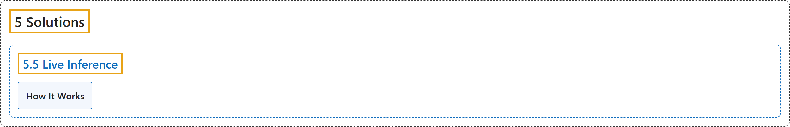

# 5.5 Live Inference

## Classification

## Glossary

| Term | Definition | 中文翻译 | Source |
|---|---|---|---|
| **5.5 Live Inference** 实时推理 | (context) "Combining this with Ultralytics YOLO26 allows for **real-time object detection and analysis directly in your browser**." | （语境）把它与 Ultralytics YOLO26 结合，就能**直接在浏览器中进行实时目标检测和分析**。 | [Ultralytics, n.d., "Live Inference with Streamlit Application using Ultralytics YOLO26", para. 1](https://docs.ultralytics.com/guides/streamlit-live-inference/#live-inference-with-streamlit-application-using-ultralytics-yolo26) |
| **How It Works** 工作原理 | "Under the hood, the Streamlit application **uses the Ultralytics solutions module to create an interactive interface**." | 在底层，Streamlit 应用**使用 Ultralytics solutions 模块来创建交互式界面**。 | [Ultralytics, n.d., "How It Works", para. 1](https://docs.ultralytics.com/guides/streamlit-live-inference/#how-it-works) |

## References

Ultralytics. (n.d.). *Live Inference with Streamlit Application using Ultralytics YOLO26*. Ultralytics YOLO Docs (ultralytics 8.4.194). Retrieved October 31, 2026, from <https://docs.ultralytics.com/guides/streamlit-live-inference/>
