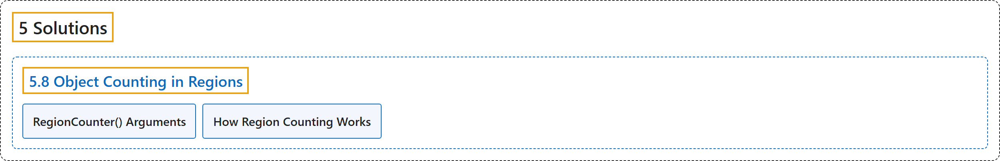

# 5.8 Object Counting in Regions

## Classification

## Glossary

| Term | Definition | 中文翻译 | Source |
|---|---|---|---|
| **5.8 Object Counting in Regions** 区域内物体计数 | "The RegionCounter solution in Ultralytics YOLO26 **tracks objects across video frames and, on every frame, counts the objects whose bounding-box center falls inside each region you define**." | Ultralytics YOLO26 的 RegionCounter 方案**在各视频帧中跟踪物体，并在每一帧统计边界框中心落在你定义的各个区域内的物体数量**。 | [Ultralytics, n.d., "Object Counting in Regions with Ultralytics YOLO26", para. 1](https://docs.ultralytics.com/guides/region-counting/#object-counting-in-regions-with-ultralytics-yolo26) |
| **RegionCounter() Arguments** RegionCounter() 参数 | (context) "Here's a table with the **`RegionCounter` arguments**:" | （语境）下表列出了 **`RegionCounter` 的参数**： | [Ultralytics, n.d., "RegionCounter() Arguments", para. 1](https://docs.ultralytics.com/guides/region-counting/#regioncounter-arguments) |
| **How Region Counting Works** 区域计数的工作原理 | "The RegionCounter solution **turns each region you pass into a polygon, with at least three points per region**." | RegionCounter 解决方案**把你传入的每个区域转换成一个多边形，每个区域至少有三个点**。 | [Ultralytics, n.d., "How Region Counting Works", para. 1](https://docs.ultralytics.com/guides/region-counting/#how-region-counting-works) |

## References

Ultralytics. (n.d.). *Object Counting in Regions with Ultralytics YOLO26*. Ultralytics YOLO Docs (ultralytics 8.4.194). Retrieved October 31, 2026, from <https://docs.ultralytics.com/guides/region-counting/>
