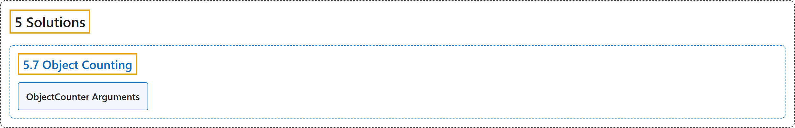

# 5.7 Object Counting

## Classification

## Glossary

| Term | Definition | 中文翻译 | Source |
|---|---|---|---|
| **5.7 Object Counting** 物体计数 | "Object counting with Ultralytics YOLO26 involves **accurate identification and counting of specific objects in videos and camera streams**." | Ultralytics YOLO26 的物体计数是**在视频和摄像头流中准确识别并计数特定物体**。 | [Ultralytics, n.d., "Object Counting using Ultralytics YOLO26", para. 1](https://docs.ultralytics.com/guides/object-counting/#object-counting-using-ultralytics-yolo26) |
| **ObjectCounter Arguments** ObjectCounter 参数 | (context) "Here's a table with the **`ObjectCounter` arguments**:" | （语境）下表列出了 **`ObjectCounter` 的参数**： | [Ultralytics, n.d., "ObjectCounter Arguments", para. 1](https://docs.ultralytics.com/guides/object-counting/#objectcounter-arguments) |

## References

Ultralytics. (n.d.). *Object Counting using Ultralytics YOLO26*. Ultralytics YOLO Docs (ultralytics 8.4.194). Retrieved October 31, 2026, from <https://docs.ultralytics.com/guides/object-counting/>
