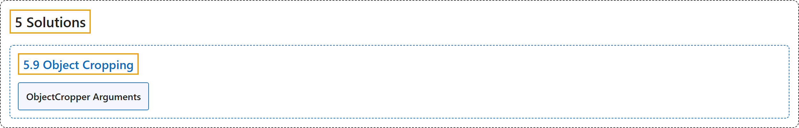

# 5.9 Object Cropping

## Classification

## Glossary

| Term | Definition | 中文翻译 | Source |
|---|---|---|---|
| **5.9 Object Cropping** 物体裁剪 | "Object cropping with Ultralytics YOLO26 involves **isolating and extracting specific detected objects from an image or video**." | Ultralytics YOLO26 的物体裁剪是**从图像或视频中分离并提取特定的被检测物体**。 | [Ultralytics, n.d., "Object Cropping using Ultralytics YOLO26", para. 1](https://docs.ultralytics.com/guides/object-cropping/#object-cropping-using-ultralytics-yolo26) |
| **ObjectCropper Arguments** ObjectCropper 参数 | (context) "Here's a table with the **`ObjectCropper` arguments**:" | （语境）下表列出了 **`ObjectCropper` 的参数**： | [Ultralytics, n.d., "ObjectCropper Arguments", para. 1](https://docs.ultralytics.com/guides/object-cropping/#objectcropper-arguments) |

## References

Ultralytics. (n.d.). *Object Cropping using Ultralytics YOLO26*. Ultralytics YOLO Docs (ultralytics 8.4.194). Retrieved October 31, 2026, from <https://docs.ultralytics.com/guides/object-cropping/>
