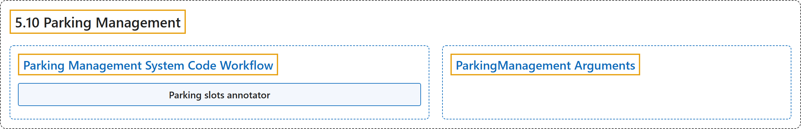

# 5.10 Parking Management

## Classification

## Glossary

| Term | Definition | 中文翻译 | Source |
|---|---|---|---|
| **5.10 Parking Management** 停车管理 | "A parking management system built with Ultralytics YOLO26 **detects vehicles in real time to track which parking spaces are occupied or available, then reports live lot occupancy**." | 用 Ultralytics YOLO26 构建的停车管理系统**实时检测车辆，跟踪哪些车位被占用、哪些空闲，并报告停车场的实时占用情况**。 | [Ultralytics, n.d., "Build a Parking Management System with Ultralytics YOLO26", para. 1](https://docs.ultralytics.com/guides/parking-management/#build-a-parking-management-system-with-ultralytics-yolo26) |
| **Parking Management System Code Workflow** 停车管理系统代码流程 | (No definition) | （无定义） | [Ultralytics, n.d., "Parking Management System Code Workflow"](https://docs.ultralytics.com/guides/parking-management/#parking-management-system-code-workflow) |
| **Parking slots annotator** 停车位标注工具 | "Ultralytics streamlines this process by providing a tool "Parking slots annotator" that **lets you define parking lot areas**, which can be utilized later for additional processing." | Ultralytics 提供了一个工具“Parking slots annotator”来简化这一过程，它**让你定义停车场区域**，这些区域之后可用于进一步处理。 | [Ultralytics, n.d., "Parking Management System Code Workflow", para. 1](https://docs.ultralytics.com/guides/parking-management/#parking-management-system-code-workflow) |
| **ParkingManagement Arguments** ParkingManagement 参数 | (context) "Here's a table with the **`ParkingManagement` arguments**:" | （语境）下表列出了 **`ParkingManagement` 的参数**： | [Ultralytics, n.d., "ParkingManagement Arguments", para. 1](https://docs.ultralytics.com/guides/parking-management/#parkingmanagement-arguments) |

## References

Ultralytics. (n.d.). *Build a Parking Management System with Ultralytics YOLO26*. Ultralytics YOLO Docs (ultralytics 8.4.194). Retrieved October 31, 2026, from <https://docs.ultralytics.com/guides/parking-management/>
