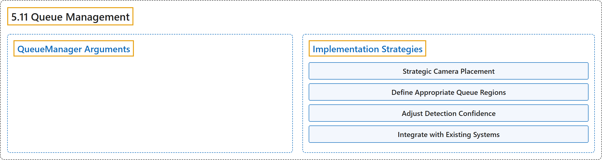

# 5.11 Queue Management

## Classification

## Glossary

| Term | Definition | 中文翻译 | Source |
|---|---|---|---|
| **5.11 Queue Management** 排队管理 | "Queue management using Ultralytics YOLO26 involves **organizing and controlling lines of people or vehicles to reduce wait times and enhance efficiency**." | 用 Ultralytics YOLO26 进行排队管理，是**组织和控制人或车辆的队列，以减少等待时间、提高效率**。 | [Ultralytics, n.d., "Queue Management using Ultralytics YOLO26", para. 1](https://docs.ultralytics.com/guides/queue-management/#queue-management-using-ultralytics-yolo26) |
| **QueueManager Arguments** QueueManager 参数 | (context) "Here's a table with the **`QueueManager` arguments**:" | （语境）下表列出了 **`QueueManager` 的参数**： | [Ultralytics, n.d., "QueueManager Arguments", para. 1](https://docs.ultralytics.com/guides/queue-management/#queuemanager-arguments) |
| **Implementation Strategies** 实施策略 | (context) "When implementing queue management with YOLO26, consider these **best practices**:" | （语境）用 YOLO26 实施队列管理时，请考虑以下**最佳实践**： | [Ultralytics, n.d., "Implementation Strategies", para. 1](https://docs.ultralytics.com/guides/queue-management/#implementation-strategies) |
| **Strategic Camera Placement** 策略性摄像头布置 | "Strategic Camera Placement: **Position cameras to capture the entire queue area without obstructions.**" | 策略性摄像头布置：要**合理安放摄像头，无遮挡地拍到整个排队区域。** | [Ultralytics, n.d., "Implementation Strategies", item 1](https://docs.ultralytics.com/guides/queue-management/#implementation-strategies) |
| **Define Appropriate Queue Regions** 定义合适的队列区域 | "Define Appropriate Queue Regions: **Carefully set queue boundaries based on the physical layout of your space.**" | 定义合适的队列区域：要**根据空间的实际布局仔细设定队列边界。** | [Ultralytics, n.d., "Implementation Strategies", item 2](https://docs.ultralytics.com/guides/queue-management/#implementation-strategies) |
| **Adjust Detection Confidence** 调整检测置信度 | "Adjust Detection Confidence: **Fine-tune the confidence threshold based on lighting conditions and crowd density.**" | 调整检测置信度：要**根据光照条件和人群密度微调置信度阈值。** | [Ultralytics, n.d., "Implementation Strategies", item 3](https://docs.ultralytics.com/guides/queue-management/#implementation-strategies) |
| **Integrate with Existing Systems** 与现有系统集成 | "Integrate with Existing Systems: **Connect your queue management solution with digital signage or staff notification systems for automated responses.**" | 与现有系统集成：要**把队列管理方案与数字标牌或员工通知系统连接起来，实现自动响应。** | [Ultralytics, n.d., "Implementation Strategies", item 4](https://docs.ultralytics.com/guides/queue-management/#implementation-strategies) |

## References

Ultralytics. (n.d.). *Queue Management using Ultralytics YOLO26*. Ultralytics YOLO Docs (ultralytics 8.4.194). Retrieved October 31, 2026, from <https://docs.ultralytics.com/guides/queue-management/>
