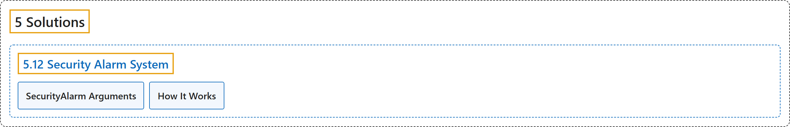

# 5.12 Security Alarm System

## Classification

## Glossary

| Term | Definition | 中文翻译 | Source |
|---|---|---|---|
| **5.12 Security Alarm System** 安防报警系统 | "The Security Alarm System Project utilizing Ultralytics YOLO26 **integrates advanced computer vision capabilities to enhance security measures**." | 基于 Ultralytics YOLO26 的安防报警系统项目**集成了先进的计算机视觉能力，以加强安防措施**。 | [Ultralytics, n.d., "Security Alarm System Project Using Ultralytics YOLO26", para. 1](https://docs.ultralytics.com/guides/security-alarm-system/#security-alarm-system-project-using-ultralytics-yolo26) |
| **SecurityAlarm Arguments** SecurityAlarm 参数 | (context) "Here's a table with the **`SecurityAlarm` arguments**:" | （语境）下表列出了 **`SecurityAlarm` 的参数**： | [Ultralytics, n.d., "SecurityAlarm Arguments", para. 1](https://docs.ultralytics.com/guides/security-alarm-system/#securityalarm-arguments) |
| **How It Works** 工作原理 | "The Security Alarm System **uses object tracking to monitor video feeds and detect potential security threats**." | 安全报警系统**使用对象跟踪来监控视频流并检测潜在的安全威胁**。 | [Ultralytics, n.d., "How It Works", para. 1](https://docs.ultralytics.com/guides/security-alarm-system/#how-it-works) |

## References

Ultralytics. (n.d.). *Security Alarm System Project Using Ultralytics YOLO26*. Ultralytics YOLO Docs (ultralytics 8.4.194). Retrieved October 31, 2026, from <https://docs.ultralytics.com/guides/security-alarm-system/>
