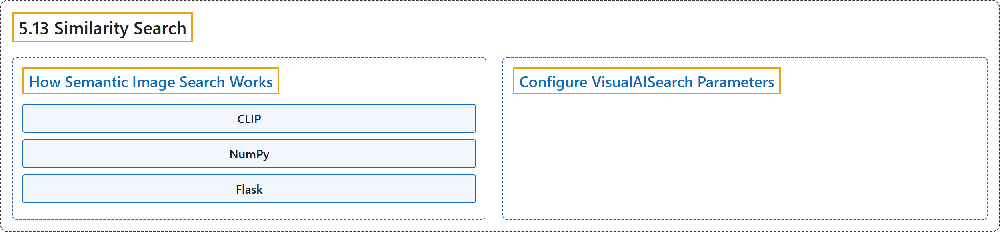

# 5.13 Similarity Search

## Classification

## Glossary

| Term | Definition | 中文翻译 | Source |
|---|---|---|---|
| **5.13 Similarity Search** 相似度搜索 | (context) "This guide walks you through **building a semantic image search engine using OpenAI CLIP and Flask**." | （语境）本指南带你**用 OpenAI CLIP 和 Flask 构建一个语义图像搜索引擎**。 | [Ultralytics, n.d., "How to Build Semantic Image Search with OpenAI CLIP", para. 1](https://docs.ultralytics.com/guides/similarity-search/#how-to-build-semantic-image-search-with-openai-clip) |
| **How Semantic Image Search Works** 语义图像搜索的工作原理 | "The pipeline **combines three components, each handling one stage of turning images and text into ranked results**:" | 该流水线**结合了三个组件，每个组件负责把图像和文本转换为排序结果的一个阶段**： | [Ultralytics, n.d., "How Semantic Image Search Works", para. 1](https://docs.ultralytics.com/guides/similarity-search/#how-semantic-image-search-works) |
| **CLIP** CLIP | "CLIP uses a vision encoder (e.g., ResNet or ViT) for images and a text encoder (Transformer-based) for language **to project both into the same multimodal embedding space**." | CLIP对图像使用视觉编码器（例如 ResNet 或 ViT），对语言使用文本编码器（基于 Transformer），从而**把两者投影到同一个多模态嵌入空间中**。 | [Ultralytics, n.d., "How Semantic Image Search Works", item 1](https://docs.ultralytics.com/guides/similarity-search/#how-semantic-image-search-works) |
| **NumPy** NumPy | "NumPy **stores the image embeddings as a single array and ranks them against a query embedding with one matrix multiplication**, returning the closest vectors by cosine similarity with no extra indexing dependency." | NumPy**把图像嵌入存为单个数组，并用一次矩阵乘法按查询嵌入对它们排序**，按余弦相似度返回最接近的向量，无需额外的索引依赖。 | [Ultralytics, n.d., "How Semantic Image Search Works", item 2](https://docs.ultralytics.com/guides/similarity-search/#how-semantic-image-search-works) |
| **Flask** Flask | "Flask **provides a simple web interface to submit natural language queries and display semantically matched images from the index.**" | Flask**提供一个简单的网页界面，用于提交自然语言查询，并显示索引中语义匹配的图像。** | [Ultralytics, n.d., "How Semantic Image Search Works", item 3](https://docs.ultralytics.com/guides/similarity-search/#how-semantic-image-search-works) |
| **Configure VisualAISearch Parameters** 配置 VisualAISearch 参数 | (context) "The table below outlines **the available parameters for `VisualAISearch`**:" | （语境）下表列出了 **`VisualAISearch` 的可用参数**： | [Ultralytics, n.d., "Configure VisualAISearch Parameters", para. 1](https://docs.ultralytics.com/guides/similarity-search/#configure-visualaisearch-parameters) |

## References

Ultralytics. (n.d.). *How to Build Semantic Image Search with OpenAI CLIP*. Ultralytics YOLO Docs (ultralytics 8.4.194). Retrieved October 31, 2026, from <https://docs.ultralytics.com/guides/similarity-search/>
