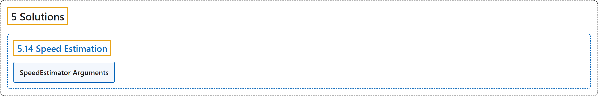

# 5.14 Speed Estimation

## Classification

## Glossary

| Term | Definition | 中文翻译 | Source |
|---|---|---|---|
| **5.14 Speed Estimation** 速度估计 | "Speed estimation is **the process of calculating the rate of movement of an object within a given context**, often employed in computer vision applications." | 速度估计是**计算物体在给定情境中运动速率的过程**，常用于计算机视觉应用。 | [Ultralytics, n.d., "Speed Estimation using Ultralytics YOLO26", para. 1](https://docs.ultralytics.com/guides/speed-estimation/#speed-estimation-using-ultralytics-yolo26) |
| **SpeedEstimator Arguments** SpeedEstimator 参数 | (context) "Here's a table with the **`SpeedEstimator` arguments**:" | （语境）下表列出了 **`SpeedEstimator` 的参数**： | [Ultralytics, n.d., "SpeedEstimator Arguments", para. 1](https://docs.ultralytics.com/guides/speed-estimation/#speedestimator-arguments) |

## References

Ultralytics. (n.d.). *Speed Estimation using Ultralytics YOLO26*. Ultralytics YOLO Docs (ultralytics 8.4.194). Retrieved October 31, 2026, from <https://docs.ultralytics.com/guides/speed-estimation/>
