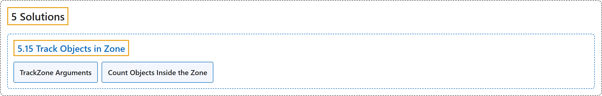

# 5.15 Track Objects in Zone

## Classification

## Glossary

| Term | Definition | 中文翻译 | Source |
|---|---|---|---|
| **5.15 Track Objects in Zone** 区域内物体跟踪 | "TrackZone **specializes in monitoring objects within designated areas of a frame instead of the whole frame**." | TrackZone **专门监控画面中指定区域内的物体，而不是整个画面**。 | [Ultralytics, n.d., "TrackZone using Ultralytics YOLO26", para. 1](https://docs.ultralytics.com/guides/trackzone/#trackzone-using-ultralytics-yolo26) |
| **TrackZone Arguments** TrackZone 参数 | (context) "Here's a table with the **`TrackZone` arguments**:" | （语境）下表列出了 **`TrackZone` 的参数**： | [Ultralytics, n.d., "TrackZone Arguments", para. 1](https://docs.ultralytics.com/guides/trackzone/#trackzone-arguments) |
| **Count Objects Inside the Zone** 统计区域内的对象 | "Every call to the tracker returns a `SolutionResults` object whose `total_tracks` attribute **holds the number of objects currently tracked inside the zone**." | 每次调用跟踪器都会返回一个 `SolutionResults` 对象，其 `total_tracks` 属性**保存当前在区域内被跟踪的对象数量**。 | [Ultralytics, n.d., "Count Objects Inside the Zone", para. 1](https://docs.ultralytics.com/guides/trackzone/#count-objects-inside-the-zone) |

## References

Ultralytics. (n.d.). *TrackZone using Ultralytics YOLO26*. Ultralytics YOLO Docs (ultralytics 8.4.194). Retrieved October 31, 2026, from <https://docs.ultralytics.com/guides/trackzone/>
