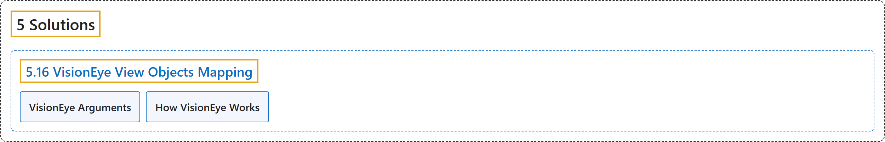

# 5.16 VisionEye View Objects Mapping

## Classification

## Glossary

| Term | Definition | 中文翻译 | Source |
|---|---|---|---|
| **5.16 VisionEye View Objects Mapping** VisionEye 视角物体映射 | "Ultralytics YOLO26 VisionEye offers **the capability for computers to identify and pinpoint objects, simulating the observational precision of the human eye**." | Ultralytics YOLO26 VisionEye 让**计算机能够识别并精确定位物体，模拟人眼观察的精确度**。 | [Ultralytics, n.d., "VisionEye View Object Mapping using Ultralytics YOLO26", para. 1](https://docs.ultralytics.com/guides/vision-eye/#visioneye-view-object-mapping-using-ultralytics-yolo26) |
| **VisionEye Arguments** VisionEye 参数 | (context) "Here's a table with the **`VisionEye` arguments**:" | （语境）下表列出了 **`VisionEye` 的参数**： | [Ultralytics, n.d., "VisionEye Arguments", para. 1](https://docs.ultralytics.com/guides/vision-eye/#visioneye-arguments) |
| **How VisionEye Works** VisionEye 的工作原理 | "VisionEye works by **establishing a fixed vision point in the frame and drawing lines from this point to detected objects**." | VisionEye 的工作方式是**在画面中设定一个固定视点，并从该点向检测到的对象画线**。 | [Ultralytics, n.d., "How VisionEye Works", para. 1](https://docs.ultralytics.com/guides/vision-eye/#how-visioneye-works) |

## References

Ultralytics. (n.d.). *VisionEye View Object Mapping using Ultralytics YOLO26*. Ultralytics YOLO Docs (ultralytics 8.4.194). Retrieved October 31, 2026, from <https://docs.ultralytics.com/guides/vision-eye/>
