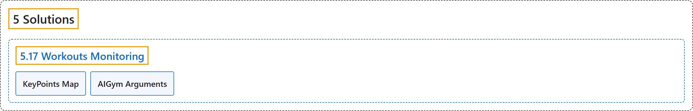

# 5.17 Workouts Monitoring

## Classification

## Glossary

| Term | Definition | 中文翻译 | Source |
|---|---|---|---|
| **5.17 Workouts Monitoring** 健身监测 | "Monitoring workouts through pose estimation with Ultralytics YOLO26 **enhances exercise assessment by accurately tracking key body landmarks and joints in real-time**." | 用 Ultralytics YOLO26 的姿态估计监测健身，**通过实时准确跟踪身体关键部位和关节来改进运动评估**。 | [Ultralytics, n.d., "Workouts Monitoring using Ultralytics YOLO26", para. 1](https://docs.ultralytics.com/guides/workouts-monitoring/#workouts-monitoring-using-ultralytics-yolo26) |
| **KeyPoints Map** 关键点映射图 | (No definition) | （无定义） | [Ultralytics, n.d., "KeyPoints Map"](https://docs.ultralytics.com/guides/workouts-monitoring/#keypoints-map) |
| **AIGym Arguments** AIGym 参数 | (context) "Here's a table with the **`AIGym` arguments**:" | （语境）下表列出了 **`AIGym` 的参数**： | [Ultralytics, n.d., "AIGym Arguments", para. 1](https://docs.ultralytics.com/guides/workouts-monitoring/#aigym-arguments) |

## References

Ultralytics. (n.d.). *Workouts Monitoring using Ultralytics YOLO26*. Ultralytics YOLO Docs (ultralytics 8.4.194). Retrieved October 31, 2026, from <https://docs.ultralytics.com/guides/workouts-monitoring/>
