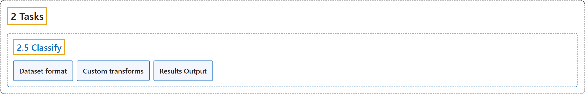

# 2.5 Classify

## Classification

## Glossary

| Term | Definition | 中文翻译 | Source |
|---|---|---|---|
| **2.5 Classify** 分类 | "Image classification is the simplest of the supported tasks and **involves classifying an entire image into one of a set of predefined classes**." | 图像分类是所支持任务中最简单的一种，**要把整张图像归入一组预定义类别中的一个**。 | [Ultralytics, n.d., "Image Classification with Ultralytics YOLO", para. 1](https://docs.ultralytics.com/tasks/classify/#image-classification) |
| **Dataset format** 数据集格式 | (context) "YOLO classification dataset format **can be found in detail in the Dataset Guide**." | （语境）YOLO 分类数据集格式**可在数据集指南中找到详细说明**。 | [Ultralytics, n.d., "Dataset format", para. 1](https://docs.ultralytics.com/tasks/classify/#dataset-format) |
| **Custom transforms** 自定义变换 | (context) "To keep the whole image without stretching it, replace the crops with the existing ClassifyLetterBox transform, which **resizes each image to fit within `imgsz` × `imgsz` and pads the remaining area while preserving its aspect ratio**." | （语境）要在不拉伸的情况下保留整张图像，可把裁剪换成现有的 ClassifyLetterBox 变换，它**把每张图像缩放到 `imgsz` × `imgsz` 以内，并在保持宽高比的同时填充剩余区域**。 | [Ultralytics, n.d., "Custom transforms", para. 1](https://docs.ultralytics.com/tasks/classify/#custom-transforms) |
| **Results Output** 结果输出 | "The primary prediction field is **`result.probs`**, which contains **the class probability vector and helpers for top predictions**." | 主要的预测字段是 **`result.probs`**，它包含**类别概率向量以及获取最高预测的辅助方法**。 | [Ultralytics, n.d., "Results Output", para. 1](https://docs.ultralytics.com/tasks/classify/#results-output) |

## References

Ultralytics. (n.d.). *Image Classification with Ultralytics YOLO*. Ultralytics YOLO Docs (ultralytics 8.4.194). Retrieved October 31, 2026, from <https://docs.ultralytics.com/tasks/classify/>
