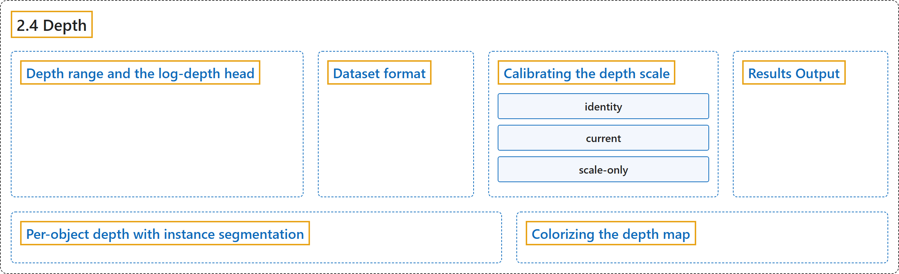

# 2.4 Depth

## Classification

## Glossary

| Term | Definition | 中文翻译 | Source |
|---|---|---|---|
| **2.4 Depth** 深度估计 | "Monocular depth estimation **predicts a per-pixel depth map from a single RGB image**." | 单目深度估计**从单张 RGB 图像预测逐像素的深度图**。 | [Ultralytics, n.d., "Monocular Depth Estimation with Ultralytics YOLO", para. 1](https://docs.ultralytics.com/tasks/depth/#monocular-depth-estimation-with-ultralytics-yolo) |
| **Depth range and the log-depth head** 深度范围与对数深度头 | "The depth head predicts `exp(logit)` — **unbounded** (~0.02–150 m) — and **decouples scene shape from absolute scale**: the network predicts a relative log-depth field" | 深度头预测 `exp(logit)`，它**无上界**（约 0.02 至 150 米），并且**把场景形状与绝对尺度解耦**：网络预测的是相对的对数深度场 | [Ultralytics, n.d., "Depth range and the log-depth head", para. 1](https://docs.ultralytics.com/tasks/depth/#depth-range-and-the-log-depth-head) |
| **Dataset format** 数据集格式 | "Depth estimation datasets **pair each RGB image with a scaled uint16 depth PNG or floating-point NPY depth map in meters**." | 深度估计数据集**把每张 RGB 图像与一张以米为单位的深度图配对，深度图为缩放过的 uint16 PNG 或浮点 NPY**。 | [Ultralytics, n.d., "Dataset format", para. 1](https://docs.ultralytics.com/tasks/depth/#dataset-format) |
| **Calibrating the depth scale** 校准深度尺度 | "If a model already produces good relative depth on your scenes but the absolute values are off for your camera, you can **correct the scale in seconds with `model.calibrate()`**" | 如果模型在你的场景上已能给出良好的相对深度，但对你的相机而言绝对值有偏差，你可以**用 `model.calibrate()` 在几秒内校正尺度** | [Ultralytics, n.d., "Calibrating the depth scale", para. 1](https://docs.ultralytics.com/tasks/depth/#calibrating-the-depth-scale) |
| **identity** 恒等（identity） | "identity: **the raw head output, with no calibration**." | 恒等（identity）：即**原始的头部输出，不做校准**。 | [Ultralytics, n.d., "Calibrating the depth scale", item 1](https://docs.ultralytics.com/tasks/depth/#calibrating-the-depth-scale) |
| **current** 当前（current） | "current: **the calibration the model already carries**, such as the one baked into the released checkpoints." | 当前（current）：即**模型已带有的校准**，例如已固化在发布检查点中的校准。 | [Ultralytics, n.d., "Calibrating the depth scale", item 2](https://docs.ultralytics.com/tasks/depth/#calibrating-the-depth-scale) |
| **scale-only** 仅尺度（scale-only） | "scale-only: **a new global scale, refit on all of those images when selected**." | 仅尺度（scale-only）：即**一个新的全局尺度，被选中时在所有这些图像上重新拟合**。 | [Ultralytics, n.d., "Calibrating the depth scale", item 3](https://docs.ultralytics.com/tasks/depth/#calibrating-the-depth-scale) |
| **Results Output** 结果输出 | "Each result stores **one dense float depth map for the full image**." | 每个结果为**整张图像存储一张稠密的浮点深度图**。 | [Ultralytics, n.d., "Results Output", para. 1](https://docs.ultralytics.com/tasks/depth/#results-output) |
| **Per-object depth with instance segmentation** 结合实例分割的逐物体深度 | "Combine instance segmentation with depth to **estimate how far away each detected object is**." | 把实例分割与深度结合起来，以**估计每个检测到的物体有多远**。 | [Ultralytics, n.d., "Per-object depth with instance segmentation", para. 1](https://docs.ultralytics.com/tasks/depth/#per-object-depth-with-instance-segmentation) |
| **Colorizing the depth map** 深度图着色 | "To turn it into a color image, use the `colorize_depth` helper in `ultralytics.utils.plotting`, which **maps the `(H, W)` depth array to a `(H, W, 3)` BGR `uint8` image**" | 要把它变成彩色图像，可使用 `ultralytics.utils.plotting` 中的 `colorize_depth` 辅助函数，它**把 `(H, W)` 深度数组映射为 `(H, W, 3)` 的 BGR `uint8` 图像** | [Ultralytics, n.d., "Colorizing the depth map", para. 1](https://docs.ultralytics.com/tasks/depth/#colorizing-the-depth-map) |

## References

Ultralytics. (n.d.). *Monocular Depth Estimation with Ultralytics YOLO*. Ultralytics YOLO Docs (ultralytics 8.4.194). Retrieved October 31, 2026, from <https://docs.ultralytics.com/tasks/depth/>
