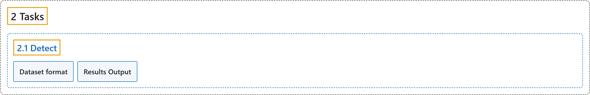

# 2.1 Detect

## Classification

## Glossary

| Term | Definition | 中文翻译 | Source |
|---|---|---|---|
| **2.1 Detect** 检测 | "Object detection is **a task that involves identifying the location and class of objects in an image or video stream**." | 目标检测是**一项识别图像或视频流中物体位置和类别的任务**。 | [Ultralytics, n.d., "Object Detection with Ultralytics YOLO", para. 1](https://docs.ultralytics.com/tasks/detect/#object-detection) |
| **Dataset format** 数据集格式 | (context) "YOLO detection dataset format **can be found in detail in the Dataset Guide**." | （语境）YOLO 检测数据集格式**可在数据集指南中找到详细说明**。 | [Ultralytics, n.d., "Dataset format", para. 1](https://docs.ultralytics.com/tasks/detect/#dataset-format) |
| **Results Output** 结果输出 | "Object detection returns one `Results` object per image. The primary prediction field is **`result.boxes`**, which contains **box coordinates, class IDs, and confidence scores for each detected object**." | 目标检测为每张图像返回一个 `Results` 对象。主要的预测字段是 **`result.boxes`**，它包含**每个检测到的物体的框坐标、类别 ID 和置信度分数**。 | [Ultralytics, n.d., "Results Output", para. 1](https://docs.ultralytics.com/tasks/detect/#results-output) |

## References

Ultralytics. (n.d.). *Object Detection with Ultralytics YOLO*. Ultralytics YOLO Docs (ultralytics 8.4.194). Retrieved October 31, 2026, from <https://docs.ultralytics.com/tasks/detect/>
