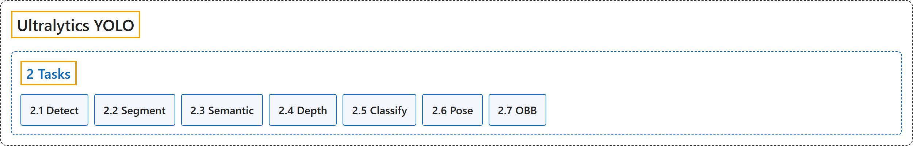

# 2. Tasks

## Classification

## Glossary

| Term | Definition | 中文翻译 | Source |
|---|---|---|---|
| **2 Tasks** 任务 | (context) "Ultralytics YOLO26 is a versatile AI framework that supports multiple computer vision **tasks**. The framework can be used to perform **detection, segmentation, semantic segmentation, depth estimation, classification, pose estimation, and OBB**." | （语境）Ultralytics YOLO26 是一个支持多种计算机视觉**任务**的多用途 AI 框架。该框架可以用来做**检测、分割、语义分割、深度估计、分类、姿态估计和旋转边界框（OBB）**。 | [Ultralytics, n.d.-a, "Computer Vision Tasks Supported by Ultralytics YOLO26", para. 1](https://docs.ultralytics.com/tasks/#computer-vision-tasks-supported-by-ultralytics-yolo26) |
| **[2.1 Detect](detect.md)** 检测 | "Object detection is **a task that involves identifying the location and class of objects in an image or video stream**." | 目标检测是**一项识别图像或视频流中物体位置和类别的任务**。 | [Ultralytics, n.d.-e, "Object Detection with Ultralytics YOLO", para. 1](https://docs.ultralytics.com/tasks/detect/#object-detection) |
| **[2.2 Segment](segment.md)** 实例分割 | "Instance segmentation goes a step further than object detection and **involves identifying individual objects in an image and segmenting them from the rest of the image**." | 实例分割比目标检测更进一步，**要识别图像中的各个物体，并把它们从图像的其余部分中分割出来**。 | [Ultralytics, n.d.-c, "Instance Segmentation with Ultralytics YOLO", para. 1](https://docs.ultralytics.com/tasks/segment/#instance-segmentation) |
| **[2.3 Semantic](semantic.md)** 语义分割 | "Semantic segmentation **assigns a class label to every pixel in an image, producing a dense class map that covers the entire scene**." | 语义分割**给图像中的每个像素分配一个类别标签，生成覆盖整个场景的稠密类别图**。 | [Ultralytics, n.d.-h, "Semantic Segmentation with Ultralytics YOLO", para. 1](https://docs.ultralytics.com/tasks/semantic/#semantic-segmentation-with-ultralytics-yolo) |
| **[2.4 Depth](depth.md)** 深度估计 | "Monocular depth estimation **predicts a per-pixel depth map from a single RGB image**." | 单目深度估计**从单张 RGB 图像预测逐像素的深度图**。 | [Ultralytics, n.d.-d, "Monocular Depth Estimation with Ultralytics YOLO", para. 1](https://docs.ultralytics.com/tasks/depth/#monocular-depth-estimation-with-ultralytics-yolo) |
| **[2.5 Classify](classify.md)** 分类 | "Image classification is the simplest of the supported tasks and **involves classifying an entire image into one of a set of predefined classes**." | 图像分类是所支持任务中最简单的一种，**要把整张图像归入一组预定义类别中的一个**。 | [Ultralytics, n.d.-b, "Image Classification with Ultralytics YOLO", para. 1](https://docs.ultralytics.com/tasks/classify/#image-classification) |
| **[2.6 Pose](pose.md)** 姿态估计 | "Pose estimation is **a task that involves identifying the location of specific points in an image, usually referred to as keypoints**." | 姿态估计是**一项识别图像中特定点（通常称为关键点）位置的任务**。 | [Ultralytics, n.d.-g, "Pose Estimation with Ultralytics YOLO", para. 1](https://docs.ultralytics.com/tasks/pose/#pose-estimation) |
| **[2.7 OBB](obb.md)** 旋转边界框检测 | "Oriented object detection goes a step further than standard object detection by **introducing an extra angle to locate objects more accurately in an image**." | 旋转目标检测比标准目标检测更进一步，**引入一个额外的角度，更准确地定位图像中的物体**。 | [Ultralytics, n.d.-f, "Oriented Bounding Box Detection with Ultralytics YOLO", para. 1](https://docs.ultralytics.com/tasks/obb/#oriented-bounding-boxes-object-detection) |

## References

Ultralytics. (n.d.-a). *Computer Vision Tasks Supported by Ultralytics YOLO26*. Ultralytics YOLO Docs (ultralytics 8.4.194). Retrieved October 31, 2026, from <https://docs.ultralytics.com/tasks/>

Ultralytics. (n.d.-b). *Image Classification with Ultralytics YOLO*. Ultralytics YOLO Docs (ultralytics 8.4.194). Retrieved October 31, 2026, from <https://docs.ultralytics.com/tasks/classify/>

Ultralytics. (n.d.-c). *Instance Segmentation with Ultralytics YOLO*. Ultralytics YOLO Docs (ultralytics 8.4.194). Retrieved October 31, 2026, from <https://docs.ultralytics.com/tasks/segment/>

Ultralytics. (n.d.-d). *Monocular Depth Estimation with Ultralytics YOLO*. Ultralytics YOLO Docs (ultralytics 8.4.194). Retrieved October 31, 2026, from <https://docs.ultralytics.com/tasks/depth/>

Ultralytics. (n.d.-e). *Object Detection with Ultralytics YOLO*. Ultralytics YOLO Docs (ultralytics 8.4.194). Retrieved October 31, 2026, from <https://docs.ultralytics.com/tasks/detect/>

Ultralytics. (n.d.-f). *Oriented Bounding Box Detection with Ultralytics YOLO*. Ultralytics YOLO Docs (ultralytics 8.4.194). Retrieved October 31, 2026, from <https://docs.ultralytics.com/tasks/obb/>

Ultralytics. (n.d.-g). *Pose Estimation with Ultralytics YOLO*. Ultralytics YOLO Docs (ultralytics 8.4.194). Retrieved October 31, 2026, from <https://docs.ultralytics.com/tasks/pose/>

Ultralytics. (n.d.-h). *Semantic Segmentation with Ultralytics YOLO*. Ultralytics YOLO Docs (ultralytics 8.4.194). Retrieved October 31, 2026, from <https://docs.ultralytics.com/tasks/semantic/>
