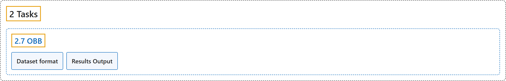

# 2.7 OBB

## Classification

## Glossary

| Term | Definition | 中文翻译 | Source |
|---|---|---|---|
| **2.7 OBB** 旋转边界框检测 | "Oriented object detection goes a step further than standard object detection by **introducing an extra angle to locate objects more accurately in an image**." | 旋转目标检测比标准目标检测更进一步，**引入一个额外的角度，更准确地定位图像中的物体**。 | [Ultralytics, n.d., "Oriented Bounding Box Detection with Ultralytics YOLO", para. 1](https://docs.ultralytics.com/tasks/obb/#oriented-bounding-boxes-object-detection) |
| **Dataset format** 数据集格式 | "The YOLO OBB format **designates bounding boxes by their four corner points with coordinates normalized between 0 and 1**, following this structure." | YOLO OBB 格式**用边界框的四个角点来表示它，坐标归一化到 0 和 1 之间**，结构如下。 | [Ultralytics, n.d., "Dataset format", para. 1](https://docs.ultralytics.com/tasks/obb/#dataset-format) |
| **Results Output** 结果输出 | "The primary prediction field is **`result.obb`**, which contains **rotated boxes, class IDs, and confidence scores for each detected object**." | 主要的预测字段是 **`result.obb`**，它包含**每个检测到的物体的旋转框、类别 ID 和置信度分数**。 | [Ultralytics, n.d., "Results Output", para. 1](https://docs.ultralytics.com/tasks/obb/#results-output) |

## References

Ultralytics. (n.d.). *Oriented Bounding Box Detection with Ultralytics YOLO*. Ultralytics YOLO Docs (ultralytics 8.4.194). Retrieved October 31, 2026, from <https://docs.ultralytics.com/tasks/obb/>
