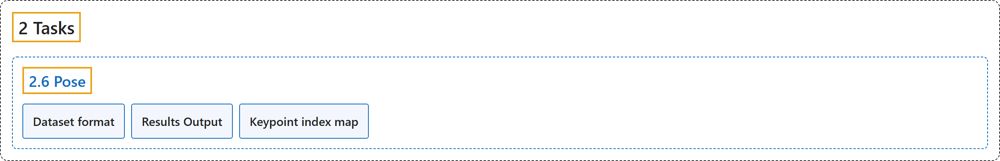

# 2.6 Pose

## Classification

## Glossary

| Term | Definition | 中文翻译 | Source |
|---|---|---|---|
| **2.6 Pose** 姿态估计 | "Pose estimation is **a task that involves identifying the location of specific points in an image, usually referred to as keypoints**." | 姿态估计是**一项识别图像中特定点（通常称为关键点）位置的任务**。 | [Ultralytics, n.d., "Pose Estimation with Ultralytics YOLO", para. 1](https://docs.ultralytics.com/tasks/pose/#pose-estimation) |
| **Dataset format** 数据集格式 | (context) "YOLO pose dataset format **can be found in detail in the Dataset Guide**." | （语境）YOLO 姿态数据集格式**可在数据集指南中找到详细说明**。 | [Ultralytics, n.d., "Dataset format", para. 1](https://docs.ultralytics.com/tasks/pose/#dataset-format) |
| **Results Output** 结果输出 | "The primary prediction fields are `result.keypoints` for **pose coordinates** and `result.boxes` for **the detected instances that those keypoints belong to**." | 主要的预测字段是用于**姿态坐标**的 `result.keypoints`，以及用于**这些关键点所属的检测实例**的 `result.boxes`。 | [Ultralytics, n.d., "Results Output", para. 1](https://docs.ultralytics.com/tasks/pose/#results-output) |
| **Keypoint index map** 关键点索引表 | (context) "The default YOLO26 Pose models **predict the 17 COCO keypoints**, so index `k` in `result.keypoints.xy[:, k]` is:" | （语境）默认的 YOLO26 姿态模型**预测 17 个 COCO 关键点**，因此 `result.keypoints.xy[:, k]` 中的索引 `k` 依次为： | [Ultralytics, n.d., "Keypoint index map", para. 1](https://docs.ultralytics.com/tasks/pose/#keypoint-index-map) |

## References

Ultralytics. (n.d.). *Pose Estimation with Ultralytics YOLO*. Ultralytics YOLO Docs (ultralytics 8.4.194). Retrieved October 31, 2026, from <https://docs.ultralytics.com/tasks/pose/>
