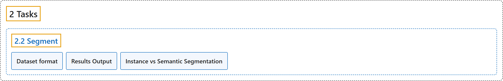

# 2.2 Segment

## Classification

## Glossary

| Term | Definition | 中文翻译 | Source |
|---|---|---|---|
| **2.2 Segment** 实例分割 | "Instance segmentation goes a step further than object detection and **involves identifying individual objects in an image and segmenting them from the rest of the image**." | 实例分割比目标检测更进一步，**要识别图像中的各个物体，并把它们从图像的其余部分中分割出来**。 | [Ultralytics, n.d., "Instance Segmentation with Ultralytics YOLO", para. 1](https://docs.ultralytics.com/tasks/segment/#instance-segmentation) |
| **Dataset format** 数据集格式 | (context) "YOLO segmentation dataset format **can be found in detail in the Dataset Guide**." | （语境）YOLO 分割数据集格式**可在数据集指南中找到详细说明**。 | [Ultralytics, n.d., "Dataset format", para. 1](https://docs.ultralytics.com/tasks/segment/#dataset-format) |
| **Results Output** 结果输出 | "Each result stores object-level predictions, where **each detected instance has its own binary mask, class, confidence, and box**." | 每个结果存储物体级的预测，其中**每个检测到的实例都有自己的二值掩码、类别、置信度和框**。 | [Ultralytics, n.d., "Results Output", para. 1](https://docs.ultralytics.com/tasks/segment/#results-output) |
| **Instance vs Semantic Segmentation** 实例分割与语义分割 | "Instance segmentation is **object-level segmentation**: two cars produce two masks, two boxes, and two confidence scores. Semantic segmentation is **pixel-level classification**: those same cars become pixels with the same class ID in one image-sized class map, with no per-object boxes, confidences, or default polygon list." | 实例分割是**物体级的分割**：两辆车产生两个掩码、两个框和两个置信度分数。语义分割是**像素级的分类**：同样这两辆车会变成一张与图像同尺寸的类别图中具有相同类别 ID 的像素，没有逐物体的框、置信度，也没有默认的多边形列表。 | [Ultralytics, n.d., "Instance vs Semantic Segmentation", para. 1](https://docs.ultralytics.com/tasks/segment/#instance-vs-semantic-segmentation) |

## References

Ultralytics. (n.d.). *Instance Segmentation with Ultralytics YOLO*. Ultralytics YOLO Docs (ultralytics 8.4.194). Retrieved October 31, 2026, from <https://docs.ultralytics.com/tasks/segment/>
