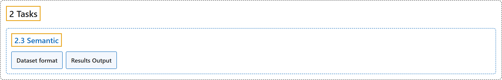

# 2.3 Semantic

## Classification

## Glossary

| Term | Definition | 中文翻译 | Source |
|---|---|---|---|
| **2.3 Semantic** 语义分割 | "Semantic segmentation **assigns a class label to every pixel in an image, producing a dense class map that covers the entire scene**." | 语义分割**给图像中的每个像素分配一个类别标签，生成覆盖整个场景的稠密类别图**。 | [Ultralytics, n.d., "Semantic Segmentation with Ultralytics YOLO", para. 1](https://docs.ultralytics.com/tasks/semantic/#semantic-segmentation-with-ultralytics-yolo) |
| **Dataset format** 数据集格式 | "Semantic segmentation datasets use **single-channel mask images, typically PNG, where each pixel value represents a class ID**." | 语义分割数据集使用**单通道掩码图像（通常为 PNG），其中每个像素值代表一个类别 ID**。 | [Ultralytics, n.d., "Dataset format", para. 1](https://docs.ultralytics.com/tasks/semantic/#dataset-format) |
| **Results Output** 结果输出 | "Each result stores **one dense class map for the full image** instead of a list of object masks." | 每个结果为**整张图像存储一张稠密的类别图**，而不是物体掩码列表。 | [Ultralytics, n.d., "Results Output", para. 1](https://docs.ultralytics.com/tasks/semantic/#results-output) |

## References

Ultralytics. (n.d.). *Semantic Segmentation with Ultralytics YOLO*. Ultralytics YOLO Docs (ultralytics 8.4.194). Retrieved October 31, 2026, from <https://docs.ultralytics.com/tasks/semantic/>
