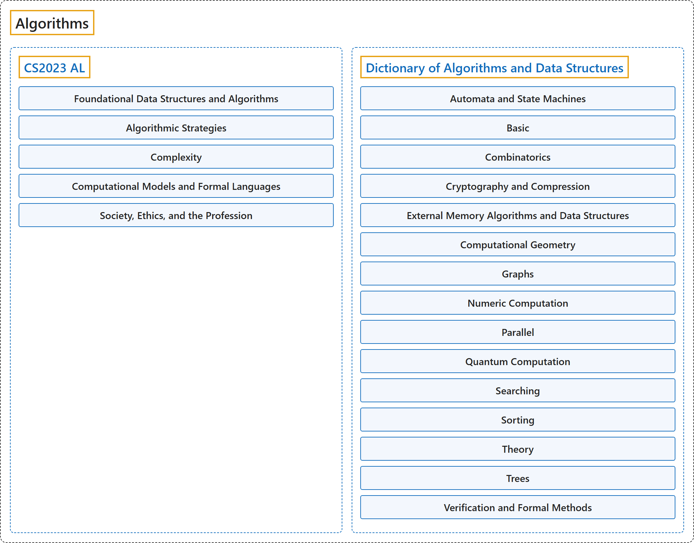

# Algorithms

## Classification

## Glossary

| Term | Definition | 中文翻译 | Source |
|---|---|---|---|
| **Algorithms** 算法 | "A **computable set of steps** to achieve a **desired result**." | 一组**可计算的步骤**，用以达成**期望的结果**。 | [Black, 2020, "algorithm" entry, definition](https://xlinux.nist.gov/dads/HTML/algorithm.html#:~:text=A%20computable%20set%20of%20steps%20to%20achieve%20a%20desired%20result) |
| **[CS2023 AL](cs2023/index.md)** CS2023 AL | "Algorithms and data structures are **fundamental to computer science**, since every theoretical computation and applied program consists of **algorithms** that operate on **data elements** possessing some **underlying structure**." | 算法和数据结构**对计算机科学至关重要**，因为每一个理论计算和应用程序都由**算法**构成，这些算法操作的**数据元素**具有某种**底层结构**。 | [Joint Task Force on Computing Curricula, 2024, AL "Preamble" section, para. 1](https://csed.acm.org/wp-content/uploads/2024/04/3.1-Body-of-Knowledge-1.pdf#page=25) |
| **[Dictionary of Algorithms and Data Structures](dictionary-of-algorithms-and-data-structures/index.md)** 算法与数据结构词典 | "This is a dictionary of **algorithms**, **algorithmic techniques**, **data structures**, **archetypal problems**, and related **definitions**." | 这是一部词典，收录**算法**、**算法技术**、**数据结构**、**典型问题**以及相关**定义**。 | [Black, 2024, home page, para. 2](https://xlinux.nist.gov/dads/#:~:text=This%20is%20a%20dictionary%20of%20algorithms) |

## References

Black, P. E. (2020, November 9). Algorithm. In P. E. Black (Ed.), *Dictionary of algorithms and data structures*. National Institute of Standards and Technology. Retrieved October 25, 2026, from <https://xlinux.nist.gov/dads/HTML/algorithm.html>

Black, P. E. (Ed.). (2024, August 19). *Dictionary of algorithms and data structures*. National Institute of Standards and Technology. Retrieved October 25, 2026, from <https://xlinux.nist.gov/dads/>

Joint Task Force on Computing Curricula. (2024). *Computer science curricula 2023*. Association for Computing Machinery. <https://doi.org/10.1145/3664191>
