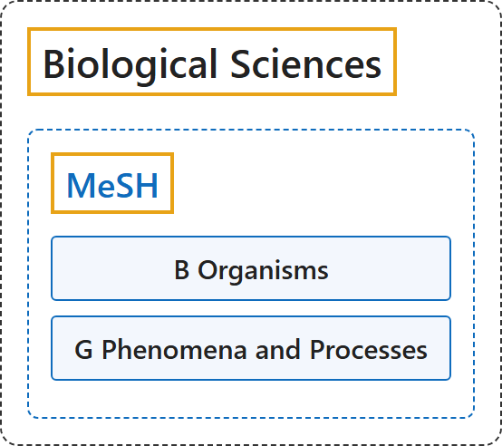

# Biological Sciences

## Classification

## Glossary

| Term | Definition | 中文翻译 | Source |
|---|---|---|---|
| **Biological Sciences** 医学主题词表（MeSH） | "any of the areas of scientific study that **relate to living things**" | 任何**与生物有关**的科学研究领域 | [Cambridge University Press & Assessment, n.d., "biological science" noun](https://dictionary.cambridge.org/dictionary/english/biological-science) |
| **[MeSH](mesh/index.md)** 医学主题词表（MeSH） | "The Medical Subject Headings (MeSH) thesaurus is a **controlled and hierarchically-organized vocabulary** produced by the National Library of Medicine. It is used for **indexing, cataloging, and searching** of biomedical and health-related information." | 医学主题词表（MeSH）叙词表是美国国家医学图书馆编制的一套**受控且分层组织的词表**。它用于对生物医学和健康相关信息进行**标引、编目和检索**。 | [National Library of Medicine, n.d., para. 1](https://www.nlm.nih.gov/mesh/meshhome.html#:~:text=The%20Medical%20Subject%20Headings%20%28MeSH%29%20thesaurus%20is%20a%20controlled) |

## References

Cambridge University Press & Assessment. (n.d.). Biological science. In *Cambridge Dictionary*. Retrieved October 27, 2026, from <https://dictionary.cambridge.org/dictionary/english/biological-science>

National Library of Medicine. (n.d.). *Welcome to Medical Subject Headings*. Retrieved October 27, 2026, from <https://www.nlm.nih.gov/mesh/meshhome.html>
