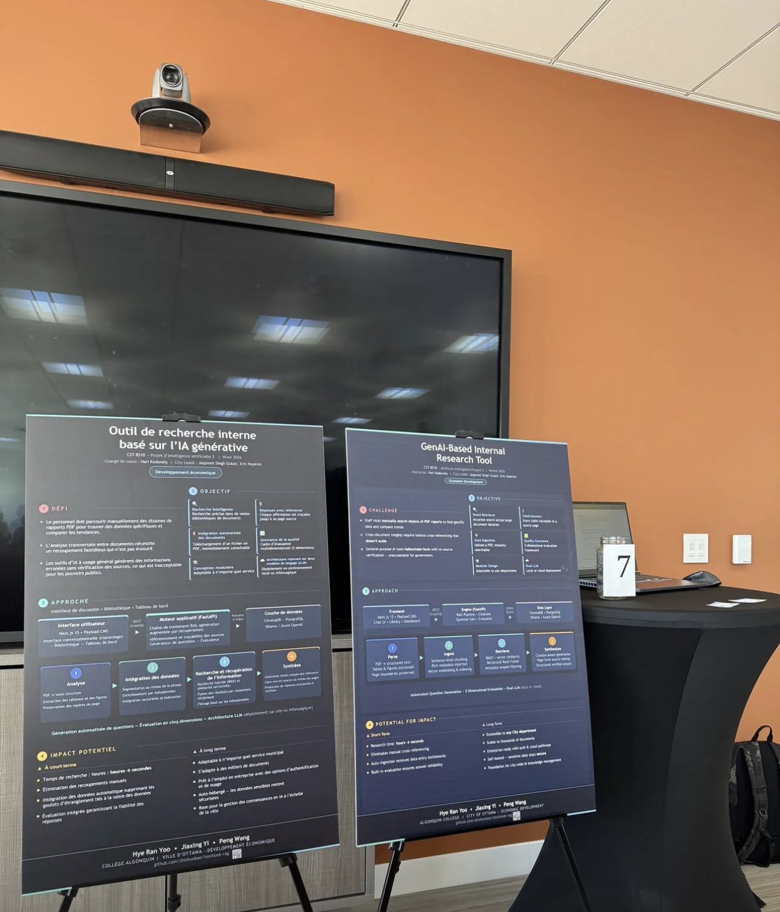

# The City of Ottawa AI Chatbot

- **Time:** September 2025 to May 2026
- **Topic:** Projects
- **My role:** architecture, front end and back end, technology selection

In a course project for the City of Ottawa, I built most of a proof-of-concept AI chatbot on my own, chose its RAG components after reading their source code, worked with the City's development team on it, and rebuilt it on Payload for a showcase at the University of Ottawa.

在给 City of Ottawa 做的课程项目里，AI chatbot 概念验证的大部分是我一个人做的。RAG 组件是我读过源代码后选定的；后来和市政府的开发团队一起做，最后又基于 Payload 重写了一版，拿到 University of Ottawa 的展会上展示。

## What Happened

### The Project

Another course had us build a proof of concept for the City of Ottawa: an AI chatbot. At first the city gave us no clear technology stack, so we wrote it entirely with open-source components. The front end was React and the back end was Python FastAPI.

另一门课要给 City of Ottawa 做一个概念验证 POC：一个 AI chatbot。前期他们没有给我们明确的技术栈，所以一开始我们完全用开源方案来写。前端用的是 React，后端用的是 Python FastAPI。

The school required this project, and because it was government-related, we had to deliver a POC. Whether we did it well or badly made no difference: the City would not hire us to keep working on it inside the government. Once the course ended, the features and code we wrote would basically be of no use, and the next group of students would take the project from the City again, every year. We knew early on that it would bring no job opportunity.

这个项目是学校强制要求的，因为跟政府相关，必须给他们做 POC。但做好做坏都没用，他们不会因此把我们招过去，在政府里继续做。课程结束之后，我们写的功能和代码基本上就没用了，下一批学生再从政府那边接这个项目，每年都这样。我们很早就知道这个肯定没有什么工作机会。

The City gave us nothing; they only gave us a requirement, and we had to build the thing from zero. I built this project from scratch, front end and back end and everything else. The other groups in our class basically didn't even have a demo.

他们什么都不给，就给你提一个要求，然后你就从零开始做。这个项目是我从零开始做的，前端、后端和其他的都有。我们班其他组的人基本上连个 demo 都没有。

### The Team

The team had four people; one dropped out last semester, leaving three. A classmate with good English but no software development background replied to emails and worked with the client. The other classmate felt the course load was too heavy and had no time to develop. We had no time to discuss splitting the work, so I did basically all of the early work: the overall architecture, front end and back end, technology selection and functional analysis.

团队一开始有四个人，上学期一个人退了，剩下三个人。一位英语好的同学没有软件开发基础，负责回复邮件和对接客户。另一位同学觉得课程压力比较大，没有时间开发。我们也没有时间讨论分工，所以前期基本上都是我一个人在做：整体架构、前后端开发、技术选型和功能分析。

### Choosing the Components

We chose LlamaIndex, not LangChain. I read LangChain's source code and found it very messy; LlamaIndex was written much more clearly.

我们没有选 LangChain，选的是 LlamaIndex。因为我看了 LangChain 的源代码，写得非常乱，不如 LlamaIndex 清晰。

RAG projects were very popular last year. We used MinerU to scan the PDFs: it identified which parts were titles, body text and images, tagged them and built an index, turning them into text that could be stored in our vector database. That made RAG retrieval and BM25 retrieval straightforward afterwards.

去年 RAG 相关的项目非常火。我们用 MinerU 扫描 PDF，识别出哪些是标题、哪些是正文、哪些是图片，打上标记并建立索引，把它们转成文本，这样就能存进我们的向量数据库。之后再做 RAG 检索和 BM25 检索就比较方便。

I did all of this research by myself. The Chinese-language internet has a very active AI community, so in my free time I kept reading AI news and posts there, learning and researching on my own, and worked these choices out step by step.

这些调研都是我一个人做的。中文互联网的 AI 社区非常活跃，我休息的时候没事就刷相关的 AI 信息，自己学习、自己研究，一点点摸索出了这些方案。

### Working with the City's Team

The City of Ottawa has a small development team. At first, one of their developers introduced us to a project they had developed internally. After a while that developer left, and two people replaced him: an architect and a programmer. The architect drew an architecture diagram for us and asked us to build to it.

City of Ottawa 有一个小的开发团队。刚开始是他们的一位开发人员跟我们介绍他们之前内部开发的一个项目。过了一段时间，那个人离职了，换成了两个人：一个架构师，一个程序员。架构师给我们画了一张架构图，让我们照着做。

By then we had already built most of it with open-source components, and it worked: the interface, login, file upload and download and the other features were all done. The City said we should use Azure, but they gave us nothing for Azure, so we could only use our own accounts and our own money. I paid for Azure GPT-4 myself. At that point it was basically a working RAG search: you could ask questions and get answers.

那时候我们已经用开源组件做得差不多了，已经可以用了：界面、登录、文件上传下载这些功能都做好了。市政府说要用 Azure，但没给我们任何 Azure 相关的东西，我们只能用自己的账号、自己花钱。Azure GPT-4 是我自己花钱接的。那时候基本上已经算是一个 RAG 查询了，可以查，可以问答。

Then they took the code. Because they were close to the business, they collected real everyday questions from their work and the related documents. But they could not make the chatbot locate an answer in the PDF down to the exact paragraph, line and words, and for answers about data, they could not generate the matching charts. They didn't do these two parts: they gave the hard parts to us and did the simpler work, user management, themselves. In the end we implemented both parts, submitted them and emailed them, and the project was basically over.

后来他们把代码拿过去了。因为他们离业务近，收集了一些实际业务里日常会问的问题和相关的文档。但他们没办法让 chatbot 把一个问题真正定位到 PDF 的哪一段、哪一行、哪几个字；定位之后，有些跟数据相关的回答还要生成对应的图表。这两部分他们没做，把比较难的部分交给我们做，用户管理这些比较简单的工作他们来做。最后我们把这两部分实现完，提交之后发邮件给他们，这个项目基本上就算结束了。

We still gritted our teeth and made it as good as we could. We handed the code over, though they probably won't use it either; it will most likely wait until next year's new group.

但我们还是咬着牙，尽量把这个东西做好。代码交给了他们，他们估计也不会用，基本上就等明年再有新的一批了。

### Rebuilding with Payload

After that, our teacher told us that the City of Ottawa and the University of Ottawa were holding a showcase and that it was quite important. So I rewrote the whole thing again with the same logic, this time on Payload with LlamaIndex. The first version had a React front end and a Python back end. With the front end and back end separated like that, when I was adjusting the front end, the back end was sometimes hard to keep aligned with it. In the new version everything is in Payload, written entirely in TypeScript, and the back end provides only one Python service, built with LlamaIndex.

之后老师又说，City of Ottawa 和 University of Ottawa 那边要举行一个展会，挺重要的。我就基于同样的逻辑，又重新写了一套，基于 Payload 和 LlamaIndex。最早的版本是 React 前端加 Python 后台，这种前后端分离的写法，有时候调前端的时候，后端很难对齐。新版本全部用 Payload，全部用 TypeScript 写，后台只提供一个 Python 服务，用 LlamaIndex 做的。

### The Showcase

After graduation, on May 1, 2026, we went to HUBBUB 2026, the annual CityStudio Ottawa project showcase held at the University of Ottawa, where the University of Ottawa, Carleton University and Algonquin College present their projects for the City together. A manager from the City of Ottawa had said he would come with us, but in the end he didn't, so only the two of us went. Nobody from the school came for us; a few professors were there, but they had nothing to do with us. Nobody promoted us or introduced us.

毕业之后，2026 年 5 月 1 日，我们去了在 University of Ottawa 举办的 HUBBUB 2026，这是 CityStudio Ottawa 一年一度的项目展示，University of Ottawa、Carleton University 和 Algonquin College 几个学校一起展示给市政府做的项目。本来 City of Ottawa 的一位 manager 说要陪我们一起去，后来他也没去，就我们两个人去了。学校没有人为我们去，有几个教授去了，但跟我们完全没关系。没人帮我们宣传，也没人帮我们介绍。

The event was quite big, with many people in suits giving presentations in both English and French. Most of the projects were about entertainment, like traditional KTV, or other commercial projects. Hardly anyone cared about an AI chatbot like ours. Now and then someone came over to learn a little, we explained it, and that was it. A few teachers from our own school came by and said "amazing". Nobody paid any attention to us, so we stood there for about half a day; after we finished our sandwiches, we left.

会议弄得挺大的，很多人西装革履地在那介绍，又是英语又是法语。大部分项目都跟娱乐相关，比如传统的 KTV，还有一些商业项目。像我们这种做 AI chatbot 的，基本上没人在乎。偶尔有人过来稍微了解一下，我们解释一下，就结束了。我们自己学校有几个老师过来看了看，夸了几句 amazing。因为没人搭理我们，我们就在那站了半天吧，吃完三明治之后就走了。

## Reflections

As for personal growth, developing this had many details that are hard to explain to other people. We put in so much time, money and effort, and it did not even lead to an internship. The whole thing felt like money thrown down the drain: work done for the sake of work, with nothing real behind it.

说是个人能力提升吧，这个东西开发有很多细节，不好跟别人解释。付出了这么多时间、金钱和努力，连一个实习机会都没有。整个感觉就是特别打水漂：为了工作而工作，没有实质性的东西。

They said they would adapt it, but once the project was over, you never know whether they actually use it. And you can't do a co-op there either; there was no opportunity at all. Basically they just wait for the AI course to start again next year and string along the next group, and that's how it goes.

他们说会去适配，但实际上项目结束之后，他们用不用你也不知道。你也没办法去他们那里 co-op，没有什么机会。基本上就是等来年这个 AI 课程再开，再忽悠下一波人，就是这样。
